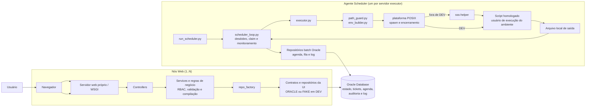
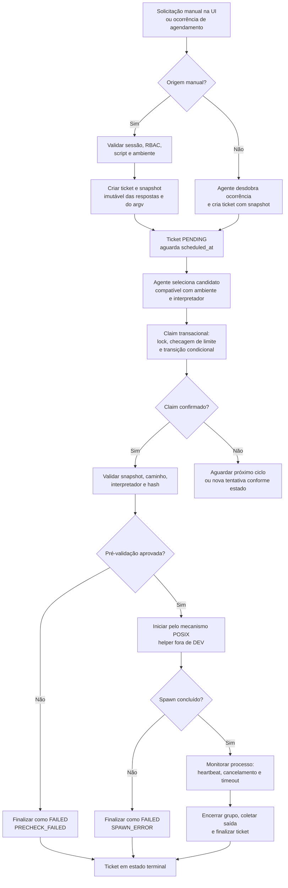

# Script Scheduling Service (SSS) — README.md

Serviço web corporativo para gestão, agendamento e execução distribuída de rotinas em Python e Shell em servidores Unix/Linux restritos, integrado ao Oracle Database >= 11gR2 e com arquitetura multi-ambiente e multi-nó.

> **Change requests aplicados:** os CRs estão em `docs/architecture/`; o texto abaixo já os incorpora.
>
> **Autoridade documental:** este README é a autoridade máxima de **negócio, dados e algoritmos**. O `AGENTS.md` é a autoridade sobre **como codificar**. Em conflito sobre regra de negócio ou modelo de dados, prevalece este documento. Em caso de lacuna, o desenvolvedor ou agente deve **parar e perguntar**, sem presumir.

---

## 1. Princípio Fundamental de Negócio

No SSS, **nenhuma tarefa roda de forma avulsa ou desvinculada de ambiente**.

Os scripts do catálogo não pertencem a um único ambiente. Cada script declara em quais ambientes está homologado (`tbsss_script_env`). A associação concreta acontece na criação do **Ticket**, que registra de forma imutável:

* o solicitante autenticado e o IP de origem;
* o script e o ambiente alvo, validados contra perfil, ambiente, script e homologação;
* o **snapshot imutável** das respostas e do `argv` compilado no momento da criação;
* o agente executor, o PID, o instante de início do processo e os timestamps de auditoria;
* o histórico de status, o motivo, o código de retorno e o log completo em `CLOB`.

---

## 2. Pilha Tecnológica e Restrições de Runtime

### 2.1 Linguagem e framework

* **Python 3.6.0 ou superior**, só com a biblioteca padrão e o driver Oracle; **sem framework web** desde o CR-021 (`docs/architecture/CR-021-no-web2py-no-alpine.md`).
  * A sintaxe e a biblioteca padrão usadas são as da 3.6.0.
  * As versões validadas vão da 3.6.0 à 3.13, e a 3.6.8 é a referência de produção (AGENTS §2.1).
  * O núcleo web é próprio (`modules/web/`: roteador, requisição e multipart em fluxo, resposta, sessão em cookie assinado, estáticos, motor de templates e servidor `wsgiref` com limite de threads), ligado à aplicação por `webapp/` e iniciado por `scripts/run_web.py`. As views mantêm a sintaxe de template do web2py (`{{=x}}`, `if`/`for`/`pass`, `extend`/`include`) e as URLs continuam `/script_scheduling_service/<controller>/<função>/<args>`.
* É proibido usar recursos de Python 3.7+. A lista normativa completa está no `AGENTS.md` §2.1.

### 2.2 Banco de dados

* **Somente Oracle Database (CR-002).** O **11gR2** é o piso de compatibilidade, com suporte às versões superiores (12c, 18c, 19c, 21c, 23ai). Todo SQL e DDL deve rodar no 11gR2, mesmo que o servidor seja mais novo.
* **SQL Oracle 11gR2 escrito diretamente** nos repositórios, sem camada de dialeto (§2.7).
* **Charset:** AL32UTF8. Toda coluna textual usa `VARCHAR2(N CHAR)`.
* **Teto de 30 caracteres** para todo identificador, inclusive após a expansão do prefixo (§9).

### 2.3 Conectividade (dependências homologadas pré-instaladas)

| Componente | Versão permitida | Observação |
|---|---|---|
| Driver (Python 3.6) | `python-oracledb 1.x` (`< 2.0`); contingência `cx_Oracle 8.3` | A série 2.x exige Python 3.7+ |
| Driver (Python 3.7 a 3.13) | `python-oracledb 2.x`; contingência `cx_Oracle 8.3` (até 3.10) | — |
| Cliente C (modos Thick e cx_Oracle) | **Oracle Instant Client 19.x** (Linux ou Unix, conforme o nó) | Conecta do 11.2.0.4 ao 23ai. O IC 21c/23ai não conecta ao 11gR2. **Obrigatório em todos os nós**, inclusive no DEV: o projeto conecta pelo Thick ou pelo cx_Oracle |
| `cryptography` | **não usada** | O projeto não depende da biblioteca `cryptography`. Só o modo Thin do `python-oracledb` precisa dela, e ele fica fora de uso (`driver_mode = thick`) |

**Seleção do driver (CR-002, `[oracle] driver_mode`):**

* **Recomendado: `thick`** (o `config.ini.example` e o DEV já vêm assim). O projeto não usa a biblioteca `cryptography`, e o modo Thin depende dela; com `thick`, o Thin nunca é tentado. Com `auto` num nó sem `cryptography`, a sondagem do Thin falha com `DPY-3016` (WARN) e a cadeia segue para o Thick: funciona, mas registra o aviso a cada subida.

* `auto` (padrão): ordem **Thin → Thick → cx_Oracle**.
  * O modo Thin dispensa o Instant Client, mas só conecta a banco **12.1 ou superior** (no 11gR2 falha com `DPY-3010`).
  * Como o modo do `oracledb` é fixado por processo, a escolha é feita **antes da primeira conexão** por um subprocesso de sondagem (`scripts/probe_driver.py`), um candidato por vez: importa o driver, conecta e executa `SELECT SYSDATE FROM DUAL`. O processo principal inicializa apenas o candidato vencedor. A sondagem conecta com a **conta do papel** que vai conectar (`[oracle] user` no web e no agente, `[monitor] user` no `health.py`): o usuário vai no argv do subprocesso (`--user`) e a senha só pela entrada padrão (F9.1d; antes, a sondagem usava sempre o `[oracle]`, e o `health.py` nunca conectava).
  * Erro de **autenticação** (ORA-01017, ORA-28000, ORA-28001, ORA-01005) interrompe a cadeia e aborta, para não consumir tentativas de login do usuário no banco. Os demais erros geram WARN e passam ao próximo candidato.
  * Se nenhum candidato conectar, a subida aborta com CRITICAL listando o código de erro de cada tentativa.
  * A senha chega ao subprocesso pela entrada padrão, nunca por argumento ou variável de ambiente.
  * A combinação escolhida é registrada em INFO, exibida pelo `check_env.py` e mantida pelo processo; reconexões a reutilizam e só um reinício refaz a sondagem.
* `thin`, `thick` ou `cx_oracle`: força um único candidato, sem sondagem; falha é fatal.
* **Carregamento do Instant Client no Linux/Unix** (Thick e cx_Oracle): o IC deve estar no caminho de bibliotecas **antes** de o processo Python iniciar, via `ldconfig` (preferencial) ou `LD_LIBRARY_PATH` exportado pelos launchers `bin/sss-web.sh` e `bin/sss-scheduler.sh`. Nessas plataformas, `init_oracle_client(lib_dir=...)` não tem efeito e deve ser chamado sem `lib_dir`.
* **Desenvolvimento em macOS:** `oracle_client_lib_dir` só é usado em macOS. O IC 19 para macOS existe apenas para Intel (x86_64). Em Apple Silicon, use Python x86_64 sob Rosetta ou um container/VM Linux x86_64 (o modo Thin exigiria a `cryptography`, que o projeto não usa).
* `src/sss/persistence/db_conn.py` é a **única** porta de acesso ao banco. Ele contém a seleção do driver, o adaptador das diferenças de API entre `oracledb` (Thin/Thick) e `cx_Oracle` (exceções mapeadas por driver e modo para os erros do contrato, tipos de bind, conversão do estilo `:name` para o `paramstyle` do driver, pool e `init_oracle_client`).
* **Toda conexão deve:**
  * usar `autocommit = False`;
  * definir `call_timeout` (`call_timeout_ms` no config);
  * preencher `module`, `action` e `client_identifier` para rastreabilidade pelo DBA (por exemplo, `module='SSS_SCHED'`, `action='CLAIM'`, `client_identifier=<agent_id ou login>`).
* **Reconexão e failover (CR-007, R-12):**
  * Erros de rede e de indisponibilidade descartam a conexão e levam à reconexão. Thick/cx_Oracle: ORA-03113, ORA-03114, ORA-03135, ORA-12541, ORA-12170, ORA-12514, ORA-12528, ORA-12537, ORA-01033, ORA-01034, ORA-01089, ORA-00028, ORA-01012, ORA-02396, ORA-25408 e DPI-1080. Thin: os equivalentes `DPY-*`, como DPY-4011, DPY-6000 e DPY-6005. A lista é mapeada por driver e modo no `db_conn`; um erro de rede fora dela é tratado como erro de operação (ERROR) e investigado.
  * O daemon tenta **uma** reconexão por ciclo, com *backoff* exponencial de 1 s a 60 s contado em prazos do relógio monotônico, **nunca** com `sleep` dentro da operação (orçamento do laço, §8.1). Cada tentativa registra WARN.
  * **Tempo esgotado da chamada** (*call timeout*: DPY-4024 no Thin, DPI-1067 ou ORA-03156 no Thick e no cx_Oracle) é mapeado à parte: `ROLLBACK`, WARN e nova tentativa no ciclo seguinte. É o caso típico de linha travada por uma sessão morta (§8.8).
  * **Conexão com prazo:** a abertura da conexão também respeita `call_timeout_ms` (`tcp_connect_timeout` no Thin; `CONNECT_TIMEOUT` no descritor ou `SQLNET.OUTBOUND_CONNECT_TIMEOUT` no `sqlnet.ora` do cliente, no Thick e no cx_Oracle).
  * **Orçamento da abertura (CR-008, R-17):** com DSN descritor, o pior caso da abertura é `CONNECT_TIMEOUT × (RETRY_COUNT + 1) × endereços` (um endereço por `ADDRESS` da lista, somando as listas). Esse valor precisa ser `<= call_timeout_s`. O `db_conn` calcula a conta a partir do descritor (`CONNECT_TIMEOUT` ausente = `call_timeout_s`; `RETRY_COUNT` ausente = 0) e o agente, o nó web e o `check_env.py` registram WARN `CONEXAO_ACIMA_DO_PRAZO` com o valor quando ela passar; o exemplo do `DEPLOYMENT.md` §5.4 segue a fórmula.
  * **Pool do nó web:** valida a conexão antes do uso depois de 60 s ociosa (`ping_interval`), para descartar sessões perdidas num failover.
  * **Desfecho desconhecido do `COMMIT`** (a conexão cai durante o `COMMIT`): a operação nunca é repetida às cegas. No agente, a varredura própria reconcilia o estado (§8.7); no web, o usuário vê a mensagem de falha e confere o resultado na tela.
  * Exemplos de DSN para RAC e Data Guard (serviço, `FAILOVER`, `RETRY_COUNT`) e o `SQLNET.EXPIRE_TIME` do servidor ficam no `docs/DEPLOYMENT.md`.

### 2.4 Frontend

* HTML5, **Bootstrap 5.3.8** e JavaScript próprio, sem framework (o Alpine.js saiu no CR-021, `docs/architecture/CR-021-no-web2py-no-alpine.md`), servidos exclusivamente de `static/` com fontes locais.
* **Identidade visual**, aplicada pelos tokens de `static/css/sss.css`:
  * **Cores:** Roxo Vivo `#5f0684` (ações primárias, links, cabeçalho), Azul Esverdeado `#4daf9a` (destaques, item ativo, faixa do cabeçalho) e Amarelo `#faba00` (avisos e faixa de ambiente). As variações claras e escuras do manual são usadas no modo escuro e nos estados de passar o mouse e de clique.
  * **Contraste:** todo par texto/fundo atende WCAG AA (≥ 4,5:1, verificado por `tests/architecture/test_color_contrast.py`). Por isso o Azul Esverdeado nunca é cor de texto sobre fundo claro (contraste de 2,6:1).
  * **Tipografia:** Montserrat (OFL 1.1), em arquivos `woff2` locais em `static/fonts/montserrat/`, com a licença junto. A Cocomat Light do manual é comercial e não está disponível; os títulos usam Montserrat.
  * **Formas:** cantos levemente arredondados (`--sss-radius: 8px`) e ícones com traço arredondado.
  * **Logo:** a logo oficial não é desenhada nem aproximada (o manual proíbe distorção). Ela só entra quando houver os arquivos oficiais.
* Não há CDN, Google Fonts nem `@import` remoto.
* **Componentes (CR-021, D7):** um componente é um elemento com `data-component="<nome>"`, montado uma vez no `DOMContentLoaded` pela fábrica registrada com `SSS.component(nome, fábrica)` em `static/js/app/` (base em `static/js/app/dom.js`). Os eventos chegam por delegação (`data-action`), os elementos por `data-ref` (e, dentro de um item copiado de um `<template>`, por `data-part`) e o texto só por `textContent`. Não há expressão no HTML, estado reativo nem `innerHTML`. Os modais são do Bootstrap, abertos e fechados por classe pelo `SSS.modal`, sem o JavaScript do Bootstrap. Campo que aparece conforme uma escolha declara em `data-types` os valores em que aparece (regra de agendamento).

#### 2.4.1 Contrato de responsividade

* **Larguras suportadas:** de 360 px (celular) a 1440 px ou mais (desktop), usando os breakpoints do Bootstrap 5.3.8.
* **Sem rolagem horizontal da página:** em 360, 414, 768, 1024 e 1440 px, nenhuma página pode ficar mais larga que a tela (`scrollWidth <= clientWidth` no documento).
* **Conteúdo largo rola dentro do próprio container:**
  * tabelas ficam dentro de `.table-responsive`, que é posicionado para conter filhos absolutos, como o `.visually-hidden` dos badges;
  * logs e comandos ficam em `<pre>` com `white-space: pre-wrap` e rolagem própria.
* **Texto sem ponto de quebra** (caminhos, identificadores, argv) usa `overflow-wrap: anywhere`. Colunas flexíveis de grid usam `minmax(0, 1fr)`, nunca `1fr` puro.
* **Barras de ações e de filtros** usam `flex-wrap`: nenhum botão ou campo fica fora da área visível.
* **Verificação:** toda tela nova ou alterada é conferida nas cinco larguras acima antes da entrega, no DevTools ou com Playwright local. O Playwright fica fora do repositório (AGENTS §2.2).

#### 2.4.2 Linguagem clara (CR-004)

**Público de referência:** qualquer pessoa precisa entender a tela sem treinamento. A régua é **uma criança de 10 anos** que sabe ler: ela deve conseguir responder sozinha "o que eu posso fazer aqui?", "o que está acontecendo?" e "o que eu faço agora?".

Regras para todo texto de interface (rótulos, títulos, mensagens, modais e ajuda):

1. **Frases curtas e diretas**, em português, na voz do sistema falando com o usuário ("Você pode…", "Vamos rodar…"). Nada de jargão sem explicação.
2. **Termo técnico sempre explicado no lugar:** na primeira vez que aparece numa tela (ticket, ambiente, script, agendamento, perfil), vem acompanhado de uma explicação curta no texto de ajuda do campo ou do título. Exemplos:
   * "Ticket: o pedido para rodar um script";
   * "Ambiente: onde o script vai rodar (por exemplo, produção ou homologação)";
   * "Agendamento: uma regra que pede para rodar um script sozinho, de tempos em tempos".
3. **Situação do ticket com nomes simples** (tabela do §5.2.1). O código técnico (`FAILED`, `TIMEOUT`) aparece só como informação secundária no detalhe, para o suporte.
4. **Toda mensagem de erro tem duas partes:** *o que aconteceu* e *o que fazer agora*, nesta ordem e na mesma caixa. As mensagens-padrão estão na tabela abaixo; mensagens de campo dizem o formato esperado **com um exemplo** ("Use o formato AAAA-MM-DD, por exemplo 2026-10-16").
5. **Nunca** mostrar detalhe técnico (ORA-, stack trace, SQL); essa regra continua valendo (AGENTS §3.1). O caminho do script (`path_file`) não é detalhe técnico oculto: aparece para todos que veem o script ou o ticket (CR-005, D8).
6. **Cor nunca é o único sinal:** status e avisos têm sempre ícone **e** texto, além da cor (contraste AA, §2.4).

**Mensagens-padrão** (texto exato; `{…}` é preenchido pelo servidor):

| Situação | O que aconteceu | O que fazer agora |
|---|---|---|
| Sem permissão (403) | "Você não tem permissão para abrir esta página." | "Veja em **O que eu posso fazer** o que já está liberado para você, ou peça acesso ao administrador." |
| Não encontrado (404) | "Não encontramos o que você procurou." | "Confira o número ou volte para a lista." |
| Falha interna (500) e falha de infraestrutura | "Algo deu errado do nosso lado." | "Tente de novo em alguns minutos. Se continuar, avise o suporte e informe o horário." |
| Conflito de edição | "Outra pessoa mudou este registro enquanto você editava." | "Recarregue a página para ver a versão nova e faça a sua alteração de novo." |
| Sessão expirada | "Você ficou um tempo sem usar o sistema e saiu por segurança." | "Entre de novo." |
| Login ou senha incorretos | "Usuário ou senha incorretos." | "Confira o que digitou e tente de novo." |
| Conta bloqueada | "Houve muitas tentativas com a senha errada." | "Espere {minutos} minutos ou peça ao administrador para desbloquear." |
| Formulário com erro | "Alguns campos precisam de correção." | "Os campos estão marcados em vermelho, com a explicação embaixo de cada um." |
| Último administrador | "Não pode ficar sem nenhum administrador ativo." | "Antes, dê acesso de administrador a outra pessoa." |
| Só administrador, usuários (CR-008, E1) | "Só um administrador pode alterar um usuário administrador ou dar o perfil de administrador." | "Peça a um administrador." |
| Só administrador, perfis (CR-008, E1) | "Só um administrador pode alterar um perfil de administrador, mudar o seu próprio perfil ou marcar um perfil como administrador." | "Peça a um administrador." |
| Sessão no tempo máximo (CR-008, E2) | "A sua sessão chegou ao tempo máximo e foi encerrada por segurança." | "Entre de novo." |

#### 2.4.3 Mapa de telas

Todas as telas, quem pode abrir cada uma e para que servem. Telas marcadas com **(CR-004)** são novas ou mudam no CR-004.

| Tela | Rota | Quem pode abrir | Para que serve |
|---|---|---|---|
| Entrar | `default/login` | Todos | Entrar no sistema |
| Painel inicial | `default/index` | Logado | Resumo do que importa para o seu perfil (§13) |
| Minha senha | `default/my_password` | Logado | Trocar a própria senha (§4.2) |
| **O que eu posso fazer** (CR-004) | `default/permissions` | Logado | Ver o que o seu perfil libera e por que algo não aparece (§4.3.E) |
| **Rodar um script** (CR-004) | `tickets/catalog` | `EXEC_SCRIPT` | Escolher o script que você quer rodar e onde, com as perguntas que ele faz e como foi a última vez (§5.8). É a entrada do disparo e o único item de menu para rodar |
| **Histórico do script** (CR-004) | `tickets/history/<script_id>` | `EXEC_SCRIPT` | Ver como o script se saiu nos últimos 30 dias (§5.8) |
| Disparar script | `tickets/new` | `EXEC_SCRIPT` | Escolher o ambiente, responder às perguntas e pedir para rodar agora ou num horário (§5.4, **CR-004**: resumo em frase e exemplos). Abre a partir de Rodar um script; sem script, redireciona para lá (CR-017b) |
| Tickets | `tickets/index` | `EXEC_SCRIPT` ou `VIEW_LOGS` | Acompanhar os pedidos e o que está rodando (§4.3.C). No menu Operação, o item "Tickets" aparece com qualquer uma das duas (CR-017) |
| Detalhe do ticket | `tickets/detail/<id>` | Quem pode ver o ticket | Saber o que aconteceu, ver o log, cancelar ou repetir (§5.7, **CR-004**: frase-resumo e etapas) |
| **Saída do ticket** (CR-012) | `tickets/output/<id>` | Quem pode ler o log do ticket | Baixar o zip com os arquivos que o script deixou na pasta de saída (§8.13) |
| Agendamentos | `schedules/index`, `form` | `MANAGE_SCHEDULES` | Criar e cuidar das regras que rodam sozinhas (§7.6) |
| **Agenda** (CR-004) | `schedules/agenda` | `MANAGE_SCHEDULES` | Ver o que vai rodar hoje e nos próximos 7 dias (§7.7). Item próprio no menu Operação (CR-017c) |
| Ambientes | `admin_environments/*` | `MANAGE_ENVIRONMENTS` | Cadastrar onde os scripts rodam |
| Perfis e permissões | `admin_profiles/*` | `MANAGE_PROFILES` | Definir o que cada perfil pode fazer (§4.3.B.1) |
| **Quem pode o quê** (CR-004) | `admin_profiles/who_can` | `MANAGE_PROFILES` | Descobrir quem pode rodar um script ou usar um ambiente (§4.3.B.2) |
| Usuários | `admin_users/*` | `MANAGE_USERS` | Cadastrar pessoas, senhas e bloqueios |
| Parâmetros | `admin_parameters/*` | `MANAGE_PARAMETERS` | Cadastrar as perguntas que os scripts fazem (§6.2) |
| Scripts | `admin_scripts/*` | `MANAGE_SCRIPTS` | Cadastrar scripts, onde podem rodar e que perguntas fazem (§8.5). Na edição, o quadro "Quem pode rodar" diz se o script já roda e o que falta (§4.3.B.2, CR-017d) |
| Auditoria | `audit/index` | `VIEW_AUDIT` | Ver quem fez o quê e quando (§4.4) |
| Agentes | `audit/agents` | `VIEW_AUDIT` | Ver se os servidores que rodam os scripts estão bem (§13). Item próprio no menu Operação; a Auditoria não tem mais abas (CR-017c) |

As telas novas do CR-004 são **somente de consulta**: não gravam nada, não auditam e usam `GET`. Elas seguem os mesmos guardas, o mesmo escopo de ambiente e o §2.4.1.

### 2.5 Backend de dados (estratégia UI-first)

* Toda persistência passa por **contratos de repositório** em `src/sss/persistence/contracts/repo_*.py`: classes abstratas por agregado, sem SQL.
* O contrato tem duas implementações, escolhidas pela `src/sss/persistence/repo_factory.py`. **A aplicação usa sempre o Oracle** do `[oracle]` do config (owner e prefixo). A chave `[app] data_backend` foi removida no F7.3, e um config que ainda a tenha é recusado com a instrução de apagar a linha. O FAKE só existe quando um **teste** o injeta pelo gancho `repo_factory.configure(...)`, e só com `sss_env = DEV`:

| Backend | Uso | Implementação |
|---|---|---|
| `FAKE` | Só testes automáticos sem banco, por injeção (`repo_factory.configure`) | `src/sss/persistence/fake/`: memória do processo, seed determinístico e `threading.Lock` por agregado. O `repo_factory` só o importa quando o FAKE é ligado, porque o pacote de implantação não o leva (§12.2; F9.1d) |
| `ORACLE` | A aplicação, em DEV, HML e PROD | `src/sss/persistence/oracle/` (§2.7): único local com SQL; conexões pelo pool do processo (`db_conn.pool`, fechado no `atexit`) |

* Os controllers e services **não sabem** qual backend está ativo.
* **Paridade obrigatória:** o FAKE emula a semântica do Oracle que o código consome. Isso inclui `UPDATE` condicional com `rowcount` (transição perdida gera `RepoConflict`), unicidade (`RepoViolation`), `ON DELETE CASCADE`, triggers de imutabilidade, paginação e ordenação idênticas. Também inclui:
  * **chaves estrangeiras e NOT NULL:** inclusões de ticket, `ticket_answer` e agendamento com script, ambiente (nome), solicitante (login), usuário ou parâmetro inexistente geram `RepoViolation` com o nome da FK do §10. A UK de `ticket_answer` também é verificada;
  * **limites de coluna** que o código grava, por exemplo `actor` (40) e `detail` (1.000) da auditoria;
  * **unicidade da ocorrência** de agendamento nos tickets (`ix_tbsss_tck_occur`, CR-007, R-27) e o **`total` limitado** das listagens (10.001, §10, R-29);
  * a **linha de controle** (`tbsss_control`, tabela 17) com a versão do esquema do código (`sql_ident.SCHEMA_VERSION`, CR-007, D4);
  * **colunas de registro (CR-006):** `created_*` na inclusão e `updated_*` só nas alterações de negócio (§10), com `store.now()` no lugar do `SYSDATE`. Gravação sem ator é recusada com `RepoViolation`, como no Oracle;
  * **comparação de texto** idêntica à do Oracle: UKs diferenciam maiúsculas de minúsculas;
  * **cascatas** (`ON DELETE CASCADE` e `SET NULL` do §10): o contrato não expõe exclusão de registros mestres (só o `purge.py`, que é batch e não tem FAKE, apaga linhas). Por isso, não há cascata a emular no FAKE; o `test_repo_contract.py` as cobre **contra o Oracle** (F7.3), com `DELETE` direto no teste.
* **Seed do FAKE coerente com as regras de negócio:** ele também serve de demonstração na homologação e precisa respeitar as regras:
  * funcionalidades com os nomes do §4.3.D;
  * nenhum parâmetro de senha ou credencial (§6.5); o exemplo sensível é um dado pessoal, como um documento;
  * prioridade 1 só em tickets de solicitante admin;
  * snapshot e `ticket_answer` compatíveis com o script e os vínculos de cada ticket;
  * `created_at` nunca no futuro;
  * colunas de registro coerentes com o §10 (CR-006): `created_by = 'SYSTEM:seed'` nos cadastros e vínculos; `SYSTEM:<codigo>` nos agentes; nos tickets, o login do solicitante (manual) ou `SYSTEM:<agente>` (desdobro); `updated_*` preenchidos só onde o estado do seed implica uma alteração (ticket fora de `PENDING`, regra pausada, registro inativo), sempre entre o `created_at` e o momento atual;
  * `next_run_at` calculada pelo `recurrence.py`, alinhada ao minuto e à regra;
  * `params_json` com as respostas resolvidas completas (§7.6).
* **Relógio do FAKE:** `store.now()` (hora local sem microssegundos) simula o `SYSDATE` e é o único uso permitido de `datetime.now()` (AGENTS §6).
* **Simulação de execução no FAKE (somente DEV):** não há daemon. Um ticket `RUNNING` do seed avança e termina quando o log é lido pelo visualizador (`_simular_log`); a finalização simulada grava `updated_*` com `SYSTEM:<agente>` do ticket (§10). Isso é só demonstração e não tem equivalente no Oracle.
* **Leituras de tickets sem CLOB (F7.3, TICKETS), nos dois backends:**
  * `RepoTickets.list` nunca devolve `log_output` nem `submitted_params`.
  * `RepoTickets.get` devolve o `submitted_params` (o snapshot que o detalhe mostra), mas nunca o `log_output`. O log só sai em fatias por `log_read` (AGENTS §4.13, §8.10).
* **Exceção documentada (F7.3, AGENDAMENTOS):** `RepoSchedules.list` traz o `params_json` (CLOB pequeno com as respostas da regra), porque o service avalia cada regra com ele (tela de regras e Agenda). Ler por `get` faria uma consulta por regra ativa. Nenhuma listagem traz `log_output`.
* **Concorrência das transições no FAKE:** as transições web de ticket rodam sob o lock do agregado, então o FAKE nunca chega a perder uma corrida. O tratamento de `rowcount = 0` (`RepoConflict`) nessas transições só é exercitado pelo `test_repo_contract.py` contra o Oracle (F7.3).
* **Exceções de contrato** (`src/sss/persistence/repo_errors.py`): `RepoError`, `RepoNotFound`, `RepoConflict`, `RepoViolation` e `RepoUnavailable`.
* A suíte `tests/unit/persistence/test_repo_contract.py` roda **a mesma bateria** contra os dois backends. Contra ORACLE, ela só executa se `SSS_TEST_DSN` estiver definido.
* **Testes Oracle reais: uma chave só, `SSS_TEST_ORACLE=1`** (`tests/support/_oracle_test_support.py`).
  * **Origem dos parâmetros:** owner, prefixo, DSN e conta vêm só do `instance/config.ini`, os mesmos da aplicação. Nada é repetido em variáveis de ambiente.
  * **Recusas antes de qualquer conexão:** sem a chave, os testes de banco ficam pulados (`NÃO TESTADO`). Fora de `sss_env = DEV`, ou com `[oracle] dsn`/`owner` inválidos, a execução é recusada. As variáveis da versão anterior (`SSS_TEST_DSN`, `SSS_TEST_OWNER`, `SSS_TEST_CONFIG`, `SSS_TEST_SCHEMA_DISPOSABLE`, `SSS_TEST_SCHEMA_COMPARTILHADO`) também são recusadas, para não serem ignoradas em silêncio.
  * **A partir do F7, aplicação e validações usam as tabelas reais** do owner e do prefixo do config. O FAKE fica só como dublê dos testes automáticos sem banco (os casos que dá para mockar). Desde o fim do F7.3, a aplicação não tem mais `data_backend`: é sempre Oracle.
  * **Modo deduzido do owner:**
    * **Descartável** (owner `SSS_TEST_*`): owner dedicado e conta de teste diferente do owner.
    * **Compartilhado** (qualquer outro owner): para um owner existente, onde não há permissão para criar outro (ex.: `openrisow` no `GFPR`).
      * A conta pode ser o próprio owner, mas o esquema SSS tem de estar implantado na versão do código (`tbsss_control.schema_version = sql_ident.SCHEMA_VERSION`).
      * Os testes gravam só registros próprios (nomes `TST_`/`tst_`, IDs das sequences) e nunca alteram os que já existem.
      * A limpeza remove só os IDs criados pelo teste, sem `DROP` nem `TRUNCATE`; limpeza incompleta falha o teste e lista os IDs que sobraram.
      * Os únicos efeitos permanentes são o avanço das sequences e as linhas de auditoria de testes que passam `audit=` (a auditoria só recebe inclusões e só o purge remove linhas).
      * **Exceção (F7.3):** algumas operações sempre auditam (`create` e `request_cancel` de tickets, as gravações e a pausa de agendamentos, o `end_sessions` de usuários). Por isso, só no modo compartilhado, a limpeza apaga a auditoria **dos próprios registros do teste**: `entity` da tabela (`tbsss_tickets`, `tbsss_schedules` ou `tbsss_users`) e `entity_id` entre os IDs criados pelo teste. Nenhuma outra linha de auditoria é tocada.
  * **Bateria integrada contra o Oracle (`test_repo_contract.py`):** roda com a mesma chave `SSS_TEST_ORACLE=1`; o gate `SSS_TEST_ORACLE_INTEGRATED` saiu depois do 5º agregado. Cada teste cria a própria massa pelos repositórios (classe `_Fixtures`: ambientes, perfil, usuários, parâmetros, script, agendamento e tickets com sufixo único) e não usa nomes nem IDs do seed.
    * A auditoria é conferida pela `entity` e pelo `entity_id` do próprio registro, e o nome das constraints segue o prefixo configurado.
    * O `tearDown` remove só os IDs criados, em ordem de dependência (e, no modo compartilhado, a auditoria deles).
    * A proteção do **último administrador** só é exercida no FAKE e com owner descartável (`SSS_TEST_*`): num owner compartilhado há administradores reais, e a classe fica pulada com o motivo.
* **Trava de ambiente:**
  * `[app] sss_env` aceita `DEV`, `HML` ou `PROD`.
  * O FAKE (só de teste) pedido fora de `sss_env = DEV` é recusado pela factory.
  * `sss_env` continua como trava de segurança da aplicação. Fora de DEV, o código recusa segredos de outro papel, a conta da aplicação igual ao owner, falta de usuário de execução ou de `exec_work_dir`, a galeria `/dev` e o hash não homologado, e exige `purge_user`.
  * **DEV e PROD se separam pelo owner e pelo prefixo** do config: basta apontar para outro owner, ou outro prefixo no mesmo owner.
* O daemon (`run_scheduler.py`) **exige** `ORACLE`. Com `FAKE`, ele aborta.

### 2.6 Plataformas suportadas (CR-005: somente POSIX)

| Nível | Plataformas | Garantia |
|---|---|---|
| **1** | Linux x86_64, para o nó web e para o agente | Testes automatizados e roteiro E2E (F9.2) |
| **2** | Demais Unix (AIX, Solaris, HP-UX, macOS, BSD) | Mesma camada POSIX; homologação pela infraestrutura sob demanda |

* **Windows não é suportado** (CR-005, que revoga a parte Windows do CR-001): nem nó web nem agente.
* Toda primitiva de sistema operacional fica em `src/sss/platform/os_platform/` (§8.0), só com a implementação POSIX. A camada continua para isolar essas primitivas e permitir os testes.
* O banco e a UI não dependem do sabor de Unix do nó.
* Um mesmo ambiente pode ter agentes com interpretadores diferentes: o claim respeita os interpretadores de cada agente (§8.2).

### 2.7 SQL Oracle 11gR2 (CR-002)

* O SQL é escrito diretamente na sintaxe aceita pelo **Oracle 11gR2**, em `src/sss/persistence/oracle/`. O CR-002 revogou a camada de dialeto e o SQL ANSI do CR-001.
* **Permitido:** `ROWNUM`, `SYSDATE`, `seq.NEXTVAL FROM DUAL`, `FOR UPDATE WAIT n` (n ≤ 5), `DBMS_LOB.WRITEAPPEND`, `DBMS_LOB.SUBSTR`, `EMPTY_CLOB()`, `MERGE`, `CASE`, `NVL` e `DECODE`. A comparação nula-segura continua `(c = :v OR (c IS NULL AND :v IS NULL))`.
* **Proibido (12c+):** ver AGENTS §4.3. A varredura `test_sql_oracle11g.py` rejeita essa sintaxe em `src/sss/persistence/oracle/` e em `scripts/init_db.py`.
* A aplicação **sempre informa o `id`** na inclusão (`seq.NEXTVAL` lido antes do `INSERT`). A trigger condicional do §10 continua existindo como defesa.
* Os blocos SQL deste README estão na forma que vai para o código.

### 2.8 Idioma dos nomes (CR-016)

Todo **nome técnico** é em inglês. A regra vale para:

* objetos do banco: tabela, coluna, constraint, índice, sequence e trigger;
* valores de domínio gravados: status, motivos, códigos de funcionalidade, ações de auditoria e flags `Y`/`N`;
* arquivos e pastas de código e de operação: módulos, scripts, views, assets e pastas de runtime como `input/` e `output/`;
* funções, classes, variáveis, parâmetros e chaves de dicionário;
* seções e chaves do `config.ini` e do `secrets.cfg`, variáveis de ambiente (`SSS_*`), opções de linha de comando, subcomandos do helper e rotas (URLs).

Continuam em **português**:

* o **conteúdo**: texto de tela, mensagens ao usuário, logs legíveis e documentação;
* os **comentários** e docstrings, inclusive os `COMMENT ON` das tabelas e colunas;
* os **dados**: o que o usuário cadastra (nomes de ambiente, scripts, parâmetros e respostas) e os scripts de demonstração do seed.

**Encerramento (2026-10-22):** o CR-016 foi aplicado em fases (016a banco, 016b configuração e operação, 016c código, 016d web: rotas, sessão, campos, flash, JSON, CSS, JS, ids, `data-*` e nomes Python da camada web) e a tradução do legado está **encerrada**. Código novo continua nascendo com nomes em inglês. Os nomes em português que restaram ficam **aceitos como estão** e não serão mais trocados:

* códigos internos de retorno: cancelamento (`CANCELADO`, `SINALIZADO`, `JA_SINALIZADO`, `TERMINAL`), fila (`DEVOLVIDO`, `PERDIDO`) e login (`falha`, `bloqueou`, `bloqueado`);
* os valores `manual`/`agendamento` do filtro de origem da lista de tickets (calculados, não gravados);
* os nomes das regras de negócio `sss_*` citados em `RepoViolation`, os códigos `[action=...]` dos logs legíveis (decisão D15) e os nomes dos testes `test_*` (D16);
* as chaves de metadados do `sql_ident` (`tabela`, `sequence`, `colunas`, `tipo`, `sufixo`, `abrev`) e aliases internos de SQL como `inicio` e `n`;
* funções privadas, parâmetros e variáveis locais dos repositórios e serviços fora da camada web (por exemplo `_auditar`, `_validar_script`, `_conferir_esperado`, e o parâmetro `date` dos serviços de cadastro, que contém os dados do formulário).

Um nome legado só muda junto com uma alteração funcional do mesmo trecho. Nesse caso, a troca é direta, sem aceitar o nome antigo. Chave configurável renomeada continua recusada com o nome novo (`RENAMED_KEYS`, `RENAMED_SECTIONS`), e rota renomeada não tem redirecionamento (CR-016d, D22): um endereço antigo dá 404.

---

## 3. Topologia e Estrutura do Repositório

### 3.1 Processos

| Processo | Execução | Responsabilidade |
|---|---|---|
| **Web** (1..N nós) | servidor web próprio (`bin/sss-web.sh` → `scripts/run_web.py`, WSGI da biblioteca padrão) atrás do proxy reverso HTTPS | UI, autenticação, RBAC, criação e cancelamento de tickets, cadastros |
| **Scheduler/Agente** (1 por servidor executor) | `bin/sss-scheduler.sh [--config <config.ini>]`, que faz `exec python scripts/run_scheduler.py` da raiz do repositório (Python puro, processo separado do web: thread única, §12.2) | Desdobro de agendamentos, claim, execução, heartbeat, cancelamento, coleta de log |

Regras de topologia:

* É proibido instanciar o scheduler em threads dos workers web.
* O daemon é **single-threaded**: um laço de eventos com `time.sleep`/`select`. No POSIX, essa decisão torna seguro o uso de `preexec_fn` (§8.4).
  * A regra vale para o **processo inteiro**, não só para o código do SSS. O daemon sobe por `scripts/run_scheduler.py`, em Python puro, sem o servidor web. A inicialização do daemon confere que só existe a thread principal (`threading.active_count() == 1`) antes do primeiro spawn, e aborta com CRITICAL se houver outra.
* O nó web **nunca** sinaliza nem encerra processos do sistema operacional.
* **Usuários do sistema operacional (CR-007, D1):** o nó web e o agente rodam com contas dedicadas, sem login interativo nem privilégio administrativo. O script de cada ambiente roda com o **usuário de execução** daquele ambiente (`[agent] exec_users`, §8.0), diferente do usuário do agente. O agente nunca roda como root e só troca de usuário pelo helper `sss-helper`, chamado por `sudo` com regra fixa. Assim, o script não lê os segredos, os logs nem o ambiente do agente.
* O servidor web (`scripts/run_web.py`, CR-021e) e o daemon são processos separados; `webapp/` e os controllers não podem executar DDL, abrir conexão no import nem fazer I/O pesado.

### 3.2 Estrutura de diretórios

**Em migração (CR-022b):** a árvore abaixo é a atual. Os testes já estão em `tests/` (022b1). A estrutura alvo (pacote `src/sss/` com subpacotes por camada e `tools/` para build) e a ordem dos passos estão em `docs/architecture/CR-022-standard-structure.md` §2b e §3; cada passo atualiza esta árvore.

Os itens marcados com `[F7.x]`, `[F8.x]` ou `[F9.x]` ainda não existem: são criados no prompt indicado (`docs/prompts/00_INDEX.md`).

```text
bin/
  sss-web.sh                  # ambiente do Instant Client/TZ e subida do servidor web: só run_web.py (§12.2)
  sss-scheduler.sh            # ambiente e subida do daemon: só run_scheduler.py [--config] (§12.2)
  sss-stop.sh                 # [F9.1] parada controlada do daemon pelo arquivo .stop (§8.11, §12.2)
  start_local.sh, stop_local.sh  # somente DEV, pelo sss-web.sh; fora do pacote
  sss-helper                  # [F8.0] helper de execução com o usuário de execução (run/term/kill/clean/stop-ticket/pack/clean-output/purge-output), instalado pelo root em /opt/sss/bin (§8.0, CR-007)
./                            # raiz do repositório = a própria aplicação (CR-022a; antes ficava em web2py/applications/script_scheduling_service/)
  controllers/                # default.py (login), tickets.py, logs.py, agendamentos.py, admin_*.py, auditoria.py, dev.py (somente DEV)
  webapp/                     # [CR-021e] camada web: requisição por thread e URL, sessão/CSRF/cabeçalhos/guardas, página de erro, montagem do servidor
  src/sss/                    # [CR-022b] pacote da aplicação, importado pelo nome qualificado (from sss.core import masking)
    config/                   # [CR-022b3] configuração, contexto do processo e caminhos de log
      sss_config.py           # parser e validação tipada do config.ini e do secrets.cfg
      sss_logging.py          # configuração de logging (§13)
      app_context.py          # [CR-021c] configuração do processo (no lugar do gluon.current)
      log_paths.py            # pasta do script e caminhos dos logs de execução e da aplicação (§8.4, §13, CR-005)
    core/                     # [CR-022b3] regras puras: CRON, recorrência, parâmetros, mascaramento, RBAC, senha, identificadores
      cron_parser.py          # parser CRON de 5 campos (§7.3)
      recurrence.py           # cálculo da próxima execução e misfire (§7)
      params_compiler.py      # validação de respostas e compilação do argv (§6)
      masking.py              # mascaramento de segredos e PII
      rbac.py                 # decisões de autorização (§4.3)
      security.py             # hash de senha, CSRF, comparação em tempo constante
      sql_ident.py            # registro de identificadores, validação de owner/prefixo, nomes qualificados
    platform/                 # [CR-022b4] base: primitivas de SO (só POSIX) e validação de caminho; só biblioteca padrão
      os_platform/            # [F8.0] primitivas de SO, só POSIX (Linux/Unix) (§8.0, CR-005)
      path_guard.py           # validação de interpretador e script (§8.5)
    persistence/              # [CR-022b4] conexão Oracle, DDL, contratos e as implementações Oracle e FAKE
      db_conn.py              # [F7.0/F7.2] seleção do driver (Thin → Thick → cx_Oracle), adaptador, binds, mapa de erros, pool, conexão dedicada do daemon
      ddl_builder.py          # [F7.1] DDL e seed Oracle 11gR2 a partir do registro de sql_ident
      repo_errors.py          # exceções de contrato (§2.5)
      repo_factory.py         # seleção do backend FAKE/ORACLE (banco real via oracle/)
      contracts/              # contratos abstratos por agregado, sem SQL: repo_users.py, repo_tickets.py...
      oracle/                 # implementação SQL Oracle 11gR2 (único local com SQL, §2.7) [F7.3]
      fake/                   # implementação em memória + seed (somente DEV)
    ui/                       # [CR-022b5] apresentação sem web, usada pelos serviços e pelas views
      ui_menu.py              # menu por permissão
      ui_helpers.py           # catálogo de mensagens; formatação de status, datas e paginação para as views
    services/                 # [CR-022b5] regras de negócio chamadas pelos controllers e pelas ferramentas de operação
      auth_service.py         # autenticação, bloqueio, revalidação de sessão
      ticket_service.py       # criação, cancelamento e reexecução de ticket (§5); rotinas disponíveis e histórico (CR-004)
      admin_*_service.py      # cadastros (ADMIN_CRUD_PATTERN.md); admin_crud.py: validação comum
      schedules_service.py, agents_service.py, permissions_service.py  # regras, painel de agentes, O que eu posso fazer
      input_browse_service.py, output_browse_service.py  # telas Entrada e Saídas (CR-020)
      audit_service.py        # catálogo de ações, consulta e exportação da trilha (§4.4). A escrita de tbsss_audit
                              # é feita pelo próprio repositório, na operação que recebe audit= (não existe audit.py)
    scheduler/                # [CR-022b6] agente (daemon); não importa ui, services nem a camada web
      scheduler_loop.py       # [F8.3] laço principal do daemon
      executor.py             # [F8.1] spawn, timeout, kill, finalização
      env_builder.py          # [F8.1] montagem do ambiente limpo (§8.6)
      log_pump.py             # [F8.2] arquivo local -> CLOB com mascaramento (§8.10)
      schedule_expansion.py   # [F8.4b] desdobro das regras de agendamento em tickets (§7)
      input_phase.py, output_phase.py  # entrega dos arquivos de entrada e empacotamento da saída (CR-020, CR-012)
  modules/
    web/                      # [CR-021d1/d2] núcleo web próprio (WSGI, request, multipart, response, sessão assinada, rotas, templates); ligado no CR-021e
  scripts/
    init_db.py                # [F7.1] bootstrap idempotente de DDL e seed, versão do esquema e migrações (§11)
    migrations/               # [F7.1] migrações numeradas m<NNNN>_<descricao>.py (§11.1, CR-007)
    health.py                  # [F9.1] verificação de saúde no padrão Nagios (§13, CR-007); consultas em src/sss/persistence/oracle/health.py
    probe_driver.py          # [F7.0] sondagem isolada de um candidato de driver (Thin, Thick, cx_Oracle) (§2.3, CR-002)
    run_scheduler.py          # [F8.3] entrypoint do daemon
    run_web.py                # [CR-021e] entrypoint do servidor web (núcleo próprio, sem web2py)
    purge.py                  # [F9.1] retenção (§11.3)
    check_env.py, generate_sql.py  # diagnóstico do ambiente e SQL de implantação (§12.2)
  tools/                      # [CR-022b2] ferramentas de build e desenvolvimento, fora do pacote
    package.py                # gera o pacote de implantação (§12.2)
  tests/                      # [CR-022b1] testes unittest por recurso usado (AGENTS.md §7; nunca implantados)
    unit/<camada>/            # sem banco real nem rede: config, core, platform, persistence, ui, services, scheduler, web, cli, tools
    integration/oracle/       # Oracle real, só com SSS_TEST_ORACLE=1 (<arquivo>_oracle.py: a parte Oracle de um teste unitário)
    integration/process/      # processos do sistema: spawn, sinais, helper, launchers
    functional/               # aplicação inteira por requisição ou com o servidor real
    architecture/             # regras lidas no código e nos documentos (Python 3.6, AST, pacote, contraste)
    support/                  # _testenv (sys.path e APP_DIR), _oracle_test_support, _output_memory
  static/bootstrap/  static/js/app/ (dom.js primeiro)  static/css/  static/img/  static/fonts/
  views/                      # layout.html, components/*.html, <controller>/*.html
  instance/config.ini         # configuração sem segredos (§12)
  dev/scripts/                # árvore de scripts de exemplo para DEV/testes (nunca implantada)
  dev/homologation/            # ferramentas de homologação: figuras do manual de UI Freeze e evidências reais no DEV
  dev/web_harness/             # [CR-021] roteiros Playwright das telas contra o backend FAKE (nunca implantados)
                              # (capture_evidence.js + build_evidence_docx.py; Puppeteer e .docx; nunca implantadas)
docs/
  prompts/                    # histórico: prompts com que as fases F0 a F9 foram construídas (caminhos de antes do CR-022a)
  homologation/               # manual de homologação (UI Freeze, histórico) e evidências reais no DEV (2026-10-22)
/portaloptrib/TESHUVA/SSS/DEV/script_scheduling_service/instance          # segredos fora do repositório, modo 0600, um arquivo por papel (§4.1)
/opt/sss/bin/sss-helper       # cópia do bin/sss-helper, dono root, 0755 (§8.0)
```

---

## 4. Segurança, Segredos, Sessão e RBAC

### 4.1 Gestão de segredos

* **Nenhum segredo** reside no `config.ini`, no repositório ou no banco.
* Os segredos ficam em `secrets_file` (padrão `/portaloptrib/TESHUVA/SSS/DEV/script_scheduling_service/instance`). Cada servidor tem o **seu** arquivo, só com os segredos do papel do processo que roda nele (CR-007, D1b). Na inicialização, web e daemon validam o arquivo pela camada de plataforma e **recusam a subida** caso ele:
  * não seja um arquivo regular;
  * tenha dono diferente de `os.geteuid()` ou `mode & 0o077 != 0`.

```ini
; Nó web
[oracle]
password = ...                 ; conta Oracle do papel web ([oracle] user deste nó)

[web]
cookie_key = ...               ; chave da sessão em cookie cifrado, igual em todos os nós web
```

```ini
; Agente
[oracle]
password = ...                 ; conta Oracle do papel agente ([oracle] user deste nó)

[purge]
password = ...                 ; conta Oracle do papel purge ([retention] purge_user), usada só pelo purge.py

[monitor]                      ; CR-008, E3: só no servidor que roda o scripts/health.py
user = sss_monitor
password = ...                 ; conta Oracle só de leitura do papel monitor (§11.1)

[environment:PRODUCAO]            ; somente os ambientes de [agent] environments
user = app_prod
password = ...

[environment:HOMOLOGACAO]
user = app_hml
password = ...
```

* **Seções por papel** (validadas por `sss_config.load_secrets(path, role)`):

  | Papel | Obrigatórias | Proibidas |
  |---|---|---|
  | `web` | `[web] cookie_key`; `[oracle] password` fora de DEV/FAKE | `[purge]`, `[environment:*]` |
  | `agente` (e o `purge.py`, que roda no mesmo servidor) | `[oracle] password`; `[environment:X]` de cada ambiente atendido; `[purge] password` no servidor que roda o purge | `[web]` |
  | `monitor` (CR-008, E3: o `scripts/health.py`) | `[monitor] user` e `[monitor] password` | `[web]`. As demais seções do arquivo do servidor são ignoradas: o `health.py` não carrega nem registra no `masking` os segredos de outros papéis |

  Fora de DEV, uma seção proibida recusa a subida com CRITICAL (seção e motivo, nunca o valor): o segredo de um papel nunca fica legível no servidor de outro. Em DEV, a mesma situação só gera WARN, porque web e agente dividem a máquina.
* **Contas Oracle por papel (D1b):** dono do esquema (só DDL, usado pelo `init_db.py` com senha digitada, §11.1), **web**, **agente**, **purge** e **monitor** (só leitura, CR-008 E3). Os GRANTs de cada papel estão no §11.1. Nenhuma conta de aplicação (web, agente) altera ou apaga `tbsss_audit`; só a de purge apaga, por retenção.
* **Usuário de execução:** o script roda com outro usuário do sistema operacional (§8.0), que não lê o `secrets.cfg` (dono = usuário do agente, `0600`). A credencial do ambiente chega ao script só pelas variáveis `SSS_ENVIRONMENT_CONNECTION` e `PADRAO_VALOR_RUN_CONEXAO_BD` (§8.6, CR-010).

* `tbsss_environments.connection` armazena **somente o DSN** (Easy Connect `host[:porta]/servico` ou alias TNS), nunca credenciais. A CK `ck_tbsss_env_connection` rejeita qualquer valor contendo `@`.
* Valores de segredo carregados são registrados no módulo `masking.py`. Eles são substituídos por `****` em todo log do daemon, do web e no `log_output`.
  * Valores com menos de 4 caracteres não são registrados, porque mascará-los apagaria trechos comuns do texto. Segredos reais devem ter 12 caracteres ou mais (§4.2); o risco está aceito no §14.

### 4.2 Autenticação e sessão web

* **Hash de senha:**
  * `hashlib.pbkdf2_hmac('sha256', ...)` com 200.000 iterações e salt de 16 bytes (`secrets.token_bytes`).
  * Formato: `pbkdf2_sha256$200000$<salt_hex>$<hash_hex>`.
  * A comparação usa `hmac.compare_digest`.
  * Se as iterações armazenadas forem menores que o valor vigente, o hash é refeito no próximo login bem-sucedido.
* **Política de senha:** mínimo de 12 caracteres. A senha nunca é registrada em log nem devolvida pela UI.
* **Proteções do login:**
  * Mensagem de erro genérica.
    * A conta bloqueada recebe uma mensagem própria de bloqueio. Para não revelar quais logins existem, um login inexistente que atinge o limite de tentativas recebe a mesma mensagem (bloqueio simulado).
    * O bloqueio simulado de login inexistente fica na memória do processo web. Com vários nós, ou após um reinício, ele pode divergir do bloqueio real, que fica no banco (risco aceito no §14).
  * Para login inexistente, calcula-se um hash fictício, equalizando o tempo de resposta.
  * Após `login_max_attempts` falhas consecutivas, a conta fica bloqueada (`locked_until = SYSDATE + login_lockout_s/86400`).
    * **Relógio do banco:** o service informa ao repositório apenas `login_lockout_s`. O repositório calcula `locked_until` com `SYSDATE` e grava `last_login_at = SYSDATE`. O relógio do nó web nunca é usado.
    * Um bloqueio já expirado zera `failed_attempts` antes de avaliar a nova tentativa, tanto no login quanto em "Minha senha". É rotina técnica (`reset_attempts` no contrato): não audita nem grava `updated_*` (§10, CR-006). O desbloqueio feito pelo administrador (`unlock`) é alteração de negócio e grava `updated_*`.
  * Um sucesso zera `failed_attempts` e grava `last_login_at`.
  * Usuário inativo com a senha correta recebe a mensagem genérica e gera `LOGIN_FAILED`, sem incrementar `failed_attempts`. Com a senha errada, a falha conta normalmente.
  * Login OK, falha e bloqueio são auditados **na mesma operação do repositório** que atualiza o usuário: os métodos `register_login_success` e `register_login_failure` do contrato recebem `audit=` (mesma transação, §4.4).
  * O rehash da senha (iterações abaixo do vigente) é gravado na mesma operação do sucesso do login.
  * Senhas com mais de 1.024 caracteres são recusadas sem calcular o hash (proteção contra negação de serviço).
* **Sessão:**
  * Armazenada no cookie `sss_session` **assinado** (CR-021e, D1; `modules/web/session.py`): `v1.<payload>.<assinatura>`, JSON em base64url e HMAC-SHA256 com uma chave derivada do `cookie_key`. Dispensa banco e funciona com N nós web sem sessão aderente. O conteúdo pode ser lido por quem tem o cookie, mas não alterado; a revogação continua pelo `session_epoch`. Atributos `HttpOnly`, `SameSite=Lax`, `Path=/script_scheduling_service/` e `Secure` (com a exceção de DEV sobre HTTP). Cookie inválido vira sessão vazia, com o motivo em WARN. A troca do cookie do web2py pelo `sss_session` encerrou uma vez as sessões abertas.
  * O payload é mínimo: `user_id`, `login`, `profile_id`, `perm_version`, `session_epoch`, `login_at`, `csrf_token` e `last_access`.
  * A sessão é renovada no login (`session.renew()`).
  * O timeout por inatividade é `session_idle_timeout_s`. A expiração por inatividade é registrada só no log (INFO), sem auditoria.
  * **Vida máxima (CR-008, E2/R-23):** além da inatividade, a sessão expira `[web] session_max_hours` horas (padrão 12) depois do login (`login_at`, relógio do nó web), mesmo com uso contínuo. A expiração é tratada como a de inatividade (log INFO, sem auditoria) e leva ao login com `next` e a mensagem-padrão "Sessão no tempo máximo" (§2.4.2).
  * **Revogação (CR-008, E2/R-23):** `tbsss_users.session_epoch` é gravado na sessão no login e comparado na revalidação. Incrementam o valor, na mesma transação da operação: sair (`LOGOUT`), trocar a própria senha, ter a senha redefinida, ser desativado e ter o perfil trocado. Uma sessão com `session_epoch` diferente do banco é encerrada pela revalidação e volta ao login, com log INFO `sessão revogada`; não há nova auditoria, porque a operação que revogou já foi auditada na origem (`LOGOUT`, `UPDATE` ou `DEACTIVATE`). Consequência declarada: sair em um navegador encerra **todas** as sessões daquele usuário, inclusive um cookie copiado.
  * Cookies com `HttpOnly` e `Secure`.
    * **Exceção de DEV:** com `sss_env = DEV` sobre HTTP (servidor de desenvolvimento), o atributo `Secure` é omitido, porque o navegador descartaria o cookie. Em HML e PROD, `Secure` é sempre enviado.
  * **`SameSite=Lax`:** o `http.cookies.Morsel` do 3.6 não aceita o atributo, então o núcleo web escreve o `Set-Cookie` sozinho (`web/response.py`, CR-021d1), sempre com `HttpOnly` e `SameSite`. A proteção cross-site continua com duas camadas além dele:
    * o token CSRF;
    * a checagem obrigatória de `Origin`, ou de `Referer` quando `Origin` estiver ausente, contra `[web] allowed_origins` em todo `POST`.

    Requisição sem nenhum dos dois cabeçalhos é rejeitada com 403.

    **Exceção de DEV:** com `sss_env = DEV`, a origem do próprio `Host` da requisição também é aceita, para permitir o acesso por `localhost`, por IP ou por túnel SSH sem editar `allowed_origins`. Em HML e PROD, vale só a lista configurada.
* **Revalidação a cada requisição:** uma única query por PK junta `tbsss_users` e `tbsss_profiles` e verifica `usuario.active`, `perfil.active`, `perfil.perm_version` e `usuario.session_epoch` (CR-008, E2), além da vida máxima da sessão.
  * Se a versão divergir da sessão, as permissões são recarregadas. O mesmo acontece quando o `profile_id` do usuário difere do gravado na sessão.
  * Se o usuário ou o perfil estiver inativo, a sessão é encerrada e auditada como `LOGOUT`, com o detalhe `sessão encerrada pela revalidação: <usuário inativo | perfil inativo>`.
  * A revalidação **não** considera `locked_until`: o bloqueio só impede novos logins. Uma sessão aberta continua válida até expirar (inatividade ou vida máxima), até a revogação por `session_epoch` (logout, troca ou redefinição de senha, desativação ou troca de perfil) ou até o perfil ser desativado.
* **CSRF:** token sincronizador por sessão.
  * Formulários enviam o campo oculto `_csrf`.
  * Chamadas `fetch` do JavaScript (`SSS.fetch`) enviam o cabeçalho `X-CSRF-Token`.
  * Todo `POST` valida o token com `hmac.compare_digest`.
  * `GET` nunca altera estado.
* **Cabeçalhos HTTP obrigatórios:**
  * `Content-Security-Policy: default-src 'self'; script-src 'self'; style-src 'self'; img-src 'self' data:; frame-ancestors 'none'`
  * `X-Content-Type-Options: nosniff`
  * `X-Frame-Options: DENY`
  * `Referrer-Policy: same-origin`. Com `no-referrer`, o navegador envia `Origin: null` em POST de formulário (especificação Fetch), o que inviabiliza a checagem de `Origin` descrita acima. `same-origin` continua omitindo o `Referer` em navegação para fora do site.
  * `Cache-Control: no-store` em páginas autenticadas
* **Gestão de senhas pela UI** (F4.3):
  * **Inclusão de usuário:** a senha inicial passa pela política e exige confirmação. Grava `password_hash` (nunca a senha) e `password_changed_at`.
  * **Redefinir senha** (administrador, `MANAGE_USERS`): aplica a política com confirmação, zera `failed_attempts` e `locked_until` e incrementa `session_epoch` (as sessões abertas do alvo caem, CR-008 E2). A auditoria é `UPDATE` com detalhe `senha redefinida`, sem o valor. Não existe "trocar no próximo login". A senha de um **administrador** só é redefinida por outro administrador (CR-008, E1).
  * **Desbloquear:** zera tentativas e bloqueio, com auditoria `UPDATE`. A ação é auditada mesmo quando a conta não estava bloqueada.
  * **Nova senha igual à atual:** é aceita em todas as telas. Não há histórico de senhas.
  * **Minha senha** (`default/my_password`, qualquer usuário logado):
    * exige a senha atual. Uma senha atual errada **conta como falha de login**, com o mesmo limite e bloqueio do item "Proteções do login" e auditoria `LOGIN_FAILED`;
    * se a conta for bloqueada, a sessão é encerrada;
    * no sucesso, `session_epoch` é incrementado (as outras sessões do usuário caem, CR-008 E2), a sessão atual é renovada (`session.renew()`, com novo token CSRF e o novo `session_epoch`) e a troca é auditada (`UPDATE`, "senha alterada pelo próprio usuário").
  * **Autoproteção:** pela administração, o usuário logado não pode:
    * desativar a si mesmo;
    * trocar o próprio perfil administrativo por um não administrativo;
    * sem ser administrador, trocar o próprio perfil por qualquer outro (mudaria as próprias permissões; CR-008 E1, revisão de 2026-10-20). A recusa usa a mensagem "Só um administrador pode … mudar o seu próprio perfil";
    * redefinir a própria senha (para isso existe "Minha senha", que exige a senha atual).
  * **Senhas não aparecem em lugar nenhum:** campos `type="password"`, nunca reapresentados. A listagem e o formulário recebem os registros sem `password_hash`. Os controllers retiram as senhas de `request.vars` logo após a leitura (`security.strip_passwords`), para nenhum registro de erro ou depuração encontrá-las.
* **IP de origem:** usa `request.env.remote_addr`. O `X-Forwarded-For` só é aceito se o `remote_addr` constar em `trusted_proxies`. Nesse caso, a lista é lida da direita para a esquerda, e o IP de origem é o primeiro endereço que não é um proxy confiável.
* **Retorno após o login (`next`):** só caminhos locais da aplicação são aceitos; URL externa é ignorada. O `next` só é gerado quando a requisição sem sessão é um GET ou HEAD. Um POST sem sessão redireciona ao login sem `next`.
* **XSS:**
  * Saída sempre escapada (`{{=valor}}`).
  * É proibido `XML()` com dado de usuário.
  * No navegador, texto só por `textContent`; são proibidos `innerHTML`, `outerHTML`, `insertAdjacentHTML` e `document.write`.

### 4.3 RBAC

#### A. Regras fundamentais

* **1 usuário → 1 perfil** (`profile_id NOT NULL`).
* **Dimensões de acesso:**
  1. **Ambiente** (`tbsss_profile_env`): ambientes que o perfil enxerga e seleciona.
  2. **Funcionalidade** (`tbsss_profile_feature`): telas e ações.
  3. **Script** (`tbsss_profile_script`): rotinas que o perfil pode executar.
  4. **Homologação** (`tbsss_script_env`): em quais ambientes cada script **pode** rodar. Esta é uma propriedade do catálogo, não do perfil.
     * Na UI (F4.5), só ambientes ativos podem ser **adicionados**. Homologações existentes a ambientes inativos aparecem marcadas com o selo "inativo" e **podem ser removidas** (desmarcadas), mas nunca readicionadas enquanto o ambiente estiver inativo.
     * Script inativo pode ter a homologação editada: a regra vale para o caso de ele ser reativado.
     * A alteração é auditada (`UPDATE`, `homologação: +A, -B`).
     * O modal mostra os agendamentos ativos afetados nos ambientes removidos.
* **Decisão composta para executar** (`rbac.can_execute(user, script, environment)`), verdadeira somente se todas as condições forem atendidas:
  * usuário ativo **e** perfil ativo;
  * script ativo **e** ambiente ativo **e** par (script, ambiente) presente em `tbsss_script_env`;
  * perfil admin, **ou** (funcionalidade `EXEC_SCRIPT` **e** ambiente em `profile_env` **e** script em `profile_script`).
* **Perfis administrativos** (`is_admin = 'Y'`) dispensam as dimensões 1, 2 e 3. Eles **não** dispensam as flags `active` nem a homologação (dimensão 4).
* Toda ação do servidor reautoriza com os IDs recebidos. Campos ocultos e IDs do cliente nunca são confiáveis.
* **`RepoCatalog.executable_scripts` no Oracle (F7.3, CATALOGO):** uma única consulta.
  * O não administrador precisa de `EXEC_SCRIPT` no contexto. A matriz é lida do banco pelo `profile_id` do contexto, com `EXISTS` sobre `tbsss_profile_script` e `tbsss_profile_env`, e não pelos conjuntos `ambientes`/`scripts` do contexto.
  * O administrador dispensa as dimensões 1 a 3, mas não a homologação em ambiente ativo.
  * O resultado é o mesmo do FAKE quando o contexto está atualizado (`perm_version`). Ele continua sendo só a lista de candidatos: a decisão por ambiente segue em `rbac.can_execute`.
* **`perm_version`:** qualquer alteração em perfil, na matriz do perfil, em `is_admin` ou em `active` incrementa `tbsss_profiles.perm_version` **na mesma transação**.
  * Desativar um usuário ou trocar o perfil dele também incrementa o `perm_version` dos perfis de origem e de destino. Por isso, uma edição de matriz aberta ao mesmo tempo nesses perfis recebe a mensagem de conflito e precisa ser recarregada.
* **Administrador só por administrador (CR-008, E1/R-05):** quem tem `MANAGE_USERS` ou `MANAGE_PROFILES` sem ser administrador **não** pode:
  * incluir um usuário num perfil administrativo nem mover alguém (inclusive a si) para um perfil administrativo;
  * redefinir a senha, desbloquear, desativar ou trocar o perfil de um usuário que esteja num perfil administrativo;
  * marcar ou desmarcar `is_admin` em qualquer perfil, incluir perfil com `is_admin = 'Y'` ou alterar um perfil administrativo (dados, matriz, ativação);
  * alterar a matriz (funcionalidades, ambientes, scripts) ou a ativação do **próprio** perfil.

  A checagem é do service, sobre os dados lidos do repositório (nunca do formulário), antes de gravar. A recusa usa a mensagem-padrão "Só administrador" do §2.4.2 (usuários ou perfis), sem gravar nem auditar (como as autoproteções); é registrada no log (WARN, `action = UPDATE`, com o login e a regra). O formulário mostra a mensagem no topo e mantém os dados digitados. A lista de perfis do formulário de usuários, para quem não é administrador, não oferece perfis administrativos.

#### B. Proteção do último administrador

Qualquer operação que possa reduzir o conjunto de administradores ativos executa, na mesma transação e antes da alteração:

```sql
SELECT u.id
  FROM {owner}.tbsss_users u
  JOIN {owner}.tbsss_profiles p ON p.id = u.profile_id
 WHERE u.active = 'Y' AND p.active = 'Y' AND p.is_admin = 'Y'
   FOR UPDATE OF u.active WAIT 5
```

As operações cobertas são: desativar usuário, trocar o perfil de usuário, desativar perfil e remover `is_admin`. Se o conjunto resultante ficar vazio, a operação é rejeitada com `ROLLBACK`. O lock serializa operações concorrentes.

* **No contrato de repositório**, a proteção faz parte da própria operação de alteração (`profiles_update`; no F4.3, a de usuários): lock, cálculo do conjunto resultante e `UPDATE` ou rejeição, numa só chamada. O service nunca faz check-then-act com duas chamadas soltas.
* A rejeição é `RepoViolation(constraint='sss_ultimo_admin')`, uma regra de aplicação e não uma constraint do banco. A UI exibe a mensagem-padrão do §2.4.2: "Não pode ficar sem nenhum administrador ativo. Antes, dê acesso de administrador a outra pessoa."
* Um perfil `is_admin = 'Y'` sem usuários ativos não conta como administrador ativo.
* Para usuários (`repo_users.update`), a proteção vale ao desativar o usuário ou ao movê-lo para um perfil não administrativo (ou inativo). No Oracle, é o mesmo `SELECT ... FOR UPDATE WAIT 5`, na mesma transação do `UPDATE`.
* **Autoproteção no cadastro de perfis:** o usuário logado não pode remover `is_admin` nem desativar **o próprio perfil**. A tentativa é recusada com "Você não pode remover o acesso administrativo do seu próprio perfil." ou "Você não pode desativar o seu próprio perfil.", sem gravar nem auditar. Isso vale mesmo que existam outros administradores, e complementa a autoproteção da tela de usuários (§4.2).
  * Não há proteção contra um perfil **não** administrativo retirar da própria matriz `MANAGE_PROFILES` ou `MANAGE_USERS`. Quem fizer isso perde o acesso à tela no próximo clique, e um administrador pode restaurar a permissão.
* **Filtro de situação na lista de usuários:** Ativos, Inativos e **Bloqueados**, que são os usuários com `locked_until` ainda vigente (filtro `bloqueado_em` do contrato).

#### B.1 Matriz de permissões na UI (`admin_profiles`)

* **Um único POST** com as três listas (funcionalidades, ambientes e scripts), revalidado inteiro no servidor.
* **Concorrência:** a tela envia o `perm_version` lido. `matrix_save` só grava se ele não tiver mudado; senão, `RepoConflict`.
* **Validação dos IDs:**
  * um ID inexistente ou não numérico rejeita a operação inteira;
  * só itens **ativos** podem ser adicionados;
  * associações já existentes a itens **inativos** aparecem marcadas, com o selo "inativo", e **podem ser removidas** (desmarcadas). Elas nunca podem ser readicionadas enquanto o item estiver inativo. O servidor recusa a adição e aceita a remoção;
  * **limite operacional:** a matriz trabalha com até 1.000 ambientes e 1.000 scripts cadastrados. Acima disso, IDs válidos ficariam de fora da validação, então o limite deve ser revisto antes de ser atingido.
* **Auditoria `PERM_UPDATE`:** o `detail` é o diff `+EXEC_SCRIPT, -VIEW_LOGS, +amb:PRODUCAO, -scr:carga_diaria` (por dimensão, rótulo e sinal). Salvar sem mudança não incrementa `perm_version` nem audita. O resumo do modal de confirmação usa o mesmo formato.
* **Perfil administrativo:** a matriz continua editável e registrada, com um aviso de que o perfil dispensa as dimensões 1 a 3 (mas não a homologação). Ela passa a valer se `is_admin` for removido.
* **Incluir perfil (CR-018b):** depois da inclusão, a tela abre a matriz do perfil novo, com a mensagem "Perfil incluído. Agora marque o que ele pode fazer."; um perfil sem permissões não serve para nada.
* **Desativar perfil:** o modal mostra a quantidade **e os logins** dos usuários ativos afetados (no máximo 20, seguidos de "e outros N"), que têm a sessão encerrada no próximo request pela revalidação (§4.2).

#### B.2 Consulta "Quem pode o quê" (`admin_profiles/who_can`, CR-004)

Responde às duas perguntas mais comuns do administrador, sem abrir perfil por perfil. A tela é só de consulta e exige `MANAGE_PROFILES`.

* **Por script:** escolhe-se um script e a tela lista os **perfis ativos** que podem executá-lo. Para cada perfil, mostra:
  * os **ambientes onde ele pode rodar** esse script: a interseção `profile_env ∩ homologação`, só com ambientes ativos. Para perfil admin, todos os ambientes ativos homologados;
  * quantos **usuários ativos** o perfil tem;
  * o motivo de cada perfil estar na lista: "administrador" ou "tem Rodar Scripts, o ambiente e o script" (o nome da funcionalidade vem do cadastro, CR-018b).
* **Por ambiente:** escolhe-se um ambiente e a tela lista os perfis ativos que o acessam e, para cada um, os scripts homologados ali que eles podem rodar.
* Perfis **inativos** aparecem num bloco separado, "Não valem agora (perfil inativo)". Script ou ambiente **inativo** gera um aviso no topo: "Este script está inativo: ninguém consegue rodá-lo agora."
* A regra usada é a mesma de `rbac.can_execute` (§4.3.A), aplicada perfil a perfil. O cálculo é feito no service com as leituras que já existem no contrato (`profiles_list`, `matrix_get`, catálogo e homologações), sem método novo.
* Cada perfil tem um link para a matriz dele (§4.3.B.1).
* A tela de perfis ganha o botão "Quem pode o quê".
* **Quadro "Quem pode rodar" no cadastro do script (CR-017d):** a conta "por script" fica em `admin_profiles_service.script_runners`, sem guarda de funcionalidade, e é a mesma usada por esta tela (que exige `MANAGE_PROFILES`) e pelo formulário de edição do script (`MANAGE_SCRIPTS`). O quadro é só de leitura e mostra:
  * a situação: "Pronto para rodar." (script ativo, liberado em ambiente ativo e com perfil de usuários ativos que pode rodá-lo, inclusive um não administrador), "Só administradores podem rodar." ou "Ainda não pode rodar.";
  * o que falta, em frase simples e com o link para a tela certa: "O script está desativado." (botão Reativar), "Ainda não foi liberado em nenhum ambiente ativo." (Homologação), "Só administradores podem rodá-lo: nenhum outro perfil tem este script." (Perfis, para quem tem `MANAGE_PROFILES`) e "Nenhum usuário ativo está nos perfis que podem rodá-lo." (Usuários, para quem tem `MANAGE_USERS`);
  * a tabela dos perfis ativos que podem rodá-lo, com os ambientes e a quantidade de usuários ativos, e o link "Ver em Quem pode o quê" para quem tem `MANAGE_PROFILES`.

#### C. Escopo das funcionalidades operacionais

| Funcionalidade | Escopo |
|---|---|
| `EXEC_SCRIPT` | Criar tickets e reexecutar tickets próprios, sujeito a `can_execute`. **Perfil admin** reexecuta qualquer ticket que consegue ver. O novo ticket registra o admin como solicitante, então não há uso de privilégio alheio |
| `VIEW_LOGS` | Tickets de ambientes autorizados ao perfil (admin: todos). Respostas de parâmetros `sensitive = 'Y'` aparecem mascaradas. **Sem** `VIEW_LOGS`, quem tem `EXEC_SCRIPT` vê, lista e lê o log apenas dos **próprios** tickets |
| `CANCEL_TICKET` | Cancelar ticket de terceiro em ambiente autorizado, **junto com** `VIEW_LOGS` (CR-018a): só cancela quem enxerga o ticket na lista e no detalhe. Sem `VIEW_LOGS`, `CANCEL_TICKET` não vale para tickets de terceiros. A decisão é de `rbac.can_cancel`. **Sem** esta funcionalidade, o solicitante com `EXEC_SCRIPT` pode cancelar apenas os próprios tickets, mesmo que tenha perdido o acesso ao ambiente |
| `DOWNLOAD_OUTPUT` (CR-020a) | Navegar pelas saídas `AVAILABLE` dos tickets de ambientes autorizados ao perfil (admin: todos), inclusive de outras pessoas, e baixar o zip ou um arquivo dele (§5.9). O download pelo detalhe do ticket continua com a regra do log |
| `UPLOAD_INPUT` (CR-020d) | Ver a pasta de entrada e enviar arquivos para ela, só em script **e** ambiente do perfil (admin: todos), script ativo homologado em ambiente ativo (§5.10) |
| `MANAGE_SCHEDULES` | Criar e editar regras. O `user_id` da regra é o criador, e cada desdobro roda sob os privilégios vigentes desse usuário |

#### D. Catálogo canônico de funcionalidades (seed)

| Módulo | Código | Nome de exibição | Finalidade |
| :--- | :--- | :--- | :--- |
| `OPERATION` | `EXEC_SCRIPT` | Rodar Scripts | Preencher questionários e abrir tickets |
| `OPERATION` | `VIEW_LOGS` | Consultar Tickets | Acompanhar os tickets e ler o log em tempo quase real |
| `OPERATION` | `CANCEL_TICKET` | Cancelar Tickets | Cancelar tickets de terceiros nos ambientes consultados (com Consultar Tickets) |
| `OPERATION` | `UPLOAD_INPUT` | Enviar Arquivos | Enviar arquivos para a pasta de entrada dos scripts do perfil, nos ambientes do perfil (CR-020d; no seed, com ADMINISTRATOR, OPERATOR_PROD e OPERATOR_HML) |
| `OPERATION` | `DOWNLOAD_OUTPUT` | Baixar Saídas | Navegar pelas saídas dos tickets nos ambientes do perfil e baixar o zip ou um arquivo (CR-020a; no seed, com ADMINISTRATOR, OPERATOR_PROD e OPERATOR_HML) |
| `ADMIN` | `MANAGE_USERS` | Gestão de Usuários | Gerenciar operadores e credenciais |
| `ADMIN` | `MANAGE_PROFILES` | Gestão de Perfis | Gerenciar perfis e matrizes de permissão |
| `ADMIN` | `MANAGE_ENVIRONMENTS` | Gestão de Ambientes | Gerenciar ambientes e DSNs |
| `ADMIN` | `MANAGE_SCRIPTS` | Gestão de Scripts | Cadastrar rotinas e homologação por ambiente |
| `ADMIN` | `MANAGE_PARAMETERS` | Dicionário de Parâmetros | Gerenciar perguntas e flags reutilizáveis |
| `ADMIN` | `MANAGE_SCHEDULES` | Regras de Agendamento | Criar e gerenciar recorrências |
| `ADMIN` | `VIEW_AUDIT` | Auditoria | Consultar a trilha de auditoria e os agentes |

* O seed (FAKE e `init_db.py`) grava os nomes e as finalidades **exatamente** como nesta tabela, com acentuação. A matriz de perfis exibe esses textos.
* **Não existe tela de cadastro de funcionalidades.** O catálogo é fixo: cada código está ligado a rotas e guardas no código (`ui_menu.py`, `_require_func`), então um código novo sem rota não teria efeito. Novas funcionalidades entram por change request, com seed e código no mesmo pacote.
* A associação perfil × funcionalidade (`tbsss_profile_feature`) é editada **somente** na aba Funcionalidades da matriz de permissões (§4.3.B.1), no mesmo POST de ambientes e scripts.

#### D.1 Perfis e Usuários Padrão Homologados (Seed Inicial)

O processo de inicialização do banco (`init_db.py` e script SQL de implantação) cadastra de forma idempotente a matriz operacional inicial e os usuários para demonstração e homologação das telas (UI Freeze):

1. **Perfis de Acesso (`tbsss_profiles`):**
   * **`ADMINISTRATOR`:** Super Administrador (`is_admin = 'Y'`). Acesso total a todas as 10 funcionalidades, a todos os ambientes atendidos e a todas as rotinas homologadas.
   * **`OPERATOR_PROD`:** Operacional de Produção (`is_admin = 'N'`). Acesso a `EXEC_SCRIPT`, `VIEW_LOGS` e `CANCEL_TICKET` em todos os ambientes operacionais (`CLONE2`, `CLONE1`, `CLONE6`, `CLONE7`, `GFPREPROD`).
   * **`OPERATOR_HML`:** Operacional de Homologação (`is_admin = 'N'`). Acesso a `EXEC_SCRIPT`, `VIEW_LOGS` e `CANCEL_TICKET` restrito aos ambientes de teste e validação (`CLONE6`, `CLONE7`, `GFPREPROD`).
   * **`READ_ONLY`:** Auditoria e Consulta (`is_admin = 'N'`). Perfil de somente leitura, restrito a `VIEW_LOGS` em todos os ambientes, sem permissão de disparo ou alteração de cadastros.

2. **Usuários Padrão Homologados (`tbsss_users`):**
   * **`admin`** (`Super Administrador`): vinculado ao perfil `ADMINISTRATOR`.
   * **`op.prod`** (`Operador Producao`): vinculado ao perfil `OPERATOR_PROD`.
   * **`op.hml`** (`Operador Homologacao`): vinculado ao perfil `OPERATOR_HML`.
   * **`consulta`** (`Auditor e Consulta`): vinculado ao perfil `READ_ONLY`.
   * **Credencial Inicial de Homologação:** senha `Sss@Homolog2026!` (hash PBKDF2-SHA256, 200k iterações: `pbkdf2_sha256$200000$f9fb31dc39b754d083af236a880dfa6e$2229f3f8a694a9c45be82d9c3bd38110f8b474d2a0aa0ee7f691d405738a4cd8`).
   * **Idempotência:** o `MERGE` do seed atualiza nome e perfil de acesso, mas preserva a senha existente caso tenha sido redefinida pelo operador.

#### E. Tela "O que eu posso fazer" (`default/permissions`, CR-004)

Qualquer usuário logado pode abrir. Ela responde, em linguagem simples (§2.4.2), "o que eu posso fazer aqui?". O acesso fica no cabeçalho, ao lado de "Minha senha", e a mensagem de 403 aponta para ela.

* **Meu perfil:** nome do perfil e, se for administrador, a frase "Seu perfil é de administrador: você pode usar todas as telas e rodar qualquer script ativo, nos ambientes ativos onde ele foi liberado."
* **Telas que posso usar:** as funcionalidades do perfil, com o nome e a finalidade do §4.3.D e um link para cada tela.
* **Onde posso rodar scripts:** os ambientes ativos do perfil, com a descrição de cada um.
* **Scripts que posso rodar (CR-018b):** quantos scripts o usuário pode rodar, com o botão "Abrir Rodar um script". Os ambientes de cada script, as perguntas e a última execução ficam só nos cartões (§5.8).
* **Por que um script não aparece:** só para os scripts **associados ao perfil** (`profile_script`) que não podem rodar em nenhum ambiente. O motivo vem de `can_execute` em frase simples:
  * "o script está desativado";
  * "o script não foi liberado em nenhum dos seus ambientes";
  * "o ambiente está desativado";
  * "seu perfil não tem Rodar Scripts" (o nome vem do cadastro da funcionalidade, CR-018b).

  Scripts fora do perfil **nunca** são listados, para não revelar o catálogo.
* Sem `EXEC_SCRIPT`: a seção de scripts mostra "Você ainda não pode rodar scripts. Peça ao administrador, se precisar."
* No fim da página: "Precisa de mais acesso? Fale com o administrador do sistema." Não há pedido de acesso pelo sistema.
* Usa o contexto da sessão revalidado (§4.2) e as leituras do catálogo que já existem. Não grava nada e não audita.

### 4.4 Auditoria

Toda ação sensível grava uma linha em `tbsss_audit` **na mesma transação** da ação:

* login (OK, falha, bloqueio) e logout (o logout também revoga as sessões do usuário, §4.2, CR-008 E2);
* criação, cancelamento e reexecução de ticket;
* download da saída de um ticket, pela tela de Saídas ou pelo detalhe do ticket (`OUTPUT_DOWNLOAD`, CR-020a). É uma leitura: a linha é gravada pelo service antes do envio, como a exportação da auditoria;
* envio de arquivo para a pasta de entrada (`INPUT_UPLOAD`, pela web) e a entrega de cada agente (`INPUT_DELIVERY`, pelo agente), CR-020b;
* inserção, alteração e desativação em qualquer cadastro;
* alteração de matriz de permissão;
* pausa automática de agendamento;
* início e fim de agente;
* purge.

O campo `detail` nunca contém segredos nem valores de parâmetros sensíveis.

* **Mesma transação:** a linha de auditoria é gravada pelo **próprio repositório**, na operação que recebe `audit=`. Isso vale também para o login (§4.2). O service nunca grava a auditoria numa chamada separada, salvo nas **leituras auditadas** (`AUDIT_EXPORT` e `OUTPUT_DOWNLOAD`), que não têm gravação de negócio para acompanhar: a linha é gravada por `RepoAudit.register` antes do envio.
* **Entidade de cada ação:**

| Ação | `entity` | `entity_id` |
|---|---|---|
| `LOGIN_*`, `LOGOUT` | `tbsss_users` | id do usuário (nulo para login inexistente) |
| `TICKET_*` | `tbsss_tickets` | id do ticket |
| `CAD_*` | tabela do cadastro | id do registro |
| `PERM_UPDATE` | `tbsss_profiles` | id do perfil |
| `SCHEDULE_PAUSE` | `tbsss_schedules` | id da regra |
| `AGENT_START`, `AGENT_STOP` | `tbsss_agents` | id do agente |
| `PURGE` | tabela purgada (`tbsss_tickets` ou `tbsss_audit`), uma linha por tabela, **sempre** que a execução obtém a concessão, mesmo com 0 linhas apagadas (CR-008, R-16) | nulo |
| `SCHEMA_MIGRATE` (CR-007, D4) | `tbsss_control` | `1` (a linha de controle) |
| `AUDIT_EXPORT` | `tbsss_audit` | nulo |
| `OUTPUT_DOWNLOAD` (CR-020a) | `tbsss_tickets` | id do ticket; o `detail` diz se foi o zip completo ou qual arquivo, com o tamanho |
| `INPUT_UPLOAD` (CR-020b) | `tbsss_input_upload` | id do envio; o `detail` traz o arquivo, o tamanho, o destino e os agentes que vão receber |
| `INPUT_DELIVERY` (CR-020b) | `tbsss_input_upload` | id do envio; o `detail` traz o agente e o resultado (com o motivo da falha); ator `SYSTEM:<agent_id>` |

  O filtro "Entidade" da consulta oferece exatamente as tabelas acima.
* **Atores do sistema:** `SYSTEM:<agent_id>` (agente), `SYSTEM:init_db` (`init_db.py`), `SYSTEM:purge` (`purge.py`) e `SYSTEM:seed` (seed FAKE). Por isso `init_db`, `seed` e `purge` não podem ser `agent_id` (§8.12).
* **Trilha protegida (CR-007, D1b):** as contas web e agente só têm `SELECT`/`INSERT` em `tbsss_audit` (o agente, só `INSERT`); só a conta de purge apaga, por retenção (§11.3). Nenhuma conta de aplicação a altera.
* **Limites da coluna:** `actor` tem até 40 caracteres e é obrigatório (nunca é preenchido com um valor padrão). `detail` é cortado em 1.000 caracteres, com `...` no final. O FAKE recusa a gravação fora desses limites, como o Oracle.
* **Colunas de registro (CR-006):** cada tabela guarda só quem criou o registro e quem fez a **última** alteração de negócio (§10), com o mesmo ator da linha de auditoria e na mesma transação. O histórico completo fica aqui, dentro de `audit_retention_days`; as colunas de registro não são purgadas.

**Cadastros** (padrão em `docs/ADMIN_CRUD_PATTERN.md`):

| Situação | Ação | `detail` |
|---|---|---|
| Inclusão | `CREATE` | `campo: valor` **somente dos campos preenchidos**: campos vazios são omitidos. Todos os campos do formulário entram, inclusive `description` (parâmetros e scripts) e `stage` (scripts). Referências aparecem pelo nome: `perfil: OPERATOR_PROD` |
| Alteração | `UPDATE` | `campo: antigo → novo`, só dos campos que mudaram (salvar sem mudança não audita) |
| Desativação | `DEACTIVATE` | `ativo: S → N`, mais o impacto (ex.: `agendamentos ativos afetados: 2`) |
| Reativação | `UPDATE` | `ativo: N → S` (não existe ação `CAD_REATIVAR`) |

Todo `detail` passa pelo `masking.py`, inclusive os de vínculos de parâmetros, homologação e matriz, e é limitado a 1.000 caracteres. Valores de parâmetros sensíveis aparecem sempre como `****`.

**Consulta e exportação** (tela `audit/index`, `VIEW_AUDIT`, decisões do F6.1):

* Filtros: período (`de`/`até`, por dia, inclusivos), ator (trecho), ação (catálogo da tabela 16), entidade, `entity_id` e IP (trecho). Ordenação `created_at DESC, id DESC` e página de no máximo 100 linhas.
* Período padrão: últimos 7 dias. Período máximo: 90 dias. Acima disso, até 366 dias, só com filtro seletivo: ator, ou entidade + ID.
* O `detail` é sempre exibido escapado (truncado com "ver mais"), e passa de novo pelo `masking.py` na leitura.
* **Nomes simples (CR-018b):** nos filtros e na tabela, a ação e a entidade aparecem com o nome simples (`audit_service.ACTION_LABELS` e `ENTITY_LABELS`: "Cancelamento de ticket", "Tickets"), e a ação também com o código ao lado. A URL dos filtros, o CSV e o banco continuam com os códigos.
* O ID vira link só quando a entidade tem tela (tickets, agendamentos, usuários, perfis, ambientes, scripts e parâmetros) **e** o usuário tem a funcionalidade dessa tela. Nos outros casos, o ID aparece como texto.
* **Exportação CSV** (`audit/export`):
  * por `POST` com CSRF, porque grava auditoria e `GET` nunca altera estado;
  * mesmos filtros e mesmo RBAC da tela;
  * streaming de no máximo 50.000 linhas (as mais recentes);
  * UTF-8 com BOM, separador `;`, cabeçalho em português e datas `AAAA-MM-DD HH:MM:SS`;
  * neutralização de *CSV injection*: texto iniciado por `=`, `+`, `-`, `@`, TAB ou CR recebe o prefixo `'`;
  * auditada com a ação `AUDIT_EXPORT` (entidade `tbsss_audit`, `detail` = filtros + quantidade de linhas), gravada antes do streaming. O arquivo para no ID anterior ao dessa linha.
  * **Quantidade registrada:** o `id` da linha de auditoria é obtido primeiro (`seq.NEXTVAL`, §2.7), e `id_max = id − 1`. A quantidade é contada sobre os filtros com `id <= id_max` e limitada a 50.000, por um `COUNT` no banco (`RepoAudit.count`, CR-018c), sem ler as linhas. Só então a linha é gravada, com essa quantidade, e o streaming lê o mesmo conjunto. Assim, a contagem e o arquivo correspondem ao mesmo recorte.
* Contrato: `RepoAudit.count(filters, limit)` conta o recorte (o mesmo filtro e o mesmo teto do `iterate`) e `RepoAudit.iterate(filters, limit)` alimenta o streaming (no Oracle, um cursor com `arraysize`, sem paginação por offset). O filtro `id_max` delimita o conjunto exportado.

---

## 5. Ciclo de Vida do Ticket

### 5.1 Estados e transições

| Estado | Significado |
|---|---|
| `PENDING` | Na fila. Pode ser reservado (claim) quando `scheduled_at <= SYSDATE`; antes disso, está agendado para o futuro |
| `RUNNING` | Reservado e em execução no agente dono |
| `SUCCESS` | Encerrado com código 0 |
| `FAILED` | Erro, timeout, falha de pré-validação, nó offline, órfão etc. |
| `CANCELLED` | Interrompido por solicitação explícita |

| Transição | Executor | Condição SQL obrigatória |
|---|---|---|
| `PENDING → RUNNING` | Agente (claim) | `WHERE status = 'PENDING' AND cancel_requested = 'N'` |
| `PENDING → CANCELLED` | Web | `WHERE status = 'PENDING'` |
| `RUNNING → SUCCESS / FAILED / CANCELLED` | Agente dono | `WHERE status = 'RUNNING' AND agent_id = :agent_id` |
| `RUNNING → FAILED (NODE_OFFLINE)` | Qualquer outro agente | `heartbeat_at` defasado (§8.8) |
| `RUNNING → PENDING` (devolução, CR-007, R-03) | Agente dono | `WHERE status = 'RUNNING' AND agent_id = :agent_id AND process_id IS NULL AND cancel_requested = 'N'`, e só quando o script nunca foi iniciado: sem `.sss_proc` **e** sem `.sss_spawn` (§8.7; CR-008, R-01 e R-02), e por erro de rede ou prazo do banco (CR-008, R-07). Limpa `agent_id`, `started_at`, `heartbeat_at` e `log_output` |
| `RUNNING → CANCELLED` (devolução com cancelamento pedido, CR-008, R-02) | Agente dono | Mesmas condições da devolução, mas com `cancel_requested = 'Y'`: em vez de voltar à fila, o ticket é finalizado `CANCELLED`/`CANCEL_USER`/`-1`, com `finished_at = SYSDATE` e `updated_by = 'SYSTEM:<agent_id>'` |

Os estados `SUCCESS`, `FAILED` e `CANCELLED` são **terminais e imutáveis**. Toda transição é um `UPDATE` condicional. Se `rowcount = 0`, a transição perdeu a corrida e o código deve tratar o caso, nunca ignorá-lo.

* **Sem retentativa automática (CR-007, R-18):** um ticket encerrado com falha (inclusive `NODE_OFFLINE`, `FENCED`, `ORPHAN_PROCESS` e `SHUTDOWN`) nunca é executado de novo sozinho. Ele roda outra vez só por reexecução (§5.5) ou, se veio de um agendamento, na próxima ocorrência da regra. A única volta à fila é a devolução acima, quando o script não chegou a ser iniciado.

### 5.2 Catálogo de `status_reason` e `return_code`

| Status | `status_reason` | `return_code` |
|---|---|---|
| `SUCCESS` | `EXIT_OK` | `0` |
| `FAILED` | `EXIT_ERROR` | código do processo (`> 0`) |
| `FAILED` | `KILLED_SIGNAL` | `128 + signum` (morte por sinal não solicitado) |
| `FAILED` | `TIMEOUT` | `-3` |
| `FAILED` | `NODE_OFFLINE` | `-2` |
| `FAILED` | `ORPHAN_PROCESS` | `-2` |
| `FAILED` | `FENCED` | `-2` |
| `FAILED` | `PRECHECK_FAILED` | `-4` |
| `FAILED` | `SPAWN_ERROR` | `-4` |
| `FAILED` | `LOG_LIMIT` | `-5` |
| `FAILED` | `SHUTDOWN` | `-6` |
| `CANCELLED` | `CANCEL_USER` | `-1` |

* `OWNERSHIP_LOST` é um **evento de log** do agente. Ele nunca é gravado no ticket, que já foi finalizado por outro nó.
* `Popen.returncode` negativo (morte por sinal) é convertido para `128 + abs(returncode)`.
* **Motivo técnico no log (CR-007, R-18):** antes de gravar `PRECHECK_FAILED` ou `SPAWN_ERROR`, o agente anexa ao `log_output` a linha `[SSS] pré-validação recusada: <código> (agente <agent_id>)` ou `[SSS] falha ao iniciar: <classe do erro> (agente <agent_id>)`, sem o caminho do arquivo. Códigos da pré-validação: os do `path_guard` (§8.5), `UNSUPPORTED_VERSION`, `INTERPRETER_UNAVAILABLE`, `SCRIPT_INACTIVE`, `NOT_HOMOLOGATED`, `ENVIRONMENT_INACTIVE`, `NO_PERMISSION` e `REGISTRATION_CHANGED`. O mesmo vale para as finalizações pelo startup check, com `[SSS] <motivo>: <detalhe>`.

#### 5.2.1 Explicação ao usuário (CR-004)

Na interface, a situação do ticket usa **nomes simples** (§2.4.2), sempre com ícone e cor. O código técnico fica como informação secundária no detalhe.

| Status | Nome na tela |
|---|---|
| `PENDING` | Esperando |
| `RUNNING` | Rodando |
| `SUCCESS` | Deu certo |
| `FAILED` | Deu erro |
| `CANCELLED` | Cancelado |

Os filtros da lista de tickets usam os mesmos nomes. A auditoria, o CSV e o banco continuam com os códigos.

**Lista de tickets (CR-018b):** a coluna e o filtro se chamam "Situação". A coluna mostra o nome simples da situação e, nos erros, o nome simples do motivo (`ui_helpers.REASON_NAMES`, por exemplo "Passou do tempo máximo"); o código técnico (`status_reason`) não aparece na lista, só na descrição exibida ao passar o mouse e no detalhe.

**Filtro por solicitante (CR-018a):** só aparece e só vale para quem vê o login das pessoas (`VIEW_AUDIT` ou administrador, a mesma regra de `ui_helpers.visible_actor`, CR-008 E5). Para os demais, o solicitante aparece como "você" ou "outra pessoa", e um `requested_by` com login alheio é ignorado pelo serviço (`ticket_service.allowed_filters`), não só pela tela; o próprio login continua aceito.

**Frase do que aconteceu e o que fazer** (exibida no topo do detalhe, §5.7; `{…}` é preenchido pelo servidor):

| Situação | O que aconteceu | O que fazer agora |
|---|---|---|
| `PENDING`, `scheduled_at` no futuro | "Está agendado para começar em {data} às {hora}." | "Não precisa fazer nada. Se não quiser mais, cancele." |
| `PENDING`, já pode rodar | "Está na fila, esperando um servidor livre." | "Não precisa fazer nada. Esta página se atualiza sozinha." |
| `RUNNING` | "Está rodando agora. Começou há {tempo}." | "Acompanhe o log abaixo." |
| `RUNNING` com cancelamento pedido | "O cancelamento foi pedido. O servidor está parando o script." | "Espere alguns segundos." |
| `EXIT_OK` | "Terminou e deu certo." | — |
| `EXIT_ERROR` | "O script rodou, mas terminou avisando que algo deu errado (código {n})." | "Veja o fim do log para entender o erro. Se não souber resolver, envie o número deste ticket ao responsável pelo script." |
| `KILLED_SIGNAL` | "O script foi interrompido de repente pelo servidor." | "Tente de novo. Se acontecer outra vez, avise o suporte com o número deste ticket." |
| `TIMEOUT` | "O script demorou mais do que o tempo máximo ({tempo}) e foi parado." | "Confira se as respostas estão certas e tente de novo. Se o script costuma demorar mais, peça ao administrador para aumentar o tempo máximo." |
| `NODE_OFFLINE` | "O servidor que rodava o script parou de responder." | "Tente de novo: outro servidor pode assumir." |
| `ORPHAN_PROCESS` | "O servidor foi reiniciado e perdeu o controle do script." | "Tente de novo." |
| `FENCED` | "O servidor perdeu contato com o banco de dados e parou o script por segurança." | "Tente de novo em alguns minutos." |
| `PRECHECK_FAILED` | "O script não pôde começar: o arquivo, o cadastro ou a permissão não estavam liberados na hora de rodar." | "Veja o motivo no fim do log e avise o administrador com o número deste ticket." |
| `SPAWN_ERROR` | "O servidor não conseguiu iniciar o script." | "Avise o administrador com o número deste ticket." |
| `LOG_LIMIT` | "O script escreveu mensagens demais e foi parado, para não lotar o disco." | "Avise o responsável pelo script." |
| `SHUTDOWN` | "O servidor foi desligado enquanto o script rodava." | "Tente de novo." |
| `CANCEL_USER` | "A execução foi cancelada a pedido." | — |
| Motivo desconhecido | "Terminou com um motivo que o sistema não conhece ({código})." | "Avise o suporte com o número deste ticket." |

O catálogo fica num único lugar do código (`ui_helpers.py`), consumido pelas views e testado por `test_ui_helpers.py`. Os textos técnicos atuais de `reason_description` continuam existindo para o suporte e aparecem no detalhe como "Detalhe técnico".

### 5.3 Prioridade

* Escala de **1 (mais alta) a 4 (mais baixa)**, padrão 2.
* Prioridade 1 é reservada a perfis admin. No desdobro, se o responsável pela regra deixou de ser admin, o ticket sai com prioridade 2 (§7.5, passo 2).
* A fila ordena pela **prioridade efetiva**, depois pelo início da espera (`GREATEST(scheduled_at, created_at)`) e depois `id` (§8.2, CR-013).
* **Envelhecimento (CR-007, R-07):** a prioridade efetiva é `GREATEST(1, priority − FLOOR(minutos na fila / queue_aging_min))`, com os minutos contados desde `GREATEST(scheduled_at, created_at)` (CR-008, R-20): um ticket criado já vencido (desdobro atrasado, R-27 do CR-007, ou disparo com horário passado na fila) não herda a idade da ocorrência e não passa à frente de quem já esperava. Com `queue_aging_min = 60`, um ticket de prioridade 4 chega a 1 depois de 3 horas na fila; com `0`, o envelhecimento fica desligado. A prioridade gravada no ticket não muda.

### 5.4 Criação manual de ticket (transação única)

1. Validar o CSRF e `rbac.can_execute(user, script_id, environment)`.
2. Carregar o vínculo `tbsss_script_param` + `tbsss_parameters` (ativos) do script.
3. Validar as respostas e compilar o snapshot (§6). Em caso de erro, retornar o erro por campo, sem gravar nada.
4. Gravar o `scheduled_at` informado (opcional, padrão `SYSDATE`).
   * Ele deve ser `>= SYSDATE` **exato**, sem tolerância de minuto: um horário no minuto corrente, mas anterior ao `SYSDATE`, é recusado.
   * O limite superior é `SYSDATE + 366` dias (CR-007, D2). Acima disso, o campo é recusado: "Escolha uma data até {data}."
   * O valor digitado no campo de data e hora do navegador é interpretado como horário de parede do servidor Oracle (§7.1). A tela informa isso ao lado do campo.
5. `INSERT INTO tbsss_tickets (...) VALUES (...) RETURNING id INTO :out_id`, com `submitted_params` contendo o JSON do snapshot, `created_at = SYSDATE` e `created_by` = login do solicitante (§10, CR-006).
6. `INSERT` em `tbsss_ticket_answer` via `executemany`, com os valores **resolvidos** (após a precedência) e o mesmo `created_by` do ticket.
7. Auditoria `TICKET_CREATE` e `COMMIT`. Em qualquer exceção, `ROLLBACK`.

* **Caminho do script na criação (CR-005, D4):** o nó web valida `path_file` conforme a §8.5 ("Validação no nó web"). O formato e as pastas do sistema são conferidos sempre. Se o arquivo existe no nó web, as checagens de dono e permissão também rodam e bloqueiam a criação. Se não existe ali, o ticket é criado e a validação definitiva fica no claim (§8.4).
* **`ticket_answer`:** respostas sem valor (`None`) não são gravadas. `CHECKBOX` é gravado como `"true"`/`"false"`.
* **O contexto é conferido de novo na execução (CR-007, D2):** se, até o claim, o solicitante perder a permissão, o usuário ou o perfil forem desativados, ou o ambiente for desativado, o agente recusa com `PRECHECK_FAILED` e o subcódigo `NO_PERMISSION` ou `ENVIRONMENT_INACTIVE` (§8.4). O ticket agendado para o futuro não "guarda" a permissão da época da criação.

**Clareza no disparo (CR-004):**

* **Explicação das etapas:** cada etapa diz em uma frase o que fazer.
  * "1. Escolha o script, que é a rotina que você quer rodar."
  * "2. Escolha o ambiente, que é onde ela vai rodar."
  * "3. Responda às perguntas."
* **Entrada única (CR-017b):** o script é escolhido nos cartões de Rodar um script (§5.8). `tickets/new` sem `script_id` (e sem `rerun`) redireciona para `tickets/catalog`; "Trocar script" volta aos cartões.
* **Um ambiente só (CR-017b):** se o script pode rodar em um único ambiente para o usuário, `tickets/new?script_id=…` abre direto na etapa 3, com esse ambiente, e não mostra "Trocar ambiente".
* **Sem pré-visualização separada (CR-017b):** o comando aparece só no modal de confirmação ("Comando que será executado"), montado pelo mesmo `tickets/preview` do resumo em frase.
* **Ajuda da prioridade:** "1 é a mais alta." e, com `queue_aging_min > 0`, "Na fila, quem espera mais sobe de prioridade: a cada {queue_aging_min} minutos, um nível." (§5.3).
* **Exemplo em cada pergunta**, gerado pelo tipo do parâmetro, sem coluna nova. Vem junto da `description` do parâmetro, se houver:

  | Tipo | Texto de ajuda |
  |---|---|
  | `DATE` | "Use o formato AAAA-MM-DD, por exemplo {hoje}." |
  | `NUMBER` | "Use só números, com ponto para decimais, por exemplo 10 ou 2.5." |
  | `SELECT` | "Escolha uma das opções da lista." |
  | `CHECKBOX` | "Marque para sim; deixe desmarcado para não." |
  | `TEXT` com regex | "Siga o formato pedido pelo cadastro. {descricao}" |
  | `TEXT` sem regex | A `description` do parâmetro, se houver |

  Obrigatório aparece como "(obrigatório)" no rótulo, e não só com asterisco.

  **Montagem do texto de ajuda** de cada campo, nesta ordem e em frases separadas: a `description` do parâmetro, o exemplo do tipo e, por último, uma destas frases (só uma):
  * campo sensível com valor já salvo (edição de agendamento): "Valor sigiloso já salvo (não exibido): deixe em branco para manter o valor atual.";
  * campo sensível com padrão configurado: "Valor sigiloso: deixe em branco para usar o padrão configurado." (vale a precedência da §6.1);
  * campo com padrão não sensível: "Padrão: {valor}.".

  Se a `description` não terminar em ponto, interrogação ou exclamação e vier alguma frase depois dela, o servidor acrescenta o ponto, para que as frases não fiquem grudadas.
* **Resumo em frase antes de confirmar:** o modal de confirmação abre com uma frase montada pelo servidor:

  > "Vamos rodar **{script}** no ambiente **{ambiente}** {agora | em {data} às {hora}}, com prioridade {n}. Respostas: {rótulo} = {valor}; …"

  * valores sensíveis aparecem como `****`;
  * respostas vazias aparecem como "(sem resposta)";
  * o comando lógico (argv, §6.4) continua no modal, abaixo da frase, com o título "Comando que será executado".
* **"Usar as respostas da minha última execução":** o botão aparece na etapa 3 quando existe um ticket **do próprio usuário** para o mesmo script e o mesmo ambiente. Ele usa `list` com os filtros `requested_by`, `script_id` e `environment`, `size=1`, e depois `answers`, sem método novo no contrato.
  * Preenche só as respostas **não sensíveis**; os campos sensíveis ficam vazios, com a nota "Por segurança, digite de novo." no início do texto de ajuda.
  * Uma resposta que não vale mais no catálogo atual (opção removida, formato novo) fica vazia, com o aviso "esta resposta mudou desde a última vez".
  * Nada é gravado até a confirmação, que segue o fluxo normal (§5.4).
* **Aviso de horário:** ao lado do campo de agendamento aparece "Horário do servidor do banco de dados" (§5.4, passo 4).
* **Ambiente de produção (CR-017):** um ambiente com `is_production = 'Y'` (§10, tabela 1) aparece com o selo "Produção" na escolha do ambiente (etapa 2), no ambiente escolhido (etapa 3) e no formulário de agendamento. No modal de confirmação do disparo, mostra o alerta "Ambiente de produção" e o botão de criar em vermelho. A marcação é só do cadastro: o nome do ambiente não tem significado.

### 5.5 Reexecução

* Cria um novo ticket com `parent_ticket_id = <original>` e `created_by` = login de quem reexecutou, que também é o `requested_by` (§10, CR-006).
* As respostas resolvidas do original (`tbsss_ticket_answer`) são **recompiladas contra o catálogo vigente**, gerando um novo snapshot.
* A reexecução exige `can_execute` vigente.
* O snapshot original permanece intocado.
* **Regras complementares:**
  * só ticket **terminal** pode ser reexecutado;
  * o novo ticket usa o **mesmo script e o mesmo ambiente** do original. Se o pedido divergir, a operação é recusada (`REEXECUCAO_DIVERGENTE`);
  * a prioridade é herdada do original, e `scheduled_at` é `SYSDATE`. Se a prioridade herdada não for mais permitida (prioridade 1 e o usuário deixou de ser admin), a reexecução direta é recusada e o formulário de disparo abre preenchido para ajuste;
  * valores sensíveis são reaproveitados do `ticket_answer` original, sem passar pela tela;
  * se a recompilação falhar (por exemplo, o catálogo mudou), o formulário de disparo abre preenchido com as respostas não sensíveis. Um campo sensível deixado em branco recebe o **padrão vigente** (§6.1), não o valor original;
  * códigos de resposta que não existem mais no catálogo vigente são descartados.

### 5.6 Cancelamento distribuído

**No nó web (uma transação):**

```sql
UPDATE {owner}.tbsss_tickets
   SET cancel_requested = 'Y',
       updated_at = SYSDATE, updated_by = :actor
 WHERE id = :id AND status IN ('PENDING', 'RUNNING') AND cancel_requested = 'N';

UPDATE {owner}.tbsss_tickets
   SET status = 'CANCELLED', status_reason = 'CANCEL_USER',
       return_code = -1, finished_at = SYSDATE,
       updated_at = SYSDATE, updated_by = :actor
 WHERE id = :id AND status = 'PENDING';
```

* `:actor` é o login de quem pediu o cancelamento (§10, CR-006).

* Se o primeiro `UPDATE` afetar 0 linhas, o ticket já é terminal **ou** o cancelamento já tinha sido pedido. Para saber qual, a mesma transação lê a linha pela PK (`SELECT status, cancel_requested FROM {owner}.tbsss_tickets WHERE id = :id FOR UPDATE WAIT 5`): terminal dá `sem efeito: ticket encerrado`; `RUNNING` com `cancel_requested = 'Y'` dá `já sinalizado`. O sistema informa o usuário nos dois casos.
* Se o segundo afetar 0 linhas, o ticket está `RUNNING` e o agente dono trata o cancelamento.
* **`PENDING` com `cancel_requested = 'Y'` (CR-008, R-02):** é um resíduo (ex.: ticket devolvido por versão anterior do agente). A leitura pela PK o identifica, e o segundo `UPDATE` o cancela na mesma transação, com o resultado `cancelado`. O agente nunca o reserva (o claim exige `'N'`).
* A operação é auditada e confirmada com `COMMIT`.
* **Toda solicitação é auditada** (`TICKET_CANCEL`), inclusive as que não mudam nada. O `detail` informa o resultado:

  | Resultado | Situação | Mensagem ao usuário |
  |---|---|---|
  | `cancelado` | Era `PENDING` e virou `CANCELLED` | Ticket cancelado |
  | `sinalizado` | Era `RUNNING`; o agente vai encerrar | Cancelamento solicitado ao agente |
  | `já sinalizado` | `RUNNING` com `cancel_requested = 'Y'` já gravado | O cancelamento já havia sido solicitado |
  | `sem efeito: ticket encerrado` | Já era terminal | O ticket já estava encerrado |

  O botão some quando o cancelamento já foi solicitado, mas o servidor trata o POST repetido do mesmo modo.

**No agente dono:** a cada `cancel_poll_interval_s`, executa a varredura combinada da §8.7. Ao encontrar `cancel_requested = 'Y'` em ticket próprio:

1. Iniciar o encerramento do grupo pela máquina de estados do §8.7 (CR-007, R-02 e R-04): `signal_group(execution, SIGTERM)` pela camada de plataforma (§8.0; fora de DEV, pelo helper `term`), **sem esperar** no laço.
2. Nos ciclos seguintes, conferir com `collect` (`Popen.poll()`); passado `kill_grace_s` sem o processo terminar, `signal_group(execution, SIGKILL)` (helper `kill`). Nunca `Popen.wait()` bloqueante (AGENTS §3.2).
3. Com o processo coletado, encerrar o restante do grupo (R-02 do CR-007) e gravar `.sss_result` antes do `UPDATE` (§8.7).
4. Fazer o flush final do log (§8.10).
5. `UPDATE ... SET status = 'CANCELLED', status_reason = 'CANCEL_USER', return_code = -1, finished_at = SYSDATE, updated_at = SYSDATE, updated_by = :actor WHERE id = :id AND agent_id = :agent_id AND status = 'RUNNING'`, com `:actor = 'SYSTEM:<agent_id>'`, seguido de `COMMIT`.

Se o processo terminou sozinho **antes** de o agente sinalizá-lo, prevalece o resultado real (`SUCCESS` ou `FAILED`).

`ProcessLookupError` no `killpg` (DEV) ou `ESRCH` no helper é tratado como "grupo já encerrado". O detalhe da escalada, do `.sss_result` e da finalização pendente está no §8.7, que prevalece (CR-008, R-26).

---

### 5.7 Detalhe do ticket: resumo e etapas (CR-004)

O topo do detalhe (`tickets/detail/<id>`) responde "o que está acontecendo?" antes de qualquer dado técnico:

1. **Frase-resumo:** um quadro com o nome simples da situação (§5.2.1), a frase "o que aconteceu" e a frase "o que fazer agora", com ícone e cor da situação.
2. **Barra de etapas**, uma lista ordenada acessível, com `aria-current` na etapa atual:

   | Etapa | Horário exibido | Concluída quando |
   |---|---|---|
   | Pedido criado | `created_at` | sempre |
   | Na fila | `scheduled_at` ("agendado para…" se estiver no futuro) | o ticket saiu de `PENDING` |
   | Rodando | `started_at` | o ticket saiu de `RUNNING` |
   | Terminou | `finished_at`, com o nome simples do resultado | status terminal |

   * Um ticket cancelado ainda na fila mostra a etapa "Rodando" como "não chegou a rodar" e a etapa final como "Cancelado".
   * A etapa atual de um ticket `RUNNING` mostra "há {tempo}".
3. Depois disso vêm: resumo, comando executado, respostas, reexecuções e log. A situação aparece só no quadro do item 1 e no cabeçalho do log, que se atualiza sozinho; não há selo ao lado do número do ticket, linha "Situação" no resumo nem linha do tempo (CR-017b). Enquanto o ticket roda, o resumo mostra "Último sinal do servidor" (`heartbeat_at`). A linha "Detalhe técnico" do resumo traz o status, o `status_reason`, o `return_code` e a descrição técnica (`reason_description`). O bloco do snapshot mostra o **arquivo do script** (`path_file`, snapshot v5), com o caminho completo para todos (CR-005, D8). Logo depois do resumo vem o quadro **Registro** (§10, CR-006): quem criou o pedido e quando, e a última alteração, que normalmente é a última mudança de situação feita pelo agente.
4. **Quadro Saída (CR-012):** depois do log, quando o ticket tem linha em `tbsss_ticket_output`, com a situação e o botão **Baixar** (§8.13).
5. **Botões com o efeito escrito:** "Cancelar este pedido" (com a consequência no modal) e "Rodar de novo com as mesmas respostas" (reexecução, §5.5).
6. A página continua se atualizando sozinha enquanto o ticket não termina, e a frase e a barra acompanham. Quando o polling do log (§8.10) recebe uma situação diferente da que a página mostrou ao abrir, o visualizador para, mostra "A situação mudou; atualizando a página…" e recarrega a página após 1,5 s. Num ticket que já estava encerrado ao abrir, o visualizador lê o log até o fim e mostra "Log completo." (CR-018b).

### 5.8 Rodar um script e histórico do script (CR-004)

**Rodar um script** (`tickets/catalog`, exige `EXEC_SCRIPT`): responde "o que eu posso rodar?" e é a entrada do disparo (§5.4).

* Um cartão por script em que o usuário tem `can_execute` em **pelo menos um** ambiente (admin: todo script ativo homologado em ambiente ativo). Cada cartão traz:
  * nome, descrição, grupo e categoria;
  * as **perguntas** que o script faz (rótulos, com "(obrigatório)" quando for o caso);
  * os **ambientes** onde o usuário pode rodar, cada um com o botão "Rodar em {ambiente}", que abre o disparo já na etapa 3;
  * a **última execução** que o usuário pode ver: o nome simples da situação, "há {tempo}" e o link para o ticket. Sem nenhuma: "Ainda não rodou";
  * o link "Ver histórico".
* **Leitura do catálogo (CR-018c):** os cartões, o disparo, "O que eu posso fazer" e a nova regra montam os ambientes de cada script a partir de um retrato único do catálogo por tela (`ticket_service._catalog_view`: a lista de ambientes e a de scripts, que traz a homologação em lote), sem ler a homologação e os ambientes script a script. A decisão continua em `rbac.can_execute`, ambiente a ambiente. Um script além do teto da listagem (1.000, o mesmo limite da matriz, §4.3.B.1) tem a homologação lida só para ele. Os vínculos de parâmetros (as perguntas de cada cartão) continuam lidos por script.
* Uma busca no topo filtra os cartões por nome, descrição, grupo e categoria, no navegador (componente `scriptSearch`, `static/js/app/components.js`). A lista completa já vem do servidor. Os cartões ficam agrupados por grupo, como no disparo.
* O **escopo da última execução** é o mesmo da lista de tickets (§4.3.C): com `VIEW_LOGS`, os tickets dos ambientes autorizados (admin: todos); sem `VIEW_LOGS`, só os próprios.
* **Contrato (leitura nova):** `RepoTickets.last_runs(script_ids, environment_scope=None, requested_by=None)` devolve `{script_id: {id, status, status_reason, created_at, finished_at}}` com o ticket mais recente (`created_at DESC, id DESC`) de cada script no escopo. No Oracle, a consulta usa `ix_tbsss_tck_scr` e um `ROW_NUMBER()` por script, que é sintaxe 11gR2 e não carrega `log_output`.
* O menu Operação tem um único item para rodar, "Rodar um script" (`EXEC_SCRIPT`), que abre esta tela (CR-017b). A funcionalidade correspondente se chama "Rodar Scripts" (CR-018b), e o disparo abre pelos cartões.
* **Agendar (CR-017c):** para quem tem `MANAGE_SCHEDULES`, cada cartão traz o botão "Agendar", que abre a nova regra já com o script (§7.6). O cartão só existe com `can_execute`, a mesma regra que o agendamento exige.

**Histórico do script** (`tickets/history/<script_id>`, exige `EXEC_SCRIPT`): responde "esse script costuma dar certo?".

* Abre só para um script que aparece nas Rotinas disponíveis do usuário. Fora disso, 404.
* Período fixo: **últimos 30 dias** pelo relógio do banco (`created_at >= SYSDATE - 30`), no mesmo escopo da última execução.
* Mostra:
  * total de pedidos e quantos **deram certo**, **deram erro**, **foram cancelados** e ainda estão **esperando ou rodando**;
  * **taxa de acerto**: deram certo ÷ terminados, em porcentagem inteira, com a frase "De cada 10 vezes, {n} deram certo";
  * **duração típica** (mediana) e **mais demorada**, só dos que terminaram com `started_at`, em linguagem simples ("cerca de 4 minutos");
  * **gráfico de barras por dia**, empilhado por situação, como SVG gerado no servidor (`ui_helpers.stacked_bars`). As cores vêm por classe CSS e não há `style=` inline:
    * quatro séries, sempre na mesma ordem e com a mesma cor: Deu certo, Deu erro, Cancelado e Esperando ou rodando;
    * as cores são tokens de `static/css/sss.css`, com valores próprios para o modo escuro:

      | Token | Série | Claro | Escuro |
      |---|---|---|---|
      | `--sss-graf-succeeded` | Deu certo | `#4daf9a` | `#4daf9a` |
      | `--sss-graf-error` | Deu erro | `#ef4444` | `#ef4444` |
      | `--sss-graf-cancelled` | Cancelado | `#9ca3af` | `#8b939f` |
      | `--sss-graf-in_progress` | Esperando ou rodando | `#831fb2` | `#b56ee0` |

    * a cor nunca é a única pista: a **legenda** com o nome das séries fica sempre acima do gráfico; cada segmento tem um `<title>` com dia, série e quantidade, que aparece ao passar o mouse; e a mesma informação está na tabela "Ver os números em tabela" (`<details>`), logo abaixo, que também serve aos leitores de tela;
    * um vão de 2 px separa os segmentos; o eixo vertical tem linhas de grade discretas;
  * os principais motivos de erro, com a contagem por `status_reason` e o nome simples;
  * o link "Ver estes pedidos", que abre a lista de tickets filtrada por script e período.
* **Contrato (leitura nova):** `RepoTickets.script_history(script_id, since, environment_scope=None, requested_by=None, limit=5000)` devolve só `{id, status, status_reason, created_at, started_at, finished_at}`, sem LOB, ordenado por `created_at`. A agregação é feita no service. Acima do limite, a tela avisa "mostrando os 5.000 mais recentes".
* Não grava nada e não audita.

### 5.9 Saídas (CR-020a)

**Saídas** (`outputs/index`, exige `DOWNLOAD_OUTPUT`, item "Saídas" do menu Operação): navegação pelas saídas dos tickets com a estrutura da pasta de saída (§8.13), montada a partir do banco, porque o web não enxerga o disco dos agentes.

* **Níveis:** Ambientes → Scripts → Dias → Tickets → Arquivos, com o caminho percorrido no topo e a quantidade de saídas em cada nível. Os dias vêm do `started_at` do ticket, o mesmo minuto da pasta.
* **Só `AVAILABLE`:** as saídas `EXCEEDED` e `FAILED` estão só no disco do agente e não aparecem; o detalhe do ticket explica cada caso (§8.13).
* **Escopo:** os ambientes do perfil (admin: todos), com tickets de outras pessoas; o solicitante aparece mascarado como no resto do sistema (`ui_helpers.visible_actor`). Ambiente, ticket ou arquivo fora do escopo, sem saída disponível ou com parâmetro fora do formato: **404**, nunca 403.
* **Tickets:** número, início, solicitante, quantidade de arquivos e tamanho, paginados de 20 em 20, com "Ver arquivos" e "Baixar zip".
* **Arquivos** (`outputs/files?ticket=<id>`): o índice do zip guardado no banco, sem as pastas, com pasta, nome, tamanho e data, de 100 em 100, e o botão "Baixar" em cada um.
* **Leitura do zip:** `output_browse_service.BlobReader` lê o BLOB por `RepoTickets.output_read` em blocos de 256 KiB, com `seek`; o `zipfile` lê só o diretório central do fim do zip e, no download de um arquivo, só aquele item. O zip nunca é carregado inteiro na memória.
* **Downloads** (`GET`): `outputs/download_zip/<id>` (o zip inteiro, `application/zip`) e `outputs/download_file/<id>?name=<nome>` (um arquivo, `application/octet-stream`). O nome pedido precisa ser **exatamente** um item do índice do zip; caminho montado, pasta ou nome acima de 500 caracteres são recusados. O `Content-Disposition` leva só o último nível do nome, sem aspas, barra nem caractere de controle, com versão ASCII e `filename*` UTF-8; com `Content-Length`, `Cache-Control: no-store` e `X-Content-Type-Options: nosniff`.
* **Auditoria:** todo download grava `OUTPUT_DOWNLOAD` (§4.4) antes do envio; navegar não audita.
* **Contrato (leituras novas):** `RepoTickets.output_summary(level, environment_scope, environment, script_id)`, com `level` em `environment`, `script` ou `day`, e `RepoTickets.output_tickets(environment, script_id, day_from, day_to, page, size, environment_scope)`. Só leem `tbsss_ticket_output` sem o BLOB, com escopo e filtros por bind; o dia é um intervalo de `started_at`, sem função na coluna no `WHERE` (AGENTS §4.12).

### 5.10 Entrada (CR-020d)

**Entrada** (`inputs/index`, exige `UPLOAD_INPUT`, item "Entrada" do menu Operação): a pasta de entrada dos scripts (§8.14), vista e alimentada pela tela. A pasta existe só no servidor de cada agente; a tela mostra o retrato que cada agente mandou e o envio vai pelo banco.

* **Níveis:** Ambientes (os do perfil, ativos) → Scripts (os do perfil, ativos e homologados no ambiente) → a pasta do script, com as subpastas navegáveis (`?dir=`). Fora do escopo ou parâmetro fora do formato: **404**.
* **Pasta:** montada a partir dos retratos (`tbsss_input_listing`) de todos os agentes: subpastas, e cada arquivo com tamanho, data e os servidores em que está. Para cada agente, quando o retrato foi feito e se um novo foi pedido. **Atualizar retrato** (`inputs/refresh`, POST) pede um retrato novo a cada servidor no ar do ambiente.
* **Enviar arquivo** (`inputs/upload`, POST multipart):
  * arquivo, subpasta (preenchida com a pasta atual; em branco é a própria pasta do script) e **Substituir se já existir**. Com a caixa marcada, uma janela explica o efeito antes do envio (`static/js/app/inputs.js`; sem JavaScript, o envio segue direto, porque a caixa já é a escolha explícita);
  * nome e subpasta seguem a regra do helper `put-input` (§8.0) e são conferidos antes de gravar; o nome é o do arquivo no computador (só o último nível);
  * **tamanho máximo** `[web] input_upload_max_bytes` (padrão 50 MiB). O modelo de segurança recusa com **413** qualquer POST com `Content-Length` acima dele (mais 64 KiB de folga do formulário) **antes** de ler o corpo; o serviço confere de novo o tamanho real;
  * o SHA-256 é calculado na web e o envio vai para todos os agentes vivos do ambiente (§10, tabelas 19 e 20). Sem nenhum: "Nenhum servidor deste ambiente está no ar agora. Tente de novo mais tarde." e nada é gravado.
* **Últimos envios** do script no ambiente (de todas as subpastas, com o caminho completo): arquivo, quem enviou (mascarado como no resto do sistema), quando, tamanho e a situação em cada servidor (Aguardando, Entregue ou Falhou, com o motivo em linguagem simples), paginados de 20 em 20, com o link **Atualizar** (sem atualização automática).
* **Auditoria:** `INPUT_UPLOAD` no envio e `INPUT_DELIVERY` na entrega (§4.4); navegar e pedir retrato não auditam.

## 6. Parâmetros, Validação e Compilação do Snapshot

### 6.1 Precedência de valores

Para cada parâmetro vinculado ao script, nesta ordem:

1. Resposta enviada explicitamente pelo usuário (ou, no agendamento, o valor em `params_json`).
2. `tbsss_script_param.default_value_override`.
3. `tbsss_parameters.default_value`.
4. Sem valor: se `required = 'Y'`, gera erro de validação. Se for opcional, aplica a regra da estratégia (§6.3).

Os valores padrão (2 e 3) **também** passam pela validação da §6.2.

### 6.2 Validação por `component_type`

Para todos os tipos, **nesta ordem**:

1. o valor recebe `strip()`, que remove espaços, tabulações e quebras de linha das pontas;
2. o resultado é texto UTF-8 com até 500 caracteres;
3. o resultado não pode conter NUL nem caracteres de controle `\x00-\x1f` e `\x7f`. Um controle que estava só nas pontas já foi removido no passo 1 e não causa rejeição;
4. em parâmetro **sensível**, o valor não vazio tem pelo menos 4 caracteres (CR-007, R-25): valores mais curtos não podem ser mascarados com segurança (§4.1). Mensagem: "O valor sigiloso precisa ter pelo menos 4 caracteres." Vale para respostas, `default_value` e `default_value_override`.

| Tipo | Regra |
|---|---|
| `TEXT` | Se houver `validation_regex`, aplica `re.fullmatch` |
| `NUMBER` | `^-?\d{1,18}(\.\d{1,6})?$` |
| `DATE` | `datetime.strptime(value, '%Y-%m-%d')`, emitido como `YYYY-MM-DD` |
| `SELECT` | O valor deve ser uma chave de `options_json` (objeto JSON `{"valor": "Rótulo"}`, parseado em Python) |
| `CHECKBOX` | Aceita `true`, `false`, `1` e `0` (sem distinção de maiúsculas), normalizados para booleano |

**`CHECKBOX` na prática:**
* `false` é um valor válido, inclusive em parâmetro obrigatório. Obrigatório significa "precisa ter resposta", não "precisa estar marcado".
* No questionário da UI, a caixa sempre envia uma resposta explícita (`true` ou `false`). Por isso, os padrões (§6.1, itens 2 e 3) só se aplicam ao `CHECKBOX` em agendamentos (`params_json`) e em chamadas sem a resposta.

**Governança de `validation_regex`:**

* O padrão é compilado no cadastro, que o rejeita se não compilar.
* **Subconjunto seguro (CR-007, D5).** O Python 3.6 não tem timeout de regex, e a regex roda também no desdobro do agente (§7.5), que faz uma coisa por vez. Por isso, `params_compiler.validate_registry_regex` recusa, com a regra violada na mensagem:
  * grupo seguido de quantificador, exceto `?` (por exemplo, `(ab)+`, `(a|b)*`, `(\d{2}){3}`);
  * quantificador logo depois de outro quantificador (`a{2}{3}`, `a**`); o modificador preguiçoso `?` (`a+?`) é permitido;
  * referência a grupo (`\1`, `(?P=name)`), lookahead e lookbehind (`(?=`, `(?!`, `(?<=`, `(?<!`) e grupo condicional (`(?(`);
  * mais de 2 quantificadores ilimitados (`*`, `+`, `{n,}`) no padrão inteiro;
  * mais de 6 quantificadores que criam escolha (`?`, `*`, `+`, `{m,n}` com `m ≠ n`, `{n,}`); `{n}` não cria escolha (por exemplo, `a?a?a?a?a?a?a?aaaaaaa` é recusado);
  * padrão com mais de 150 caracteres (tamanho da coluna);
  * **quantificadores limitados largos (CR-008, R-06):** `{m,n}` com `n − m > 10` conta como **ilimitado** (entra no limite de 2 acima); e, se houver algum quantificador ilimitado, o limite de quantificadores que criam escolha cai de 6 para **4**. Sem isso, `\w{0,100}` ×5 + `x` passava e levava 8,6 s com 200 caracteres, e `\w*\w*` + 6 × `\w{0,10}` + `x` levava 23 s com 100.

  Exemplos aceitos: `^[A-Z]{2}\d{6}$`, `^\d{3}\.\d{3}\.\d{3}-\d{2}$`, `^(PF|PJ)$`, `^\d+(\.\d{1,2})?$`, `^[\w.]+@[\w.]+$`, `^\w{0,10}$`. Recusados: `(a|a)*b`, `^(\w|\d)+$`, `(a+)+`, `\w{0,100}\w{0,100}\w{0,100}x` (3 ilimitados), `\w*\w{0,10}\w{0,10}\w{0,10}\w{0,10}\w?x` (6 escolhas com ilimitado). Com essas regras, o `fullmatch` no tamanho máximo do valor (500 caracteres) fica abaixo de 0,2 s no pior caso medido no Python 3.6.8; a promessa anterior, "no máximo quadrático", não valia para quantificadores limitados largos (auditoria final, F-06). Uma regex gravada antes do CR-007 que não atenda continua valendo até a próxima gravação do parâmetro, que exige a correção; o `init_db`/migração não a altera.
* Somente admin cadastra padrões.

**Cadastro no dicionário de parâmetros** (UI `admin_parameters`, F4.4):

* **`code` imutável depois de criado:** ele é a chave de `answers` no snapshot (§6.5) e de `tbsss_schedules.params_json` (§6.1). Renomeá-lo faria agendamentos perderem respostas sem aviso.
* **`options_json`** (somente `SELECT`) é validado no servidor:
  * objeto JSON não vazio, sem chave repetida;
  * chaves e rótulos não vazios, sem caracteres de controle, com até 100 caracteres cada;
  * até 500 caracteres serializado;
  * a ordem do usuário é preservada.

  O editor de pares valor/rótulo do cliente é apenas conveniência. Em outros tipos, `options_json` é proibido.
* **`validation_regex`** só existe em `TEXT`.
  * Perfil não admin com `MANAGE_PARAMETERS`:
    * vê a regex somente leitura, e o servidor preserva a gravada;
    * não troca o tipo de parâmetro que tem regex;
    * não usa "Testar valor" com regex.
  * A regex nunca é executada no navegador.
* **`default_value`** é validado por `validate_value` contra a configuração em edição e gravado normalizado (`CHECKBOX` → `true`/`false`, `DATE` → `AAAA-MM-DD`), com até 100 caracteres.
* **`default_value` de parâmetro sensível é só de escrita:**
  * campo `password` nunca reapresentado; deixar em branco mantém o valor gravado, e "remover" apaga;
  * na auditoria aparece como `****`;
  * na lista, a coluna "Valor padrão" mostra `****` quando existe um valor sensível, o valor quando não é sensível e `-` quando está vazio;
  * o "Testar valor" responde `****`;
  * **o valor sensível nunca entra no HTML, nem de forma derivada:** o hash de versão usado na concorrência (§10) troca o valor sensível por um marcador fixo (ver a consequência no §10);
  * **`sensitive` nunca volta de `Y` para `N`** (CR-007, R-20): respostas já gravadas em tickets (`tbsss_ticket_answer`, snapshots) e agendamentos (`params_json`), além dos padrões, passariam a aparecer em claro. A mensagem orienta: "Um parâmetro sigiloso não pode deixar de ser sigiloso. Se o dado não for mais sigiloso, crie outro parâmetro." Trocar de `N` para `Y` é sempre permitido.
* **Textos livres** (`label` e `description`) seguem a regra global de texto dos cadastros (§10): sem caracteres de controle e sem truncamento silencioso.
* **Regras de dependência**, verificadas antes (a mensagem lista os scripts) e garantidas na **mesma operação** do repositório (`RepoViolation` com constraint de aplicação):
  * trocar `component_type` com qualquer vínculo: `sss_prm_tipo_vinculado`;
  * alterar ou remover `param_flag` com vínculo a script `NAMED`, ativo ou não: `sss_prm_flag_nomeado`;
  * desativar com vínculo a script **ativo**: `sss_prm_vinculo_ativo`.
* **"Usado por N scripts"** conta todos os vínculos e vem de `parameters_list` (`qtd_scripts`, uma subconsulta `COUNT` no Oracle).
* **Risco aceito:** alterar `options_json` ou a regex de um parâmetro vinculado pode invalidar um `default_value_override` já gravado. Isso é detectado na compilação do ticket (§6.1); a revalidação dos vínculos ao salvar fica com o cadastro de scripts (F4.5).

### 6.3 Estratégias de montagem (`param_type`)

* **`NAMED`**: todo parâmetro vinculado exige `param_flag`, validado no vínculo. Por parâmetro, em ordem de `sort_order`:
  * `CHECKBOX` verdadeiro emite apenas `flag`. Falso é omitido.
  * Opcional sem valor é omitido.
  * Flag longa (`--x`) emite dois tokens, `--x` e `valor`. Se o valor começar com `-`, emite um token único `--x=valor`.
  * Flag curta (`-x`) emite dois tokens, `-x` e `valor`. Valor iniciado em `-` é **rejeitado** na validação, porque não há forma segura universal.
* **`POSITIONAL`**: argumentos posicionais ordenados por `sort_order`, ignorando `param_flag`.
  * Opcional sem valor emite `""`, preservando a posição. Isso vale para todos os tipos, inclusive `CHECKBOX` opcional sem resposta (emite `""`, não `"0"`).
  * `CHECKBOX` com resposta emite `"1"` ou `"0"`.
  * Valor iniciado em `-` é **rejeitado**, exceto `NUMBER` negativo.
* **`NONE`**: nenhum argumento. Vincular parâmetros a esse script é rejeitado no cadastro.

### 6.4 Montagem do `argv`

O catálogo guarda um **interpretador lógico** (CR-001, D1). O nó web compila apenas os **argumentos** (`args`). O **agente** monta o `argv` real no claim, com o executável **dele**:

```text
PYTHON3    -> [<exe PYTHON3>, "-I", <script_real>, ...args]
BASH       -> [<exe BASH>, <script_real>, ...args]
SH         -> [<exe SH>, <script_real>, ...args]
```

* `<exe X>` vem de `[agent] interpreters` do agente (§12.1).
* `<script_real>` é o `realpath` de `path_file`, o caminho absoluto cadastrado (CR-005, D2), conferido pelo `path_guard` do agente (§8.5).
* A UI mostra o `argv` **lógico**, por exemplo `PYTHON3 -I /opt/automacoes/scripts/carga.py --data 2026-10-13`, com o caminho completo para todos (CR-005, D8).
* Fora de DEV, o `argv` é executado pelo helper com o usuário de execução do ambiente (§8.0, §8.4); o `argv` em si não muda.

### 6.5 Snapshot imutável (`tbsss_tickets.submitted_params`)

JSON serializado com `json.dumps(obj, ensure_ascii=False, sort_keys=True)`:

```json
{
  "version": 5,
  "script_id": 12,
  "script_name": "carga_faturas",
  "interpreter": "PYTHON3",
  "path_file": "/opt/automacoes/scripts/faturamento/carga_faturas.py",
  "param_type": "NAMED",
  "args": ["--data", "2026-10-13"],
  "answers": {"data_ref": "2026-10-13"},
  "sensitive": [],
  "compiled_at": "2026-10-13 10:47:00"
}
```

* **Tipos em `answers`:** os valores são os resolvidos e normalizados (§6.2). Opcional sem valor fica `null`, `CHECKBOX` é booleano JSON (`true`/`false`) e os demais tipos são string. Os valores sensíveis ficam no snapshot (o banco é o único lugar onde ficam visíveis, §6.5 "Parâmetros sensíveis").
* **`sensitive`:** lista os códigos de **todos** os parâmetros sensíveis vinculados, mesmo os que ficaram sem valor.
* **Versão 2 (CR-001):** o snapshot não guarda mais caminho absoluto nem executável do nó que o compilou. O agente revalida `interpreter` contra a allowlist e o próprio mapeamento, resolve `path_file` pelo `path_guard` local e monta o `argv` (§6.4, §8.4).
* **Versão 3 (CR-003, várias pastas base):** acrescentava `base_dir`, o nome lógico da pasta onde o script ficava.
* **Versão 4 (CR-005, caminho livre):** sai `base_dir`; `path_file` é o caminho **absoluto** cadastrado. O agente o confere pelo `path_guard` local (§8.5) e monta o `argv` (§6.4, §8.4). O executável do interpretador continua fora do snapshot.
* **Versão 5 (CR-016c2, D20):** as chaves passam a inglês (`script_name`, `answers`, `sensitive`, `compiled_at`). O agente recusa as versões 1 a 4 (`UNSUPPORTED_VERSION`); como o CR-016a recria o banco, não há ticket v4 num ambiente atualizado.
* Snapshots das versões 1 a 3 foram gerados apenas em DEV/FAKE e não são aceitos pelo agente. O claim os rejeita com `PRECHECK_FAILED`.

* O snapshot é **compilado na criação do ticket** (manual ou desdobro). O agente **nunca** recompila nem lê `tbsss_script_param` e `tbsss_parameters` para executar.
* **Defesa em profundidade no claim:** o agente revalida o snapshot (§8.4, passo 1).
* **Snapshot × cadastro (CR-007, R-24):** se `path_file` ou `interpreter` do snapshot diferirem do cadastro atual do script, o agente recusa (`REGISTRATION_CHANGED`): o ticket foi criado antes de uma mudança de cadastro e deve ser reexecutado, para ser compilado de novo.
* **Aviso a quem muda o cadastro (CR-018a):** a regra acima não muda; o que muda é avisar quem causou. A gravação nunca é bloqueada pelo aviso, e uma falha ao montá-lo não desfaz o que foi salvo.
  * **Script:** ao salvar uma troca de `path_file` ou de `interpreter`, a mensagem diz quantos tickets `PENDING` do script foram criados antes (até 10 números) e que vão ser recusados na hora de rodar.
  * **Parâmetro:** o formulário mostra, antes de salvar, quantas regras de agendamento ativas usam o parâmetro (pelos scripts ativos vinculados). Depois de salvar, a mensagem lista as regras ativas que o próximo desdobro vai pausar, com o motivo (`schedules_service.rules_at_risk`: a mesma checagem do aviso "Será pausada" da lista de regras, §7.6).
  * **Vínculos de parâmetros do script:** depois de salvar, a mesma mensagem das regras que vão ser pausadas.
* **Conteúdo do arquivo (CR-011):** o SSS não guarda nem confere hash do arquivo; o ambiente controla o conteúdo e a versão do script (§8.5).
* **Vínculo de parâmetros pela UI** (`admin_scripts/parameters`, F4.5):
  * a lista inteira vai num único POST, e a ordem é renumerada pelo servidor (1..n, pela posição);
  * a lista é revalidada inteira: ID inexistente ou duplicado, `default_value_override` por `validate_value` (com até 100 caracteres), `NONE` sem vínculos e `NAMED` com flag em todos os parâmetros;
  * as regras de `NONE`/`NAMED` também são garantidas pelo repositório na mesma operação (`sss_scr_nenhum_vinculado` e `sss_scr_nomeado_sem_flag`), inclusive ao trocar `param_type`;
  * só parâmetros ativos podem ser adicionados; vínculos existentes a parâmetros inativos aparecem com o selo "inativo" e podem ser removidos, mas nunca readicionados enquanto o parâmetro estiver inativo (D9);
  * o `default_value_override` de parâmetro sensível é só de escrita (em branco mantém o gravado) e aparece como `****` na auditoria e na prévia. Há uma opção explícita "remover valor" por vínculo, que apaga o valor gravado sem remover o vínculo;
  * o valor sensível **mantido** também é revalidado por `validate_value` contra a configuração atual do parâmetro. Se tiver ficado inválido, a gravação é recusada com a orientação de informar um novo valor ou removê-lo;
  * o hash de versão dos vínculos troca o valor sensível por um marcador fixo (§6.2), para que o segredo não saia no HTML nem de forma derivada;
  * a **prévia do argv** usa a configuração em edição, com os valores padrão (§6.1), e não grava nada;
  * concorrência pelo estado lido (hash dos vínculos), com a mensagem de conflito;
  * **limites operacionais:** até 200 vínculos por script, e a tela trabalha com até 1.000 parâmetros cadastrados (o mesmo vale para os 1.000 ambientes da homologação). Os limites devem ser revistos antes de serem atingidos;
  * script inativo pode ter os vínculos editados, para o caso de ser reativado.
* `tbsss_ticket_answer` é a cópia normalizada das respostas resolvidas, usada em relatórios, auditoria e reexecução. O executor não a utiliza.
* **Parâmetros sensíveis** (`sensitive = 'Y'`):
  * Os valores são listados em `"sensiveis"` (por `code`).
  * Ficam mascarados na UI, nos logs do daemon e no `log_output`, pelo mascarador do próprio ticket (§8.10).
  * No `argv` exibido, todo token igual a um valor sensível do ticket vira `****`, mesmo que apareça em outro parâmetro. Na dúvida, o sistema prefere mascarar a mais.
  * **Continuam visíveis em `ps` no servidor e no banco.** Por isso, é **proibido** cadastrar parâmetro destinado a senha ou credencial, que deve vir do ambiente (§8.6).

---

## 7. Agendamentos Recorrentes (`tbsss_schedules`)

### 7.1 Base de tempo

* Todo cálculo usa o **horário de parede do servidor Oracle**. O daemon obtém o instante atual com `SELECT SYSDATE FROM DUAL` e **nunca** usa `datetime.now()` para agendamento.
* Datas são `datetime` *naive*, sem microssegundos.
* **Horário de verão:**
  * Semântica de parede: um horário inexistente (avanço do relógio) é tratado pela regra de *misfire* (§7.4). Com `RUN_ONCE`, executa uma vez, com WARN se o avanço passar de `misfire_tolerance_s`. Com `SKIP` e avanço acima da tolerância, a ocorrência é **perdida** (CR-007, D3).
  * No horário duplicado (recuo do relógio), não há reexecução, porque `next_run_at` já aponta para a próxima ocorrência.
  * O fuso do servidor de banco é a referência oficial.
* **Pré-requisito operacional (CR-007, D3):** o servidor de banco (todas as instâncias, inclusive no RAC e no Data Guard) usa um fuso **sem horário de verão** (UTC recomendado) e NTP em modo *slew*, sem saltos. Mesmo assim, o agente detecta saltos do `SYSDATE` e suspende a detecção de nó offline (§8.8), e a subida registra WARN se o `SYSDATE` divergir do relógio local em mais de 60 s (§8.12).

### 7.2 Tipos de recorrência

| Tipo | Campos obrigatórios | Regra |
|---|---|---|
| `ONCE` | `start_date` (data e hora) | Executa uma vez e então `active = 'N'`, `pause_reason = 'COMPLETED'` |
| `DAILY` | `run_time` | Todo dia no horário indicado |
| `WEEKLY` | `run_time`, `week_days` | `week_days` em ISO 1–7 (1 = segunda), por exemplo `1,3,5` |
| `MONTHLY` | `run_time`, `month_day` | Se o mês não tiver o dia, executa no **último dia do mês** |
| `CRON` | `cron_expression` | §7.3 |

* `start_date` é o piso, e `end_date` (opcional) é o teto.
  * Em `ONCE`, `end_date` **não se aplica**: o servidor ignora o valor enviado e grava `NULL`, e a tela esconde e limpa o campo.
* Se a próxima ocorrência passar de `end_date`, a regra recebe `active = 'N'` e `pause_reason = 'COMPLETED'`.
* `next_run_at` é calculada no salvamento da regra pelo mesmo módulo `recurrence.py`.

**Semântica de piso, teto e precisão (decisões do F5.1):**

* **Precisão de minuto:** toda ocorrência tem segundos e microssegundos zerados. `start_date` também é considerado truncado ao minuto.
* **Piso inclusivo:** a primeira ocorrência é a primeira **maior ou igual** a `start_date` (e maior que o instante de referência). Exemplo:
  * `DAILY` às 03:00 com `start_date = 15/10 10:00` começa em 16/10 às 03:00;
  * com `start_date = 15/10 03:00`, começa no próprio 15/10 às 03:00.
* **Teto inclusivo:** uma ocorrência exatamente em `end_date` ainda vale. `end_date` é data **e hora**.
* **`ONCE`:** ocorre em `start_date` e só é devolvida se for estritamente maior que a referência.
* **`MONTHLY`:** o dia inexistente cai no último dia do mês sem deriva. Exemplo para o dia 31: 31/01 → 28/02 → 31/03 → 30/04.

### 7.3 Parser CRON (implementação própria, sem bibliotecas)

* Cinco campos: `minuto hora dia_mes mes dia_semana`.
* Sintaxe suportada: `*`, número, lista `a,b`, intervalo `a-b` e passo `*/n` ou `a-b/n`. **Não** há suporte a nomes (`MON`, `JAN`), `L`, `W`, `#` nem `?`.
* `dia_semana` aceita 0–7, onde 0 e 7 são domingo.
* Se `month_day` **e** `dia_semana` forem ambos restritos, vale a semântica **OU** (padrão Vixie cron).
  * Um campo cujo texto começa com `*` (inclusive `*/n`) **não** é restrito. Nesse caso, os dois campos precisam casar (E), como no Vixie. Exemplo: `0 0 */2 * 1` = dias ímpares que caiam numa segunda.
* O cálculo da próxima ocorrência é feito campo a campo, não minuto a minuto, com horizonte de `cron_horizon_days` (mínimo 1461, para cobrir regras de 29/02, que ocorrem a cada 4 anos; CR-008, R-32; o mínimo anterior, 366, aceitava `0 0 29 2 *` no cadastro e pausava a regra no primeiro desdobro. Igual em todos os agentes e no web, §8.12 e §12.1). Uma expressão sem ocorrência no horizonte é rejeitada no cadastro e pausa a regra (`INVALID_CRON`) no desdobro.
  * O horizonte é contado a partir do instante de referência da busca: `start_date` no cadastro e na prévia, e o "agora" do banco no desdobro.
  * **Exceção:** se `end_date` cair dentro do horizonte, a falta de ocorrência significa que a regra terminou (`COMPLETED`), não que a expressão é inválida. No cadastro, a mensagem é a de "sem próxima execução", e não a de expressão sem ocorrência (CR-007, R-32).
* O passo exige `*` ou intervalo (`*/5`, `0-30/5`). A forma `a/n` é rejeitada, e a expressão tem no máximo 60 caracteres.
* `CronExpr.describe()` gera a descrição em português exibida na UI. Exemplos:
  * `30 2 * * 1-5` → "às 02:30, de segunda a sexta";
  * `*/15 * * * *` → "a cada 15 minutos";
  * `0 0 1 * 1` → "às 00:00, no dia 1 de cada mês ou às segundas";
  * passo no dia do mês: `0 0 */2 * *` → "às 00:00, a cada 2 dias a partir do dia 1"; `0 0 */2 * 1` → "às 00:00, a cada 2 dias a partir do dia 1, quando cair numa segunda". A descrição não repete "de cada mês" e não usa "nos dias do mês a cada".

### 7.4 Política de *misfire*

O atraso é medido pela ocorrência vencida **mais recente** (CR-008, R-21): `atraso = agora − última vencida`. Se `atraso > misfire_tolerance_s` (por exemplo, após um downtime longo):

| `misfire_policy` | Comportamento |
|---|---|
| `RUN_ONCE` (padrão) | Gera **um** ticket, coalescendo as ocorrências perdidas |
| `SKIP` | Não gera ticket |

Com `atraso ≤ misfire_tolerance_s`, as duas políticas geram **um** ticket para a vencida mais recente, e as anteriores contam como perdidas (ex.: CRON `*/5`, `next_run_at` 10:00, agora 10:06, tolerância 300 s: gera o ticket das 10:05 e registra 1 perdida; antes do CR-008, `SKIP` media pela de 10:00 e descartava as duas).

Nos dois casos, `next_run_at` recebe a **primeira ocorrência futura** maior que `SYSDATE`. O número de ocorrências perdidas vai para o log:

* em **WARN** quando a vencida **mais antiga** (`next_run_at`) passa de `misfire_tolerance_s` (houve misfire de verdade, mesmo que a mais recente esteja na tolerância);
* em **INFO** quando há ocorrências coalescidas **dentro** da tolerância (por exemplo, CRON a cada minuto com o daemon 4 minutos atrasado gera 1 ticket e 4 perdidas em INFO).

**Contrato de `recurrence.evaluate_trigger(rule, now, misfire_policy, misfire_tolerance_s)`** (decisões do F5.1). A função devolve `Decision(create_ticket, next_date, missed, complete, occurrence, cron_error)`; `cron_error` tem padrão `False` (CR-008, R-19):

* **Vencidas** são as ocorrências em `[next_run_at, agora]`, contando a própria `next_run_at`.
* **Atraso dentro da tolerância** (`agora − última vencida ≤ misfire_tolerance_s`, CR-008 R-21): gera **um** ticket para a vencida mais recente, mesmo que várias tenham vencido e mesmo com `SKIP`. Exemplo: CRON a cada minuto com o daemon 4 minutos atrasado.
* **`missed`:**
  * `vencidas − 1` quando há ticket (o ticket cobre a ocorrência mais recente);
  * todas as vencidas com `SKIP` fora da tolerância;
  * limitada a 10.000.
  * Exemplo: `DAILY` com 3 dias de downtime e `RUN_ONCE` gera 1 ticket e 3 perdidas.
* **`next_date`:** sempre a primeira ocorrência maior que `agora`, respeitando piso e teto. É `None` quando a regra terminou.
* **`complete`:**
  * `ONCE` depois da decisão. No passado, `RUN_ONCE` dispara uma vez e conclui; `SKIP` fora da tolerância conclui sem ticket.
  * Ou quando não há próxima ocorrência até `end_date`. Nesse caso, o ticket da ocorrência atual ainda é gerado.
* **`occurrence` (CR-007, R-27):** quando `create_ticket`, a ocorrência coberta pelo ticket (a vencida mais recente, nunca no futuro); senão `None`. O desdobro a grava como `scheduled_at` do ticket (§7.5).
* **Conclusão sem ticket:** sempre que `create_ticket = False` e `complete = True`. Exemplos: `ONCE` com `SKIP` fora da tolerância, ou `end_date` vencida durante uma parada com `SKIP` (CR-007, R-32).
* **Sem próxima ocorrência no horizonte (CR-008, R-19):** a expressão é válida, mas a próxima ocorrência depois de `agora` não existe em `cron_horizon_days` (e `end_date` não explica). A função **não** lança exceção: devolve a decisão normal (`create_ticket`, `missed` e `occurrence` calculados pelas vencidas, como em qualquer regra) com `next_date = None`, `complete = False` e `cron_error = True`. O daemon aplica os passos 4 e 5 do §7.5 normalmente e grava a pausa `INVALID_CRON` (§7.5, passo 6, variante `cron_error`).
* **Expressão CRON sintaticamente inválida** (gravada por fora da validação): lança `CronError`, sem decisão. O daemon pausa com `INVALID_CRON` **sem** ticket (passo 7), porque não há como calcular as vencidas.
* Os módulos `cron_parser.py` e `recurrence.py` são puros: não importam nada da camada web, nunca chamam `datetime.now()` e recebem o "agora" por parâmetro.

### 7.5 Algoritmo de desdobro (ciclo 1 do daemon)

Implementado em `src/sss/scheduler/schedule_expansion.py` (F8.4b), chamado pelo ciclo do orquestrador do agente e suspenso na parada; o SQL fica em `src/sss/persistence/oracle/scheduler_schedules.py`. O log de cada regra (`agendamento <id>: ...`, ação `DESDOBRO`) permite reconstruir a decisão sem o banco: ticket gerado (com a ocorrência e a prioridade), avanço, conclusão, pausa (com o motivo e o detalhe), `SKIP_OVERLAP`, `MISFIRE` e `DESDOBRO_ERRO_BANCO`; o ciclo fecha com o resumo (regras, tickets, pausas e as que estavam com outro agente).

**Leitura paginada (CR-007, R-08).** A cada ciclo do orquestrador, o agente lê páginas de regras vencidas (usa `ix_tbsss_sch_next (active, next_run_at, id)`), começando do início e continuando depois da última regra lida:

```sql
SELECT id, next_run_at FROM (
  SELECT id, next_run_at FROM {owner}.tbsss_schedules
   WHERE active = 'Y' AND next_run_at <= SYSDATE
     AND (next_run_at > :last_next OR (next_run_at = :last_next AND id > :last_id))
   ORDER BY next_run_at, id
) WHERE ROWNUM <= :batch_size
```

* Na primeira página, `:last_next` é `DATE '0001-01-01'` e `:last_id` é `0`.
* O agente lê a página seguinte enquanto a anterior vier cheia e o tempo gasto no desdobro neste ciclo for menor que `heartbeat_interval_s / 2` (orçamento do laço, §8.1). O que sobrar fica para o ciclo seguinte, a partir do início.
* Antes de tudo, cada regra da página é travada **sem esperar**:

  ```sql
  SELECT id FROM {owner}.tbsss_schedules
   WHERE id = :id AND active = 'Y' AND next_run_at <= SYSDATE
     FOR UPDATE SKIP LOCKED
  ```

  Sem linha, outro agente está processando a regra (ou ela já mudou): o agente passa à seguinte, sem esperar nem registrar erro. Assim, os agentes repartem as regras vencidas em vez de disputar as mesmas. `SKIP LOCKED` é aceito no 11gR2.

Para cada regra travada, na **mesma transação** (que já detém o lock da linha):

1. Ler a regra completa, guardando `old_date = next_run_at` **exatamente como retornada pelo banco**.
2. **Revalidar privilégios** do `user_id` com `rbac.can_execute(user, script, environment)`. Se falhar, pausar (passo 7) com o motivo dado por `rbac.pause_reason_for(rbac_reason)` (CR-008, R-33), função pura usada também pela web (aviso "Será pausada", §7.6), para que o daemon nunca grave um valor fora de `ck_tbsss_sch_pause`:

   | `rbac.Reason` | `pause_reason` |
   |---|---|
   | `USER_INACTIVE` | `USER_INACTIVE` |
   | `SCRIPT_INACTIVE` | `SCRIPT_INACTIVE` |
   | `ENVIRONMENT_INACTIVE` | `ENVIRONMENT_INACTIVE` |
   | `PROFILE_INACTIVE`, `NOT_HOMOLOGATED`, `NO_FEATURE`, `NO_ENVIRONMENT`, `NO_SCRIPT`, `INVALID_DATA` e qualquer outro | `NO_PERMISSION` |

   Se a regra tem prioridade 1 e o responsável deixou de ser admin, o ticket sai com prioridade 2 e o log registra WARN `PRIORIDADE_REBAIXADA`; a regra não muda.
3. Calcular a decisão com `recurrence.evaluate_trigger` (§7.4): `create_ticket`, `new_date`, `perdidas`, `concluir` e `ocorrencia`. Se não houver próxima ocorrência, a conclusão vem depois do ticket deste ciclo. Decisão com `cron_error = True` (CR-008, R-19): seguir os passos 4 e 5 como em qualquer regra (sobreposição, `SKIP` e snapshot) e, no passo 6, usar a variante `cron_error`. `CronError` (expressão inválida): pausar com `INVALID_CRON`, sem ticket (passo 7).
4. **Prevenir sobreposição:** se `last_ticket_id` estiver em `PENDING` ou `RUNNING`, não gerar ticket: aplicar o **avanço sem ticket** (abaixo), registrar INFO `SKIP_OVERLAP` e encerrar a regra.
   * `last_ticket_id` nulo, inexistente (purgado, §11.3) ou terminal significa **livre**.
   * Se o ticket que bloqueia foi criado há mais que o tempo máximo do script (`timeout_s` ou `script_timeout_s`) mais `node_offline_timeout_s`, o registro é **WARN** `SKIP_OVERLAP_PRESO`, com o id do ticket: ele provavelmente está preso e precisa de atenção (CR-007, R-26). A lista e a agenda também avisam (§7.6, §7.7).
5. **Compilar o snapshot** a partir de `params_json`. Se for inválido, pausar com `INVALID_PARAM`. O `detail` do `SCHEDULE_PAUSE` traz o código do parâmetro e a mensagem do erro, nunca o valor (R-26). O mesmo vale para `INVALID_CRON`, com a mensagem do parser.
6. Se `create_ticket`, obter `:ticket_id` com `SELECT sq_tbsss_tickets.NEXTVAL FROM DUAL` e aplicar a reserva otimista:

   ```sql
   UPDATE {owner}.tbsss_schedules
      SET next_run_at = :new_date,
          last_run_at  = SYSDATE,
          last_ticket_id = :ticket_id
    WHERE id = :id
      AND active = 'Y'
      AND next_run_at = :old_date
   ```

   * Se `rowcount = 1`, fazer o `INSERT` do ticket com `id = :ticket_id`, `schedule_id = :id`, `solicitante = <login do usuario_id>`, `source_ip = NULL`, **`scheduled_at = :ocorrencia`** (a ocorrência coberta, nunca no futuro, CR-007 R-27) e a prioridade do passo 2. Em seguida, o `INSERT` em `tbsss_ticket_answer`.
   * O índice único `ix_tbsss_tck_occur` impede um segundo ticket para a mesma ocorrência da mesma regra. A violação (ORA-00001) leva a `ROLLBACK` e WARN `DUPLICATE_OCCURRENCE`: outro caminho já gerou o ticket. Em seguida, numa **nova transação**, o agente aplica o **avanço sem ticket** (abaixo) com a mesma `:old_date` e a `:new_date` da decisão (CR-008, R-31); `rowcount = 0` é ignorado. Assim, a regra não é reprocessada a cada ciclo até a próxima ocorrência.
   * Se `rowcount = 0`, outro nó processou a regra: fazer `ROLLBACK` e seguir para a próxima.
   * A trigger condicional (§10) preserva o `:ticket_id`. Valores de sequence descartados geram apenas lacunas inofensivas.
   * A reserva é rotina técnica e **não** grava `updated_*` na regra (§10, CR-006). O ticket e o `ticket_answer` nascem com `created_by = 'SYSTEM:<agent_id>'`.

   Se `create_ticket` for falso e a regra não concluir (por exemplo, *misfire* `SKIP` fora da tolerância), aplicar o avanço sem ticket.

   **Variante `cron_error` (CR-008, R-19):** a reserva (com ticket) ou o avanço (sem ticket) não move `next_run_at`, porque não há `new_date`; a regra é pausada no mesmo `UPDATE` otimista, que mantém `next_run_at` com o valor lido:

   ```sql
   UPDATE {owner}.tbsss_schedules
      SET active = 'N', pause_reason = 'INVALID_CRON',
          last_run_at  = CASE WHEN :ticket_id IS NULL THEN last_run_at ELSE SYSDATE END,
          last_ticket_id = NVL(:ticket_id, last_ticket_id),
          updated_at = SYSDATE, updated_by = :actor
    WHERE id = :id AND active = 'Y' AND next_run_at = :old_date
   ```

   Com ticket, o `INSERT` do ticket e do `ticket_answer` segue como acima. Com `rowcount = 0`, `ROLLBACK` e próxima regra. A pausa é auditada como `SCHEDULE_PAUSE` (`detail` com a mensagem do parser) e registrada em WARN.

   **Avanço sem ticket (CR-007, R-05)**, usado no passo 4 e no *misfire* `SKIP` sem conclusão. Não mexe em `last_run_at`, `last_ticket_id` nem `updated_*` (rotina técnica, §10):

   ```sql
   UPDATE {owner}.tbsss_schedules
      SET next_run_at = :new_date
    WHERE id = :id AND active = 'Y' AND next_run_at = :old_date
   ```

   Se `rowcount = 0`, `ROLLBACK` e próxima regra.
7. **Pausa** (sempre otimista e só sobre regra **ativa**, CR-007 R-19):

   ```sql
   UPDATE {owner}.tbsss_schedules
      SET active = 'N', pause_reason = :reason,
          updated_at = SYSDATE, updated_by = :actor
    WHERE id = :id AND active = 'Y' AND next_run_at = :old_date
   ```

   `:actor` é `SYSTEM:<agent_id>` no desdobro e o login de quem pausou na pausa manual (§7.6). Com `rowcount = 0`, a regra já foi pausada ou concluída por outro caminho: `ROLLBACK`, sem auditoria.

   A pausa é registrada em `tbsss_audit` (`SCHEDULE_PAUSE`) e no log em WARN.
8. `COMMIT` único. **Erro de banco (CR-008, R-22):** qualquer `DatabaseError` do contrato (rede, prazo, ORA-01653/01688 de espaço, ORA-30036, ORA-00060, ORA-04068 e outros) leva a `ROLLBACK`, WARN `DESDOBRO_ERRO_BANCO` com o código e nova tentativa no ciclo seguinte, sem pausar. O agente conta, em memória, as falhas seguidas de cada regra (zeradas no primeiro sucesso ou ao reiniciar); na **3ª** falha seguida, a regra é pausada como abaixo. **Exceção que não é de banco** (ex.: erro de programação, dado incoerente): `ROLLBACK`, log ERROR com o stack e, numa **transação separada**, pausa da regra com `INTERNAL_ERROR` (passo 7, ator `SYSTEM:<agent_id>`), auditada como `SCHEDULE_PAUSE` com a classe do erro no `detail` (CR-007, R-08). Se essa pausa também falhar, a regra é ignorada até o fim do ciclo. Uma regra com defeito nunca fica travando as demais no topo da leitura.

**Conclusão da regra (`concluir = True`, `new_date = None`):**

`next_run_at` é `NOT NULL`, então a conclusão **não** grava `NULL`. Ela substitui os passos 6 e 7 por um **único** `UPDATE` otimista, que mantém `next_run_at` com o valor lido:

```sql
UPDATE {owner}.tbsss_schedules
   SET active = 'N', pause_reason = 'COMPLETED',
       last_run_at  = SYSDATE,
       last_ticket_id = :ticket_id,
       updated_at = SYSDATE, updated_by = :actor
 WHERE id = :id
   AND active = 'Y'
   AND next_run_at = :old_date
```

* **Com ticket** (a ocorrência atual ainda gera ticket): `:ticket_id` vem do `NEXTVAL` do passo 6. Se `rowcount = 1`, seguem o `INSERT` do ticket e o do `ticket_answer`, como no passo 6. Se `rowcount = 0`, `ROLLBACK` e próxima regra.
* **Sem ticket** (`SKIP` fora da tolerância em `ONCE`, ou sobreposição): `last_run_at` e `last_ticket_id` **não** são alterados. O `SET` fica só com `active`, `pause_reason` e `updated_*`.
* Nos dois casos, `:actor = 'SYSTEM:<agent_id>'` (§10, CR-006).
* A conclusão é auditada como `SCHEDULE_PAUSE`, com o detalhe `pausa_motivo: CONCLUIDO`, e registrada em INFO (não em WARN, porque não é uma falha).
* O passo 7 (pausa) não se aplica à conclusão.

**Sobreposição numa regra que conclui:** se, no passo 4, o `last_ticket_id` ainda estiver `PENDING`/`RUNNING` e a decisão for `concluir = True`, a regra é concluída **sem ticket** (UPDATE acima, variante sem ticket). A ocorrência atual entra em `perdidas`, e o log registra INFO `SKIP_OVERLAP` com o total de perdidas.

**Bind de datas:**

* `:old_date` e `:new_date` são declarados pelo `db_conn` com o tipo de data do driver (no Oracle, `setinputsizes` com `cx_Oracle.DATETIME` ou `oracledb.DB_TYPE_DATE`).
* Um `datetime` com microssegundos **nunca** é comparado a uma coluna `DATE`. A regra travaria silenciosamente.
* `:old_date` é usada **exatamente como retornada pelo banco** (passo 1), nunca recalculada nem convertida por fuso. `:new_date` sai do `recurrence.py` já sem segundos nem microssegundos (§7.2).
* **Teste obrigatório (F7.3/F8.4):** um desdobro com `old_date`/`new_date` contendo microssegundos não pode resultar em `rowcount = 0`. O tipo `DATE` declarado no bind descarta a fração.

**Contrato do repositório para o desdobro (F8.4):** `src/sss/persistence/oracle/scheduler_schedules.py` (processo batch, sem FAKE, §2.5) expõe operações distintas:
* a leitura paginada das regras vencidas e o lock de cada uma com `SKIP LOCKED` (SQL acima);
* a leitura completa da regra;
* a reserva otimista com a inclusão do ticket e do `ticket_answer` (passo 6), numa única operação;
* a conclusão, com e sem ticket;
* o avanço sem ticket;
* a pausa (passo 7), inclusive a pausa por `INTERNAL_ERROR` numa transação separada.

Todas recebem a conexão da transação do ciclo e nunca fazem `COMMIT` sozinhas; o `COMMIT` único é do passo 8. Para montar a decisão, o repositório também lê o login do responsável, o script com os vínculos de parâmetros (para o snapshot v5) e a situação do `last_ticket_id`. A violação de `ix_tbsss_tck_occur` no `INSERT` do ticket chega a quem chama como `DuplicateOccurrence` (passo 6). As operações do §8.8 e do §8.9 (`mark_node_offline`, `finalize_fenced`) ficam em `src/sss/persistence/oracle/scheduler_queue.py` (F8.4a).

### 7.6 Cadastro de regras na UI (decisões do F5.2)

Implementação: `controllers/schedules.py`, `src/sss/services/schedules_service.py` e `views/schedules/`. O questionário de parâmetros é o mesmo do disparo (`views/components/questionnaire.html`).

* **Validação estrita (sem truncamento):** todo campo recebido é validado no tamanho e no formato exatos. Um valor mais longo ou fora do formato é **recusado** com mensagem no campo, nunca cortado. Exemplos: dia do mês `100` ou `311`, hora `03:000`, data com segundos ou frações (`…T10:00:00.999`).
* **Escolha de script e ambiente:** na inclusão, a escolha é feita em etapas e usa os mesmos filtros do disparo (§4.3.A): só aparecem scripts e ambientes em que o editor tem `can_execute`. Por isso, quem não é admin precisa também de `EXEC_SCRIPT`.
  * **Mesma forma do disparo (CR-017c):** os scripts aparecem numa lista clicável, agrupada por grupo e categoria, com a busca dos cartões de Rodar um script (§5.8); os ambientes, numa lista clicável com o selo "Produção" (§5.4). Com um único ambiente para o editor, a tela vai direto à recorrência e ao questionário, sem "Trocar ambiente".
* **Edição (D2):** script e ambiente ficam **fixos**. Para usar outro script ou ambiente, cria-se uma nova regra.
* **`user_id`:** a inclusão e a edição gravam o editor, que precisa ter `can_execute` vigente (§10). Sem essa permissão, a operação é negada e a regra fica intacta. A tela de edição sempre avisa: "Ao salvar, esta regra passará a executar com as suas permissões." O criador original fica em `created_by`, que nunca muda (§10, CR-006).
* **Datas:**
  * O servidor valida as datas e as converte para `datetime` sem microssegundos.
  * `start_date` é obrigatória em `ONCE`. Nos demais tipos, vazio significa "agora" (relógio do banco, truncado ao minuto) (D3).
  * Um `start_date` no passado é aceito, desde que exista próxima execução.
  * Uma regra sem próxima execução (por exemplo, `ONCE` no passado ou `end_date` vencida) é rejeitada.
* **Campos por tipo:** só os campos do tipo escolhido são gravados; os demais ficam nulos, como exige `ck_tbsss_sch_fields`. Na `WEEKLY`, as caixas seg–dom viram `week_days` em ISO ordenado (ex.: `1,3,5`).
* **Nome da regra (D7):** obrigatório, até 60 caracteres e **sem unicidade**.
* **`params_json`:**
  * Guarda as respostas **resolvidas** (já com a precedência do §6.1 aplicada) e validadas, como objeto `{codigo: valor}` com `sort_keys`.
  * Valores nulos são omitidos, e `CHECKBOX` é gravado como `"true"`/`"false"`.
  * No salvamento, o snapshot completo é compilado só para validar; o daemon recompila a cada desdobro.
* **Parâmetros sensíveis na edição:** o valor salvo nunca é reexibido, nem de forma derivada: a versão do formulário troca as respostas sensíveis do `params_json` pelo marcador do §10. Um campo vazio mantém o valor anterior, e a tela indica isso. Na auditoria, o valor aparece como `******`, com `(alterado)` quando muda.
* **Prioridade:** igual ao disparo (§5.3), com padrão 2. Na edição, quem não é admin não consegue manter a prioridade 1.
* **Concorrência:** a edição usa o padrão de versão e `esperado` dos cadastros (§10). O `esperado` inclui `next_run_at`, então um desdobro feito entre a leitura e a gravação gera conflito.
* **Efeito da edição na agenda:**
  * salvar recalcula `next_run_at` a partir de agora. Uma ocorrência já vencida e ainda não desdobrada (daemon atrasado) é descartada, sem ticket;
  * editar uma regra pausada ou `COMPLETED` **não** a reativa: ela continua pausada até a retomada explícita.
* **Auditoria:**
  * A inclusão grava `CREATE`.
  * A edição grava `UPDATE` e **sempre** começa por `user_id: <anterior> (login) → <novo> (login)`, mesmo quando o editor não muda. Sem nenhuma mudança e com o mesmo editor, nada é gravado.
* **Pausa manual:** grava `active = 'N'` e `pause_reason = 'MANUAL'`, de forma otimista sobre `next_run_at` e só sobre regra ativa (§7.5 passo 7), e audita `SCHEDULE_PAUSE` com o login e o IP de quem pausou. Se a regra foi pausada ou concluída entre a leitura e o clique, a operação vira conflito, sem gravar nem auditar (CR-007, R-19).
* **Retomada:**
  * Revalida `can_execute` de **quem retoma**, recalcula `next_run_at` a partir de agora, limpa `pause_reason` e grava `active = 'Y'`. Audita `UPDATE`.
  * **Reavaliação da causa (CR-007, R-26):** antes de retomar, o servidor confere o que o desdobro conferiria: responsável ativo e com `can_execute` para o script e o ambiente, script e ambiente ativos, snapshot compilável a partir de `params_json` e, em `CRON`, ocorrência no horizonte. Se algo falhar, a retomada é recusada com a causa em linguagem simples e a orientação "Edite a regra para corrigir (ao salvar, ela passa a rodar com as suas permissões) e depois retome."
  * O responsável (`user_id`) não muda: os privilégios dele continuam sendo revalidados a cada desdobro (§7.5 passo 2).
  * Uma regra `COMPLETED` só é retomada se ainda houver próxima execução (D5). Pausar uma regra já pausada, ou retomar uma ativa, gera aviso sem gravar nem auditar.
* **Colunas de registro (CR-006):** a inclusão grava `created_*`; edição, pausa manual e retomada gravam `updated_*` com o login de quem agiu. O formulário de edição mostra o quadro Registro (§10).
* **Lista:**
  * Mostra as regras dos ambientes autorizados ao perfil (admin: todas). Uma regra fora do escopo é tratada como inexistente (404).
  * O filtro "Ambiente" é uma lista dos ambientes do escopo (admin: todos os cadastrados), como o da lista de tickets (CR-018b).
  * A situação aparece como "Ativo" ou "Pausado" mais o motivo (D4): Pausado manualmente, Concluída, Responsável inativo, Responsável sem permissão, Script inativo, Ambiente inativo, Parâmetros inválidos, Expressão CRON inválida ou Erro interno (`INTERNAL_ERROR`, CR-007).
  * **Aviso nas regras ativas (CR-007, R-26):** a lista avisa a regra cuja execução anterior ainda está na fila ou rodando ("A próxima vez pode ser pulada: a execução #{id} ainda está {situação}") e a regra que o desdobro vai pausar ("Será pausada: {motivo}"), com as mesmas checagens da retomada.
* **Última pausa no formulário (CR-007, R-26):** uma regra pausada mostra "Pausada em {data} por {ator}: {motivo}", a partir de `pause_reason` e do quadro Registro (`updated_at`/`updated_by`, §10), com a orientação de corrigir e retomar.
* **Prévia:** um POST com CSRF devolve as próximas 5 execuções e a descrição em português, chamado com *debounce* de 500 ms. A ajuda da sintaxe CRON fica num bloco recolhível do próprio formulário (D6).

---

### 7.7 Agenda: o que vai rodar (`schedules/agenda`, CR-004)

Responde "o que vai rodar hoje e nos próximos dias?". Exige `MANAGE_SCHEDULES` e mostra só as regras dos ambientes autorizados ao perfil (admin: todas), como a lista do §7.6.

* **Período:** de agora até o fim do 7º dia seguinte, pelo relógio do banco (§7.1).
* **Regras incluídas:** só as ativas. A tela avisa: "Regras pausadas não aparecem aqui."
* **Ocorrências:** são calculadas pelo `recurrence.py`, a partir de `next_run_at` (inclusive), respeitando `end_date`. Há dois limites:
  * no máximo **20 por regra** no período; acima disso aparece "e mais {n} vezes neste período" (por exemplo, CRON a cada minuto). A contagem para em 5.000 ocorrências por regra; acima disso, aparece "e mais de 5.000 vezes neste período";
  * no máximo **500 no total**, com aviso quando passar.
* **Apresentação:** agrupada por dia ("Hoje", "Amanhã", "sexta-feira, 18/10"), em ordem de horário. Cada linha mostra:
  * a hora;
  * o nome da regra;
  * o script;
  * o ambiente;
  * a frase da recorrência (`describe()` ou o tipo em português);
  * o link para a regra.
* `next_run_at` no passado (daemon atrasado) aparece em "Atrasado", no topo, com a frase "deveria ter rodado às {hora}; vai rodar assim que o servidor puder". Com `misfire_policy = SKIP` e atraso acima de `misfire_tolerance_s`, a frase é "passou do horário e será pulada (política de atraso: pular)" (CR-007, R-26).
* **Previsão fiel ao daemon (CR-007, R-26):** cada regra recebe as checagens do desdobro (§7.5, passos 2, 4 e 5). A regra que será pausada aparece com "Será pausada: {motivo}", e a regra cuja execução anterior ainda está na fila ou rodando, com "Pode ser pulada: a execução #{id} ainda está {situação}". Regras `CRON` sem ocorrência no horizonte aparecem num bloco "Regras com problema", e não somem.
* A tela traz a nota "É uma previsão: a execução real depende de um servidor livre."
* Usa as leituras existentes de `RepoSchedules` (listagem com filtro de ativos). Não grava nada e não audita.
* A lista de agendamentos ganha o botão "Ver agenda", e o menu Operação tem o item "Agenda" (CR-017c).

## 8. Motor de Execução (ciclo 2 do daemon)

### 8.0 Camada de plataforma (`src/sss/platform/os_platform/`, CR-001 e CR-005)

O daemon chama apenas a interface abaixo, implementada em `posix.py` (Linux e demais Unix; CR-005: somente POSIX). O restante do motor não conhece o sistema operacional.

| Operação | Implementação POSIX |
|---|---|
| `start_process` (§8.4) | Fora de DEV: `Popen` do `sudo -n -u <usuário de execução> -- /opt/sss/bin/sss-helper run`, com `start_new_session=True`, a especificação da execução pela entrada padrão e o log como stdout/stderr. Em DEV sem usuário de execução: `Popen(argv, start_new_session=True, preexec_fn=_child_limits)`, com `umask(0o077)` e `setrlimit` |
| `signal_group(execution, signal_value)` (não bloqueante) | Fora de DEV: `sudo -n -u <usuário> -- /opt/sss/bin/sss-helper term|kill <pgid> <process_start>`. Em DEV: `os.killpg`. **Nunca espera:** a escalada SIGTERM → `kill_grace_s` → SIGKILL → coleta é uma máquina de estados do laço (§8.1, §8.9) |
| `collect(execution)` | `Popen.poll()` para o filho direto. Grupo que **não** é filho do daemon (startup check) é acompanhado por `process_exists` + identidade, sem `wait()` |
| `process_identity(pid)` (contra PID reciclado) | Linux: `starttime` de `/proc/<pid>/stat` (campo 22, após o último `)`). Outros Unix: `/proc/<pid>/psinfo` ou `sysctl KERN_PROC`, sempre sem `ctypes` (AGENTS §3.2). Onde a leitura não for possível assim, devolve `None` (identidade desconhecida) |
| `process_exists(pid)` | `os.kill(pid, 0)`; `EPERM` (processo de outro usuário) conta como existente |
| `lock_instance(path)` | `fcntl.flock(LOCK_EX \| LOCK_NB)` |
| `is_privileged_user()` | `os.geteuid() == 0` |
| `validate_restricted_file(path)` (segredos, §4.1) | Dono = euid e `mode & 0o077 == 0` |
| `validate_script_path` (§8.5, CR-011) | Arquivo real (o caminho pode ter link simbólico): existe, é regular e não é gravável por grupo nem por outros |
| `validate_execution()` (CR-007, D1) | Na subida, fora de DEV: o helper existe, tem dono root, modo `0755` e pasta só gravável pelo root; `sudo -n -l` do usuário do agente mostra a regra do helper para cada usuário de execução; cada usuário de execução existe, não é root e não é o usuário do agente; `exec_work_dir/<usuário>` existe, pertence ao usuário de execução e tem modo `0700` |
| `create_work_dir` (§8.4) | `work_dir/ticket_<id>/` do agente com `0700` (estado local). O diretório de trabalho do script é criado pelo helper |
| `start_pack`, `clean_output`, `purge_output` (CR-012, §8.13) | Subcomandos `pack`, `clean-output` e `purge-output` do helper: fora de DEV, pelo `sudo` com o usuário de execução; em DEV, a cópia do pacote (`bin/sss-helper`) com o próprio usuário, pela mesma implementação. `start_pack` não espera: devolve o processo para o laço acompanhar |
| `create_output_dir` (CR-012) | Só em DEV sem usuário de execução: cria a pasta de saída do ticket nível a nível com `0700`, recusando link |
| `start_put_input`, `list_input` (CR-020c, §8.14) | Subcomandos `put-input` e `list-input` do helper, como o `pack`: fora de DEV, pelo `sudo` com o usuário de execução; em DEV, a cópia do pacote. `start_put_input` não espera: o arquivo baixado vai na entrada padrão (o usuário de execução nunca lê o `work_dir`) e o agente acompanha por `poll()`; `list_input` é curta (prazo de 30 s) e devolve o retrato |
| `validate_output_dirs` (CR-012) | Na subida, fora de DEV: `output_dir/<ambiente>` de cada ambiente atendido existe, é diretório, pertence ao usuário de execução e não tem escrita de grupo nem de outros |
| Parada | SIGTERM/SIGINT acionam a flag |

**Helper `sss-helper` (CR-007, D1).** É a única forma de o agente agir como o usuário de execução:

* Instalado pelo root em `/opt/sss/bin/sss-helper` (cópia de `bin/sss-helper` do pacote; Python 3.6 só com a biblioteca padrão, sem importar a aplicação), dono root, modo `0755`, numa pasta que só o root grava.
* Regra de sudoers, uma por usuário de execução, sem senha e sem outro comando: `sssagente ALL=(sssprd) NOPASSWD: /opt/sss/bin/sss-helper` (o modelo completo está no `DEPLOYMENT.md`). O helper valida os próprios argumentos e recusa qualquer outro uso com código 2.
* **`run`:** lê da entrada padrão uma especificação JSON (até 1 MiB) com `ticket_id`, `argv`, `env`, `rlimits`, `base_dir` (`exec_work_dir/<usuário>`) e, opcionalmente, `output` (CR-012: `base` e `relativo`; o helper cria a pasta de saída do ticket antes do `execve`, §8.13) e `input` (CR-014: `base` = `input_dir/<ambiente>` e `relativo` = a pasta do script, um nível só; o helper cria a pasta se não existir, sem seguir link, e mantém a existente, §8.14) e `work` (CR-019: `base` = `script_work_dir/<ambiente>` e `relativo` no formato de `output`; o helper cria a pasta de trabalho do ticket antes do `execve` e não a remove, §8.15). Confere que `argv[0]` é absoluto e que a pasta base pertence ao próprio usuário. Reabre a entrada padrão em `/dev/null`, cria `<base_dir>/ticket_<id>/` e `tmp/` com `0700`, usa a pasta como `cwd`, aplica `umask(0o077)` e os `setrlimit` e faz `execve(argv[0], argv, env)`. O script herda o PID do helper e o grupo do `sudo`. O stdout e o stderr são o arquivo de log aberto pelo agente: o usuário de execução escreve no descritor, mas não consegue abrir o arquivo pelo caminho.
* **`term <pgid> <process_start>`** e **`kill <pgid> <process_start>`:** se o líder do grupo existe, a identidade dele precisa ser igual a `process_start` (lida de `/proc/<pid>/stat` só pela função `_identity` do helper, exceção estreita do AGENTS §3.2; divergente ou ilegível: código 3); se não existe mais, só os membros do grupo que pertencem ao usuário de execução recebem o sinal (um PGID não é reutilizado enquanto o grupo tem membros). `ESRCH` (grupo vazio) é sucesso.
* **`clean <base_dir> <ticket_id>` (CR-008, R-36):** a `base_dir` vem como argumento e precisa ser exatamente `exec_work_dir/<usuário>` (absoluta, normalizada, dona = o próprio usuário de execução, sem link simbólico); o helper não importa a aplicação nem lê o `config.ini`. Remove `<base_dir>/ticket_<id>/` sem seguir links simbólicos.
* **`stop-ticket <base_dir> <ticket_id>` (CR-008, R-01):** para o caso "talvez iniciado" (`.sss_spawn` sem `.sss_proc`, §8.7). Com a mesma validação da `base_dir`, envia SIGTERM e, depois de `kill_grace_s` passado como terceiro argumento (máximo 300), SIGKILL a todo processo **do próprio usuário de execução** cujo diretório atual está em `<base_dir>/ticket_<id>` (Linux: `/proc/<pid>/cwd`; outros Unix: `pwdx` quando existir). Sem meio de identificar os processos, sai com código 5 (não suportado) e o agente registra WARN. É a única chamada do helper que espera, porque roda só no startup check, antes do laço.
* **`pack <base> <relativo> <max_bytes> <max_arquivos>`, `clean-output <base> <relativo>` e `purge-output <base> <dias> [count]` (CR-012):** zip da pasta de saída na saída padrão, remoção da pasta do ticket e retenção (com `count`, só a contagem, para o `--dry-run` do purge, §11.3), com a mesma validação da `base` (`output_dir/<ambiente>`, do próprio usuário, sem link). Detalhes no §8.13. O `purge-output` também faz a retenção da pasta de trabalho (CR-019, base `script_work_dir/<ambiente>`), que tem o mesmo formato (§8.15).
* **`put-input <base> <script> <subpasta|-> <nome> <Y|N> <sha256> <bytes>` e `list-input <base> <script> <max_itens>` (CR-020c):** gravação de um arquivo enviado pela tela na pasta de entrada do script e o retrato dela (§8.14). A `base` é `input_dir/<ambiente>`, com a mesma validação das outras bases; a subpasta e o nome são conferidos nível a nível (sem `..`, `/` no nome, item começando com `.` ou caractere de controle; até 255 caracteres por nível e 10 níveis), e as subpastas são criadas com `0700` sem seguir link.
* Códigos de saída: 0 sucesso, 2 uso inválido, 3 recusado (identidade divergente), 4 erro do sistema, 5 não suportado nesta plataforma (`stop-ticket`), 6 pasta de saída vazia ou inexistente, 7 saída acima do limite de arquivos e 8 acima do limite de bytes (`pack`, CR-012), 9 arquivo já existe, 10 sem espaço e 11 tamanho ou hash divergente (`put-input`, CR-020c). As mensagens vão para o stderr, sem valores sensíveis.
* **O que o agente acompanha:** o `Popen` do `sudo`, filho direto do agente. O `sudo` devolve o código de saída do script; morte por sinal vira `returncode` negativo, convertido como no §5.2. O PID registrado (`process_id`, nome do log) é o do `sudo`, que lidera o grupo, e `process_start` é a identidade dele.
* **DEV:** com `[agent] exec_users` vazio (permitido só com `sss_env = DEV`), o agente executa direto, com WARN `SEM_USUARIO_EXECUCAO` na subida.

O arquivo `work_dir/sss-<agent_id>.stop` também aciona a flag.

### 8.1 Laço principal

```text
inicialização (§8.12) -> loop (uma coisa por vez, sem espera dentro das operações):
  toda iteração                 : checagem do fence (§8.9) + máquinas de encerramento (SIGTERM → prazo → SIGKILL) + coleta dos processos que terminaram
  a cada cancel_poll_interval_s : varredura própria (§8.7) + cancelamentos + timeouts + finalizações pendentes
  a cada heartbeat_interval_s   : heartbeat (§8.7) + log pump (§8.10)
  a cada orchestrator_interval_s: releitura dos ambientes ativos + conferência da configuração crítica (§8.12) + NODE_OFFLINE (§8.8) + desdobro (§7.5) + claim (§8.2-8.4)
  sinal SIGTERM/SIGINT ou arquivo .stop : graceful shutdown (§8.11)
  entre iterações               : select/sleep até o próximo prazo, no máximo 1 s
```

**Orçamento de tempo (CR-007, R-04):**

* Nenhuma operação bloqueia além de `call_timeout_ms` (chamadas ao banco e abertura de conexão, §2.3) ou de um passo de E/S local.
* Não há `sleep` nem `wait()` dentro das operações: reconexão (uma tentativa por ciclo), encerramento de processos (máquina de estados) e espera entre ciclos são prazos do relógio monotônico.
* O fence é verificado no início de toda iteração e depois de cada chamada ao banco.
* O claim e o desdobro param ao gastar `heartbeat_interval_s / 2` no ciclo; o restante fica para o ciclo seguinte.
* **Log pump com orçamento (CR-008, R-11):** cada rodada do pump (§8.10) também para ao gastar `heartbeat_interval_s / 2`, com rodízio entre os tickets (a rodada seguinte começa pelo ticket seguinte ao último atendido). O que sobra fica para a rodada seguinte; o arquivo local continua integral. O heartbeat é feito **antes** do pump na mesma iteração.
* A regex dos parâmetros, que roda no desdobro, é do subconjunto seguro (§6.2, D5).
* Assim, o maior intervalo sem verificar o fence é `call_timeout_ms / 1000 + 1` s, o que sustenta as invariantes I3 e I4 do §8.9.

### 8.2 Seleção de candidatos

O agente só tenta o claim se `execucoes_locais < max_parallel_jobs`, com `max_parallel_jobs <= max_parallel_hard_limit`, **e** se o espaço livre no sistema de arquivos de `log_dir` for de pelo menos `[agent] log_dir_min_free_mb` (CR-008, R-25; medido por `os.statvfs` a cada ciclo de claim). Abaixo disso, não faz claim e registra WARN `DISCO_LOG` uma vez por minuto; os tickets em execução continuam. Com `output_dir` (CR-012), a mesma conferência vale para o sistema de arquivos dele (WARN `DISCO_SAIDA`). Os placeholders `:amb0..:ambN` são **gerados pelo código** a partir dos ambientes atendidos **ativos agora**; os valores sempre são binds.

Três leituras curtas, sem varrer a fila (CR-013), com o índice `ix_tbsss_tck_queue (status, environment, priority, GREATEST(scheduled_at, created_at), id, script_id)`:

1. **Scripts do agente:** `SELECT id, max_parallel_env FROM {owner}.tbsss_scripts WHERE interpreter IN (:int0, :int1)`.
2. **Em execução por par:** `SELECT script_id, environment, COUNT(*) FROM {owner}.tbsss_tickets WHERE status = 'RUNNING' AND environment IN (:amb0, :amb1) GROUP BY script_id, environment` (faixa curta de `ix_tbsss_tck_queue`, que tem `status` na frente). O agente separa, por ambiente, os scripts **elegíveis**: os do seu interpretador abaixo do teto.
3. **Janela:** para cada ambiente e cada prioridade original (1 a 4), os `:batch_size` primeiros da fila pela ordem do índice, só dos scripts elegíveis; os blocos são juntados e ordenados pela ordem da fila:

```sql
SELECT id, script_id, environment FROM (
  SELECT j.id, j.script_id, j.environment FROM (
    SELECT id, script_id, environment, prio, inicio FROM (
                   SELECT id, script_id, :amb0 environment, 1 prio, GREATEST(scheduled_at, created_at) inicio
                     FROM {owner}.tbsss_tickets
                    WHERE status = 'PENDING' AND environment = :amb0 AND priority = 1
                      AND GREATEST(scheduled_at, created_at) <= SYSDATE
                      AND (script_id IN (:s0_0, :s0_1))
                    ORDER BY GREATEST(scheduled_at, created_at), id) WHERE ROWNUM <= :batch_size
    UNION ALL ...   -- um bloco por environment x priority (1 a 4)
  ) j JOIN {owner}.tbsss_tickets c ON c.id = j.id
   WHERE c.status = 'PENDING' AND c.cancel_requested = 'N'
   ORDER BY GREATEST(1, j.prio - CASE WHEN :env_min > 0
                                      THEN FLOOR((SYSDATE - j.inicio) * 1440 / :env_min) ELSE 0 END),
            j.inicio, j.id
) WHERE ROWNUM <= :batch_size
```

* **Por que é exato:** dentro de uma prioridade original, a prioridade efetiva só cai com a espera, então os `:batch_size` primeiros de cada prioridade por `(inicio, id)` contêm o lote exato da ordem completa. `inicio <= SYSDATE` equivale a `scheduled_at <= SYSDATE`, porque `created_at` nunca passa de agora.
* **Por que é barato:** cada bloco é um `INDEX RANGE SCAN` sem sort e sem acesso à tabela, que para no `:batch_size` (4 leituras por bloco no GFPR); só os até `4 × ambientes × :batch_size` escolhidos voltam à tabela, pela PK, para conferir `cancel_requested`. Com 1 milhão de `PENDING` num ambiente, o ciclo caiu de 22.616 para 264 leituras lógicas e de 1,25 s para 0,18 s, com 1, 2 ou 5 agentes (CR-013). As colunas simples na frente do índice são o que permite ao Oracle parar no lote: um índice só com `CASE` (só dos `PENDING`) nunca eliminava o sort.
* **Teto na própria seleção (CR-007, R-07):** os scripts no teto saem da janela pelo filtro `script_id IN (...)`, aplicado no próprio índice. Sem isso, um script saturado ocupava o lote inteiro e os demais nunca eram vistos. O claim (§8.3) continua com a checagem definitiva, sob lock. Os placeholders `:s<environment>_<n>` são gerados por contagem, em listas de até 900 (o Oracle recusa mais de 1.000 itens num `IN`).
* **Ordem:** pela prioridade efetiva (§5.3, `:env_min` = `queue_aging_min`, idade contada desde `GREATEST(scheduled_at, created_at)`, CR-008 R-20), depois esse mesmo início da espera e `id`. O `EXPLAIN` está em `docs/explain/SCHEDULER.md`.
* **Ambientes ativos (CR-007, D2):** o agente relê `tbsss_environments` a cada ciclo do orquestrador e usa só os ambientes atendidos que estão ativos. Desativar um ambiente para os claims sem reiniciar os agentes; reativá-lo volta a atendê-lo.

O filtro `interpreter IN (:int0..:intN)` da leitura 1 usa os interpretadores que **este** agente suporta (§12.1). Assim, cada agente só pega os scripts que consegue executar. Os placeholders são gerados pelo código, e os valores vão sempre como binds.

Não há filtro por pasta (CR-005): o script fica num caminho absoluto, e um agente que não tenha o arquivo, ou em que ele não passe na §8.5, finaliza o ticket com `PRECHECK_FAILED`.

### 8.3 Claim em três passos (por candidato, uma transação)

1. **Serialização por script:**
   ```sql
   SELECT id, max_parallel_env
     FROM {owner}.tbsss_scripts
    WHERE id = :script_id
      FOR UPDATE WAIT 5
   ```
   ORA-30006 ou ORA-00054 leva a `ROLLBACK` e ao próximo candidato, com uma linha `WARNING [action=CLAIM] claim do ticket <id> pulado: linha do script <id> travada por outra sessao (<código>, FOR UPDATE WAIT 5)`, sem stack trace (§13; F9.1d).
2. **Checagem de teto** (usa `ix_tbsss_tck_scr`):
   ```sql
   SELECT COUNT(*) FROM {owner}.tbsss_tickets
    WHERE script_id = :script_id AND environment = :environment AND status = 'RUNNING'
   ```
   Se `total >= max_parallel_env`, `ROLLBACK` e próximo candidato.
3. **Reserva atômica, ainda sem PID:**
   ```sql
   UPDATE {owner}.tbsss_tickets
      SET status = 'RUNNING', agent_id = :agent_id,
          started_at = SYSDATE, heartbeat_at = SYSDATE,
          log_output = EMPTY_CLOB(),
          log_offset_chars = 0,
          updated_at = SYSDATE, updated_by = :actor
    WHERE id = :ticket_id AND status = 'PENDING' AND cancel_requested = 'N'
   RETURNING started_at INTO :started_at
   ```
   `:actor = 'SYSTEM:<agent_id>'` (§10, CR-006).
   Se `rowcount = 1`, `COMMIT`; o claim devolve o `started_at` (relógio do banco), que dá a pasta do log de execução (§8.4, passo 3). Se for 0, `ROLLBACK` e próximo candidato.

   Logo depois do `COMMIT`, o ticket entra no mapa local do agente, antes de qualquer outra operação (CR-007, R-03). Se o `COMMIT` falhar com desfecho desconhecido, o agente não executa o ticket; a varredura própria reconcilia o estado (§8.7).

**Ordem de locks do sistema** (evita deadlock):
* claim: `tbsss_scripts` → `tbsss_tickets`;
* desdobro: `tbsss_schedules` → `tbsss_tickets`.

É proibido inverter essas ordens.

### 8.4 Pré-validação, spawn e registro do PID

1. **Pré-validação do snapshot e do contexto.** Qualquer falha leva a `FAILED` com `PRECHECK_FAILED` e `-4`, com a linha `[SSS]` do §5.2 no log (o código entre parênteses):
   * o JSON é válido e tem `version` suportada (`UNSUPPORTED_VERSION`);
   * `version == 5`, e `interpreter` consta na allowlist lógica **e** no mapeamento deste agente (`INTERPRETER_UNAVAILABLE`);
   * `path_file` e `interpreter` do snapshot são iguais aos do cadastro atual do script (`REGISTRATION_CHANGED`, CR-007 R-24);
   * `path_file` (absoluto) passa na §8.5 neste agente, que fornece o `script_real` (códigos do `path_guard`);
   * o `argv` é montado pelo agente (§6.4) a partir de `interpreter`, `script_real` e `args`;
   * o script segue `active = 'Y'` (`SCRIPT_INACTIVE`) e homologado para o ambiente (`NOT_HOMOLOGATED`);
   * o ambiente do ticket segue ativo (`ENVIRONMENT_INACTIVE`) e o **solicitante** ainda tem `rbac.can_execute` para o script e o ambiente, com o mesmo contexto de RBAC do desdobro (`NO_PERMISSION`, CR-007 D2).

   Uma exceção inesperada nesta fase também finaliza o ticket com `PRECHECK_FAILED` (R-03). **Erro de banco antes do spawn (CR-008, R-07):** só erro de rede ou de prazo (`db_conn.is_network_error` ou `is_timeout`, §2.3) é "banco indisponível": o ticket é **devolvido à fila** (§5.1), ou finalizado `CANCELLED` se `cancel_requested = 'Y'` (R-02). Qualquer outro erro de banco (ex.: ORA-01031 por GRANT faltando, ORA-00942, ORA-30006 de lock persistente) finaliza `PRECHECK_FAILED` com a linha `[SSS] DB_ERROR: ORA-nnnnn` no log, sem a mensagem do Oracle. Se a própria devolução ou finalização falhar, o ticket fica como "devolução pendente" no mapa local (§8.7, R-08).
2. **Diretórios de trabalho:**
   * `work_dir/ticket_<id>/`, do agente, com `0700`, guarda o estado local (`.sss_spawn`, `.sss_proc` e `.sss_result`, §8.7);
   * o diretório de trabalho do **script** (`cwd`, `HOME` e, com `tmp/`, `TMPDIR`) é `exec_work_dir/<usuário de execução>/ticket_<id>/`, criado pelo helper com o usuário de execução e `0700` (§8.0). Em DEV sem usuário de execução, é `work_dir/ticket_<id>/exec/`, com `tmp/`;
   * **pasta de entrada (CR-014):** com `[agent] input_dir`, `input_dir/<ambiente>/<pasta do script>/`, criada se não existir (§8.14).
   * **pasta de saída (CR-012):** com `[agent] output_dir`, `output_dir/<ambiente>/<pasta do script>/AAAA/MM/DD/HH/MI/ticket_<id>/`, com as mesmas partes do passo 3. Fora de DEV, criada pelo helper `run` como o usuário de execução, com `0700` (§8.13); em DEV, pelo agente.
   * **pasta de trabalho (CR-019):** com `[agent] script_work_dir`, `script_work_dir/<ambiente>/<pasta do script>/AAAA/MM/DD/HH/MI/ticket_<id>/`, criada como a de saída e mantida depois do ticket (§8.15).
3. **Arquivo de log de execução (CR-005, D5; CR-009):**
   * pasta: `log_dir/<ambiente>/<pasta do script>/AAAA/MM/DD/HH/MI/`, com a data e a hora de `started_at` (relógio do banco, devolvido pelo claim), a **pasta do ambiente** (CR-009, obrigatória: o nome do ambiente do ticket em minúsculo, sem acento, sem espaço e sem caractere especial, `log_paths.environment_dir`; ambiente vazio impede o spawn) e a **pasta do script** = forma segura do nome do script (`log_paths.script_dir`: sem acento, minúsculo, cada sequência fora de `[a-z0-9._-]` vira `_`, sem `.` ou `_` nas pontas; vazio vira `script_<id>`). Ex.: `log_dir/producao/carga_diaria/2026/10/16/14/05/`;
   * criada nível a nível com `0750` (cada pasta nova da cadeia `<ambiente>/<pasta do script>/AAAA/MM/DD/HH/MI` recebe `chmod 0750`, porque o `makedirs` só aplica o modo à pasta final e sempre sob a `umask` 077 do launcher; o mesmo vale para o log da aplicação, §13);
   * o arquivo é aberto **antes** do spawn como `ticket_<id>.log.parcial`, com `os.open(path, O_WRONLY | O_CREAT | O_EXCL | O_APPEND, 0o600)`;
   * logo depois do `Popen`, é renomeado (`os.rename`, atômico no mesmo diretório; o descritor continua válido) para **`ticket_<id>_<PID>.log`**, com o PID do processo do script. Ex.: `log_dir/producao/carga_diaria/2026/10/16/14/05/ticket_41_12345.log`;
   * se o spawn falhar (`SPAWN_ERROR`), o agente grava a causa no arquivo e o renomeia para `ticket_<id>_0.log`;
   * o arquivo pertence ao usuário do agente; o script recebe só o descritor, como stdout e stderr.
4. **Spawn** (`os_platform.start_process`, §8.0).

   **Releitura do cancelamento (CR-007, R-28):** imediatamente antes do spawn, o agente lê `cancel_requested` pela PK, sem lock. Se for `Y`, finaliza `CANCELLED`/`CANCEL_USER`/`-1` sem iniciar o script.

   **Marcador de spawn (CR-008, R-01):** depois da releitura e **imediatamente antes** do `Popen`, o agente grava `work_dir/ticket_<id>/.sss_spawn` (JSON com `ticket_id`, `exec_user` e o instante monotônico e de parede; arquivo temporário + `rename`, `0600`). A partir daí, o ticket é "talvez iniciado" até o `.sss_proc` existir: nunca volta à fila. Se a gravação do marcador falhar, o ticket é finalizado `SPAWN_ERROR` sem spawn.

   Fora de DEV, pelo helper e com o usuário de execução do ambiente:

   ```python
   p = subprocess.Popen(
       ['/usr/bin/sudo', '-n', '-u', usuario_execucao, '--', '/opt/sss/bin/sss-helper', 'run'],
       stdin=subprocess.PIPE,          # a especificação (argv, env, limites) vai por aqui, e o pipe é fechado
       stdout=log_fd,
       stderr=subprocess.STDOUT,
       shell=False,
       close_fds=True,
       start_new_session=True,         # o sudo lidera o grupo; o script herda o grupo
       env={'PATH': '/usr/bin:/bin', 'LANG': locale_processo, 'LC_ALL': locale_processo},
   )
   p.stdin.write(json.dumps(especificacao).encode('utf-8'))
   p.stdin.close()
   os.close(log_fd)
   ```

   Em DEV sem usuário de execução:

   ```python
   p = subprocess.Popen(
       argv,
       stdin=subprocess.DEVNULL,
       stdout=log_fd,
       stderr=subprocess.STDOUT,
       shell=False,
       close_fds=True,
       start_new_session=True,
       cwd=ticket_work_dir,
       env=clean_env,
       preexec_fn=_child_limits,   # somente os.umask(0o077) e resource.setrlimit; permitido porque o daemon é single-threaded
   )
   os.close(log_fd)                # o filho mantém a própria cópia do descritor
   ```
   **Qualquer** exceção no spawn (não só `OSError`; por exemplo, `UnicodeEncodeError` num processo sem UTF-8) leva a `FAILED` com `SPAWN_ERROR` e `-4`, com a linha `[SSS]` no log (CR-007, R-17).

   **Exceção depois do `Popen` (CR-008, R-01):** se o `Popen` retornou e qualquer passo seguinte falhar antes do `register_pid` (escrita na entrada padrão do helper, `rename` do log, leitura da identidade, gravação do `.sss_proc`), o agente encerra o grupo de `p.pid` (`signal_group` SIGTERM e, na máquina de estados, SIGKILL; o processo continua no mapa local até ser coletado) e só então finaliza `SPAWN_ERROR`. O script nunca fica vivo sem registro local.
5. **Instante de início:** renomear o log (passo 3), ler `os_platform.process_identity(pid)` (`starttime` no Linux; §8.0), gravar **`work_dir/ticket_<id>/.sss_proc`** (JSON com `ticket_id`, `pid`, `pgid`, `process_start` e `exec_user`; arquivo temporário + `rename`, `0600`) **antes** do banco (CR-007, R-01) e então:
   ```sql
   UPDATE {owner}.tbsss_tickets
      SET process_id = :pid, process_start = :process_start
    WHERE id = :ticket_id AND agent_id = :agent_id AND status = 'RUNNING'
   ```
   Se `rowcount = 0`, a posse foi perdida (por exemplo, `NODE_OFFLINE` durante o spawn): encerramento do grupo pela máquina de estados do executor (`request_stop`/`advance_stop`, sem esperar) e ERROR `OWNERSHIP_LOST`. Se o `UPDATE` falhar por erro de banco, o ticket fica "PID pendente" no mapa local e o `UPDATE` é refeito a cada ciclo rápido até `rowcount` 1 ou 0 (CR-008, R-08); enquanto isso, o processo é acompanhado normalmente (heartbeat, cancelamento, timeout, fencing). O registro do PID é rotina técnica e não grava `updated_*` (§10, CR-006).

### 8.5 Validação de interpretador e caminho (`path_guard.py`, CR-005, CR-011)

**Princípio (CR-011):** o ambiente controla o conteúdo e a versão dos scripts; o SSS agenda e executa. O agente confere só o essencial do arquivo, no servidor onde o script roda. Não há hash do conteúdo nem conferência do dono dos arquivos.

**Interpretadores lógicos (somente POSIX):** `PYTHON3`, `BASH` e `SH`.

* O executável de cada interpretador vem de `[agent] interpreters`. Na inicialização, o agente confere, por `path_guard.validate_executable`: caminho absoluto e normalizado, existe, é arquivo executável e fica fora de `log_dir`, `work_dir` e `exec_work_dir`. Pode ser link simbólico (como `/usr/bin/python3`) e pode ficar nas pastas do sistema. Falha: `INTERPRETER_UNSAFE` (ou `NOT_FOUND`), CRITICAL.

**Caminho livre (CR-005, D2): o script pode ficar em qualquer lugar do servidor, fora das pastas do sistema e do SSS**

* O cadastro grava em `path_file` o **caminho absoluto** do arquivo (ex.: `/opt/automacoes/scripts/faturamento/carga_faturas.py`). O mesmo caminho vale para todos os agentes que atendem o script.
* **Link simbólico (CR-011):** o `path_file` pode ser link, ou ter link em qualquer pasta do caminho. O agente resolve o caminho real (`os.path.realpath`) e **executa o arquivo real**; o script recebe os dois (`SSS_SCRIPT_FILE` e `SSS_SCRIPT_LINK`, §8.6). A pasta onde o link está não é conferida: quem puder gravar nela pode trocar o destino, risco aceito no §14.
* **Formato** (`validate_registration`; parte dele também nas CKs, abaixo):
  * absoluto (começa com `/`) e normalizado (`os.path.normpath(p) == p`): sem `//`, sem `/./` e sem barra no fim;
  * sem `..` em nenhum ponto, sem `\` e sem caractere de controle;
  * até 500 caracteres.
* **Pastas proibidas**, no caminho cadastrado e no real: dentro de `/bin`, `/sbin`, `/usr`, `/lib`, `/lib32`, `/lib64`, `/libx32`, `/etc`, `/boot`, `/proc`, `/sys`, `/dev` ou `/root` é `SYSTEM_DIR`; dentro de `log_dir`, `work_dir`, `exec_work_dir`, `output_dir`, `input_dir` ou `script_work_dir` é `SSS_DIR` (CR-014 e CR-019: o usuário de execução grava nas três últimas, e um script guardado ali poderia ser trocado por outro script).
* **O arquivo real** (`os_platform.validate_script_path`):
  * existe (`NOT_FOUND`; um ciclo de links também dá `NOT_FOUND`);
  * as pastas do caminho deixam o agente passar (`EACCES` é `NO_ACCESS`, diferente de `NOT_FOUND`);
  * é arquivo regular (`NOT_A_FILE`);
  * não é gravável por grupo nem por outros (`st_mode & 0o022 == 0`; senão `GROUP_OTHER_WRITABLE`). As pastas do caminho não são conferidas.
* **Códigos de recusa:** `RELATIVE_PATH`, `PATH_NOT_NORMALIZED`, `HAS_DOTS`, `INVALID_SEPARATOR`, `INVALID_CHARACTER`, `SYSTEM_DIR`, `SSS_DIR`, `NOT_FOUND`, `NO_ACCESS`, `NOT_A_FILE`, `GROUP_OTHER_WRITABLE`, `INTERPRETER_NOT_ALLOWED` e `INTERPRETER_UNSAFE`. A mensagem de erro nunca inclui o caminho.
* **Onde cada coisa é conferida (CR-011, S1):**
  * **no nó web** (cadastro, prévia e disparo): só o formato, o interpretador da allowlist e as pastas do sistema. O web pode nem ter o arquivo, e não emite aviso de arquivo ausente;
  * **no agente**, a cada execução (§8.4, passo 1): tudo acima, inclusive o arquivo real. Falha: `PRECHECK_FAILED` com o código na linha `[SSS]` do log.
* **CKs de banco** (defesa adicional):
  * `ck_tbsss_scr_int` restringe `interpreter` à allowlist lógica;
  * `ck_tbsss_scr_path` exige `path_file` absoluto, sem `..`, `//` nem `\`.
* **Cadastro na UI** (`admin_scripts`, F4.5):
  * o formato e as pastas do sistema são conferidos ao salvar e ao reativar, com os códigos traduzidos para português; o estado do arquivo no nó web não impede salvar, editar, desativar nem reativar;
  * `path_file` é um campo de texto com o caminho absoluto; a ajuda dá um exemplo (`/opt/automacoes/scripts/carga.py`) e informa que o arquivo é conferido pelo agente, no servidor onde o script roda, e que pode ser link simbólico;
  * `interpreter` é um select fixo da allowlist lógica, e o servidor exige o valor exato, mesmo que o HTML tenha sido adulterado;
  * **caminho visível a todos (D8):** o caminho completo aparece no cadastro, na prévia do argv, no disparo e no detalhe do ticket, para todos que veem o script ou o ticket (a R-f foi revogada);
  * **nome reservado (D7):** o nome cuja pasta de log (§8.4, passo 3) seria `app` é recusado: "Este nome é reservado pelo sistema. Escolha outro.";
  * o `name` do script é texto livre de 1 a 60 caracteres (sem caracteres de controle), único e editável, porque o snapshot guarda o nome da época e tickets e agendamentos referenciam o `script_id`. Renomear um script muda a pasta dos **próximos** logs de execução; os antigos ficam onde estão;
  * a unicidade do `name` **diferencia maiúsculas de minúsculas**, como a UK `uk_tbsss_scr_name` no Oracle: `Carga` e `carga` são nomes distintos (e dividem a pasta de log `carga`, o que é aceito, porque o arquivo leva o número do ticket). O FAKE segue a mesma regra;
  * depois de salvar com sucesso, a tela **volta ao formulário do script**, e não à lista, para mostrar os atalhos de homologação e de vínculo de parâmetros. É uma exceção documentada ao `ADMIN_CRUD_PATTERN.md`.

### 8.6 Ambiente do processo filho (`env_builder.py`)

**Nomes em inglês (CR-015a):** todas as variáveis `SSS_*` passadas ao script têm nome em inglês (por exemplo, `SSS_ENVIRONMENT`, `SSS_OUTPUT_DIR`, `SSS_INPUT_DIR`, `SSS_WORK_DIR`); os nomes antigos em português (`SSS_AMBIENTE`, `SSS_SAIDA_DIR`…) **não** são mais definidos. Os valores continuam iguais. O de-para está em `docs/architecture/CR-015a-english-names.md`.

| Variável | Valor |
|---|---|
| `PATH` | `/usr/bin:/bin` |
| `HOME` | diretório de trabalho do script (§8.4, passo 2) |
| `TMPDIR` | `tmp/` dentro dele |
| `LANG`, `LC_ALL` | `child_locale` (padrão `C.UTF-8`) |
| `TZ` | herdado do daemon (definido pelo launcher) |
| `PYTHONDONTWRITEBYTECODE` | `1` (só tem efeito em BASH/SH que chamem `python` sem `-I`; o `PYTHON3` roda com `-I`, que ignora as variáveis `PYTHON*`, e o UTF-8 dele vem do `LC_ALL`; CR-007, R-17) |
| `PYTHONIOENCODING` | `utf-8` (mesma observação) |
| `SSS_TICKET_ID`, `SSS_PARENT_TICKET_ID` | id da execução e, na reexecução, o do ticket original (CR-010) |
| `SSS_EXECUTION_TYPE` | `MANUAL` ou `AGENDADA` (ticket com `schedule_id`; CR-010) |
| `SSS_RECURRENCE`, `SSS_SCHEDULE_ID`, `SSS_SCHEDULE_NAME` | só na execução agendada: `ONCE`, `DAILY`, `WEEKLY`, `MONTHLY` ou `CRON`, o id e o nome da regra (CR-010) |
| `SSS_STARTED_AT`, `SSS_SCHEDULED_AT` | `started_at` (relógio do banco, devolvido pelo claim) e `scheduled_at`, no formato `AAAA-MM-DD HH:MI:SS` (CR-010) |
| `SSS_PRIORITY`, `SSS_TIMEOUT_SECONDS` | prioridade do ticket e prazo efetivo (`timeout_s` do script ou `script_timeout_s`) (CR-010) |
| `SSS_ENVIRONMENT`, `SSS_ENVIRONMENT_DESCRIPTION` | nome e descrição do ambiente do ticket |
| `SSS_ENVIRONMENT_DSN`, `SSS_ENVIRONMENT_USER` | DSN de `tbsss_environments.connection` (sem credencial) e o usuário de `secrets.cfg [environment:<NOME>]` (CR-010) |
| `SSS_ENVIRONMENT_CONNECTION` e `PADRAO_VALOR_RUN_CONEXAO_BD` | o mesmo valor `user/password@dsn`, com credenciais de `secrets.cfg [environment:<NOME>]` e DSN de `tbsss_environments.connection`; a segunda é o nome antigo, mantido para os scripts existentes (CR-010). Omitidas se o ambiente não tiver DSN ou credencial. Mascaradas em todo log |
| `SSS_SCRIPT_ID`, `SSS_SCRIPT_NAME`, `SSS_INTERPRETER` | do snapshot (o nome da época da criação do ticket, §6.5) (CR-010) |
| `SSS_SCRIPT_FILE`, `SSS_SCRIPT_DIR` | `script_real` (o arquivo real, que é o executado) e `os.path.dirname(script_real)` |
| `SSS_SCRIPT_LINK` | o `path_file` cadastrado, só quando ele difere do real (há link simbólico no caminho; CR-011) |
| `SSS_OUTPUT_DIR` | pasta de saída do ticket (§8.13, CR-012), só quando o agente tem `output_dir` |
| `SSS_INPUT_DIR` | pasta de entrada do script no ambiente (§8.14, CR-014), permanente, só quando o agente tem `input_dir` |
| `SSS_WORK_DIR` | pasta de trabalho do ticket (§8.15, CR-019), mantida depois do ticket até a retenção, só quando o agente tem `script_work_dir`. Não é o `HOME` nem o `cwd`, que continuam na pasta descartável do passo 2 do §8.4 |
| `SSS_LOG_DIR`, `SSS_LOG_FILE` | pasta do log da execução (§8.4, passo 3) e o nome do arquivo no início (`ticket_<id>.log.parcial`, renomeado para `ticket_<id>_<PID>.log` logo depois do spawn). Informativas: a saída do script já é o log, e fora de DEV o usuário de execução não abre o arquivo pelo caminho (CR-010) |
| `SSS_AGENT_ID`, `SSS_AGENT_HOST`, `SSS_PLATFORM`, `SSS_VERSION` | agente que executa, hostname, `LINUX` ou `UNIX` e versão do SSS (CR-010) |
| `env_passthrough` | copiadas do ambiente do daemon (por exemplo, `ORACLE_HOME`, `TNS_ADMIN`, `NLS_LANG`, `LD_LIBRARY_PATH`) |

* **Bloqueadas** mesmo se listadas em `env_passthrough` (a configuração que as contiver é rejeitada na inicialização):
  * `LD_PRELOAD`, `LD_AUDIT` e qualquer `LD_*` exceto `LD_LIBRARY_PATH`; `BASH_FUNC_*`; `GCONV_PATH`, `LOCPATH`, `NLSPATH`, `HOSTALIASES`, `GLIBC_TUNABLES`, `MALLOC_*`;
  * `PYTHONPATH`, `PYTHONHOME`, `PYTHONSTARTUP`, `PYTHONINSPECT`, `PERL5LIB`, `PERL5OPT`;
  * `BASH_ENV`, `ENV`, `SHELLOPTS`, `BASHOPTS`, `IFS`, `PS4`, `PROMPT_COMMAND`, `CDPATH`, `GLOBIGNORE`.
* **CR-010:** o prefixo `SSS_` é reservado aos dados que o agente passa ao script. Variável sem valor não é definida (por exemplo, `SSS_RECURRENCE` numa execução manual). O solicitante e os parâmetros **não** vão para o ambiente: os parâmetros chegam pelos argumentos (§6.4).
* **Chaves fixas** também são recusadas no `env_passthrough`, porque o agente as define (CR-007, R-32): `PATH`, `HOME`, `TMPDIR`, `LANG`, `LC_*`, `TZ`, `SSS_*`, `PADRAO_VALOR_RUN_CONEXAO_BD` e `PYTHON*`.
* **Isolamento (CR-007, D1):** o script roda com o usuário de execução do ambiente, que não lê o ambiente do agente nem de scripts de outros ambientes. Resta legível pelo próprio usuário de execução (outros scripts do **mesmo** ambiente) e pelo root (`/proc/<pid>/environ`), aceito no §14.

### 8.7 Varredura própria, heartbeat, timeout e finalização

Varredura combinada (a cada `cancel_poll_interval_s`, usa `ix_tbsss_tck_run`):

```sql
SELECT id, cancel_requested
  FROM {owner}.tbsss_tickets
 WHERE (CASE WHEN status = 'RUNNING' THEN agent_id END) = :agent_id
```

* Um ticket que está no mapa local mas **ausente** do resultado foi finalizado por outro nó. O agente encerra o grupo (§8.9, sem bloquear), registra ERROR `OWNERSHIP_LOST` e não grava status.
* **Ticket no resultado e fora do mapa local (CR-007, R-03; CR-008, R-01 e R-02):**
  * com `.sss_proc` presente, segue o tratamento do startup check (§8.12, passo 9);
  * com `.sss_spawn` e sem `.sss_proc` ("talvez iniciado"): **nunca** volta à fila; o agente chama o helper `stop-ticket` (§8.0; em DEV, procura o diretório de trabalho do ticket em `/proc/<pid>/cwd`) e finaliza `ORPHAN_PROCESS` (ERROR `TALVEZ_INICIADO`); com código 5 do helper, registra WARN e finaliza do mesmo jeito;
  * sem `.sss_spawn`, sem `.sss_proc` e com `process_id` nulo, o script nunca foi iniciado: o ticket é **devolvido à fila** (§5.1, WARN `DEVOLVIDO`), ou finalizado `CANCELLED`/`CANCEL_USER` se `cancel_requested = 'Y'` (R-02);
  * sem `.sss_proc` e com PID, é finalizado `ORPHAN_PROCESS` (ERROR).

  Isso cobre o `COMMIT` do claim com desfecho desconhecido e qualquer perda do mapa local.
* **Pendências locais com retentativa (CR-008, R-08):** além da finalização pendente, o mapa local tem dois estados de pendência, refeitos a cada `cancel_poll_interval_s` até o banco responder:
  * **devolução pendente:** a devolução (ou o cancelamento do R-02) falhou por erro de banco; o ticket continua no heartbeat, sem processo, e entra no fencing normalmente; `rowcount = 0` na nova tentativa encerra a pendência com WARN;
  * **PID pendente:** o `register_pid` (§8.4, passo 5) falhou por erro de banco; o processo é acompanhado normalmente e o `UPDATE` é refeito até `rowcount` 1 (concluído) ou 0 (`OWNERSHIP_LOST`, grupo encerrado).

  Nenhuma pendência dura para sempre: se o banco não voltar, o fencing (§8.9) encerra os processos, e o detector de outro nó marca os tickets `NODE_OFFLINE`.
* **Heartbeat** (a cada `heartbeat_interval_s`):
  * `executemany` de `UPDATE ... SET heartbeat_at = SYSDATE WHERE id = :id AND agent_id = :agent_id AND status = 'RUNNING'`, com `arraydmlrowcounts=True`, incluindo os tickets em finalização pendente;
  * linha com contagem 0 é tratada como `OWNERSHIP_LOST`;
  * **instante de referência (CR-008, R-09):** o agente captura `time.monotonic()` **antes** do primeiro `UPDATE` da transação; no `COMMIT` bem-sucedido, `last_hb_ok` recebe esse instante (e não o do fim da transação). Assim, uma transação lenta, com várias chamadas, não estende o prazo do fence além do que outro nó vê em `heartbeat_at`;
  * na mesma transação, atualiza `tbsss_agents.heartbeat_at` com `WHERE code = :agent_id AND hostname = :hostname AND daemon_pid = :pid AND status = 'ACTIVE'` e lê `SYSDATE` (trava de salto de relógio, §8.8). `rowcount = 0` é `REGISTRO_PERDIDO`: outro processo assumiu o registro deste `agent_id` (§8.12). O agente registra CRITICAL, faz o encerramento `TERMINATE` e sai com código diferente de zero (CR-007, R-11);
  * **roda sempre**, mesmo sem tickets: o `executemany` vazio é pulado, o `UPDATE` do agente não (R-28);
  * o heartbeat é rotina técnica: não grava `updated_*` no ticket nem no agente (§10, CR-006).
* **Timeout:** `timeout = tbsss_scripts.timeout_s` ou, se nulo, `script_timeout_s`. Ao expirar, o agente inicia o encerramento escalonado do grupo (máquina de estados, §8.9) e, quando ele termina, finaliza com `FAILED`, `TIMEOUT` e `-3`.
* **Finalização** (processo terminado, detectado por `Popen.poll()`, ou encerramento concluído por timeout, cancelamento, `LOG_LIMIT` ou `SHUTDOWN`):
  1. **encerrar o grupo** do ticket (CR-007, R-02): mesmo que o processo principal tenha saído sozinho, o agente sinaliza o grupo (SIGTERM, prazo, SIGKILL) antes do flush. Havendo processos remanescentes, WARN `NETOS_ENCERRADOS`. `ESRCH` (grupo vazio) é o caso normal;
  1a. **empacotar a saída** (CR-012, §8.13, etapa 1), só com `output_dir`: o ticket continua `RUNNING` e no heartbeat por até 120 s; a linha `[SSS]` de excesso ou falha vai para o arquivo de log local e chega ao banco no flush seguinte. Não acontece em `OWNERSHIP_LOST` nem em `SHUTDOWN`;
  2. flush final do log;
  3. gravar `.sss_result` (`status`, `status_reason`, `return_code`) no `work_dir/ticket_<id>/` (R-01);
  4. `UPDATE ... SET status, status_reason, return_code, finished_at = SYSDATE, updated_at = SYSDATE, updated_by = :actor WHERE id = :id AND agent_id = :agent_id AND status = 'RUNNING'`, com `:actor = 'SYSTEM:<agent_id>'`. Toda finalização de ticket pelo agente (timeout, `LOG_LIMIT`, `SHUTDOWN`, `ORPHAN_PROCESS`, `SPAWN_ERROR`, `PRECHECK_FAILED`) grava `updated_*` do mesmo jeito (§10, CR-006);
  5. `COMMIT`. Com erro de banco no passo 4 ou 5, o ticket fica em **finalização pendente** (R-03): continua no heartbeat, e o `UPDATE` é tentado de novo a cada `cancel_poll_interval_s` até `rowcount = 1` (concluído) ou `0` (`OWNERSHIP_LOST`; o resultado local fica só no log). `finished_at` é o `SYSDATE` do `UPDATE` bem-sucedido; o instante real do fim fica na linha `[SSS] terminou às <hora local>` do log;
  6. **gravar a saída** (CR-012, §8.13, etapa 2), com o ticket já finalizado e fora do mapa de execuções (não ocupa vaga de claim): a linha de `tbsss_ticket_output`, o zip em partes e a remoção da pasta. Não altera o resultado do ticket;
  7. limpeza de `work_dir/ticket_<id>/` e, pelo helper, de `exec_work_dir/<usuário>/ticket_<id>/`. A limpeza acontece em **todo** encerramento (inclusive `OWNERSHIP_LOST` e `FENCED`), e o startup check limpa o que sobrar (R-32).

### 8.8 Detecção de nó offline (qualquer agente, a cada `orchestrator_interval_s`)

Em duas etapas (CR-007, R-12), para não esperar por linhas travadas (por exemplo, por uma sessão morta de outro agente):

```sql
SELECT id FROM {owner}.tbsss_tickets
 WHERE (CASE WHEN status = 'RUNNING' THEN agent_id END) IS NOT NULL
   AND (CASE WHEN status = 'RUNNING' THEN agent_id END) <> :agent_id
   AND heartbeat_at < SYSDATE - :node_offline_timeout_s * INTERVAL '1' SECOND
   FOR UPDATE SKIP LOCKED
```

```sql
UPDATE {owner}.tbsss_tickets
   SET status = 'FAILED', status_reason = 'NODE_OFFLINE',
       return_code = -2, finished_at = SYSDATE,
       updated_at = SYSDATE, updated_by = :actor
 WHERE id = :id AND status = 'RUNNING'
```

* O `UPDATE` roda com `executemany` sobre os ids travados, na mesma transação. `:actor` é `SYSTEM:<agent_id>` do agente que detectou (§10, CR-006). Os ids marcados vão para o log em INFO.
* Linhas travadas por outra sessão ficam para o ciclo seguinte (`SKIP LOCKED`), sem bloquear o laço.
* O detector **nunca** marca os próprios tickets (`<> :agent_id`); os dele são tratados pela varredura própria e pelo fencing.
* **Só detecta quem está saudável:** o §8.8 só roda se o último heartbeat confirmado do próprio detector tiver menos de `fence_timeout_s / 2` e se não houver suspensão por salto de relógio.
* **Trava conferida na própria transação (CR-008, R-10):** antes do `SELECT ... FOR UPDATE SKIP LOCKED`, a mesma transação lê `SYSDATE` e compara o avanço dele com o do relógio monotônico desde o último `SYSDATE` lido (heartbeat ou detecção anterior). Se a diferença passar de 30 s, a detecção é pulada, a suspensão por `node_offline_timeout_s` começa ali mesmo (WARN `SALTO_RELOGIO`) e nenhum ticket é marcado. Assim, um salto entre dois heartbeats não chega ao detector.
* **Trava contra salto de relógio (CR-007, D3):** a cada heartbeat, o agente compara o avanço do `SYSDATE` (lido na transação do heartbeat) com o do relógio monotônico desde o heartbeat anterior. Se a diferença passar de 30 s, registra WARN `SALTO_RELOGIO` (com o tamanho do salto) e suspende o §8.8 por `node_offline_timeout_s`, tempo para todos os agentes renovarem o heartbeat sob o relógio novo. Sem a trava, um avanço do relógio do banco marcaria como offline todos os tickets do cluster.

O relógio de referência é sempre o `SYSDATE` do banco, nunca o relógio do nó.

**Implementação (F8.4c):** `Agent._node_offline` no ciclo do orquestrador, com `scheduler_queue.mark_node_offline`; a referência do salto de relógio é o par (`SYSDATE`, monotônico) do último `SYSDATE` lido, no heartbeat ou na própria transação da detecção (`CLOCK_JUMP_S = 30`).

### 8.9 Self-fencing (prevenção de split-brain)

* O agente registra o instante do último heartbeat **confirmado** (commit OK), medido no **início** da transação de heartbeat (§8.7, CR-008 R-09).
* `last_hb_ok` começa no fim da inicialização (§8.12) e só avança com heartbeat confirmado (R-28).
* A condição é verificada a **cada iteração do laço** e depois de cada chamada ao banco (§8.1), não só no ciclo de heartbeat (CR-007, R-04).
* Se `now_monotonic - last_hb_ok > fence_timeout_s`, o agente:
  1. envia SIGTERM a **todos** os grupos que possui de uma vez e, depois de `kill_grace_s`, SIGKILL aos que restarem (máquina de estados, nunca grupo a grupo);
  2. suspende novos claims;
  3. registra CRITICAL `FENCED`.
* Quando o banco volta, para cada ticket que possuía:
  * **com `.sss_result`** (o script terminou e o resultado foi decidido antes ou durante a queda; CR-008, R-12), finaliza pelo resultado gravado (`status`, `status_reason`, `return_code`), como no startup check;
  * sem `.sss_result`, tenta `UPDATE ... SET status = 'FAILED', status_reason = 'FENCED', return_code = -2, ..., updated_at = SYSDATE, updated_by = :actor WHERE id = :id AND agent_id = :agent_id AND status = 'RUNNING'`, com `:actor = 'SYSTEM:<agent_id>'`.

  Nos dois casos, se o ticket já estiver `NODE_OFFLINE`, o `rowcount = 0` é esperado.
* **Invariantes validadas na inicialização** (`sss_config`), com `call_timeout_s = ceil(call_timeout_ms / 1000)`:
  * **I1:** `heartbeat_interval_s * 3 <= fence_timeout_s`;
  * **I2:** `fence_timeout_s * 2 <= node_offline_timeout_s`;
  * **I3 (CR-007):** `heartbeat_interval_s + 2 * call_timeout_s <= fence_timeout_s`, para que um heartbeat atrasado por uma chamada travada não provoque fencing falso;
  * **I4 (CR-007):** `fence_timeout_s + call_timeout_s + kill_grace_s + 2 <= node_offline_timeout_s`, para que o agente termine de matar os filhos **antes** de outro nó declará-lo offline, mesmo com uma chamada travada no momento do fence. A I4 vale para transações de heartbeat com várias chamadas porque `last_hb_ok` é medido no início da transação (CR-008, R-09): o `heartbeat_at` gravado é sempre posterior a esse instante.

  Com os valores de exemplo (heartbeat 10, fence 90, offline 180, `call_timeout_ms` 30.000, `kill_grace_s` 5): I3 = 70 ≤ 90 e I4 = 127 ≤ 180.
* **Mesmos tempos em todos os nós:** quem declara um agente offline é **outro** agente, com o `node_offline_timeout_s` dele (§8.8). Por isso, `fence_timeout_s` e `node_offline_timeout_s` devem ser **idênticos em todos os agentes**; senão a invariante deixa de valer entre nós. A conferência automática é o `critical_config` (§8.12, CR-007 R-23); além dela:
  * cada agente registra os dois valores em INFO na inicialização;
  * o pacote de implantação (F9.1) usa um único `config.ini` de referência para esses tempos;
  * o roteiro E2E (F9.2) confere que todos os agentes usam os mesmos valores.
* A medição usa `time.monotonic()`, imune a ajuste de relógio.
* **Implementação (F8.4c):** `Agent._check_fence` roda a cada iteração, depois de cada ciclo e entre as chamadas do claim e do desdobro. O encerramento pedido pelo fence finaliza `FAILED`/`FENCED`/`-2`; quem já tinha terminado ou estava sendo encerrado por outro motivo (timeout, cancelamento) fica com o resultado próprio, gravado no `.sss_result` (CR-008, R-12). Em modo cercado, os ciclos rápido e do orquestrador não usam o banco (claim, desdobro, varredura e `NODE_OFFLINE` suspensos); o heartbeat continua tentando e, ao ser confirmado, encerra o modo cercado (WARN `FENCED encerrado`), e as finalizações pendentes seguem pelo laço normal.

### 8.10 Coleta de log (`log_pump.py`)

* A cada `heartbeat_interval_s` e no flush final:
  * **orçamento (CR-008, R-11):** a rodada para ao gastar `heartbeat_interval_s / 2` (§8.1), com rodízio entre tickets; o flush final de um ticket não tem orçamento, mas só um flush final roda por iteração do laço;
  * o agente lê os bytes novos do arquivo a partir do offset local;
  * decodifica com `utf-8`, `errors='replace'`, sem cortar caracteres multibyte (o resto incompleto fica para o próximo ciclo);
  * aplica o **mascarador do ticket** (CR-007, R-25): uma instância de `masking.Masker` por ticket, com os segredos carregados, o `PADRAO_VALOR_RUN_CONEXAO_BD` (= `SSS_ENVIRONMENT_CONNECTION`) do ambiente e os valores das `answers` cujos códigos estão em `sensiveis` no snapshot. O mesmo mascarador filtra as linhas do log da aplicação que tratam do ticket;
  * anexa ao CLOB em blocos de até 8.000 caracteres:

```sql
DECLARE
  v_lob CLOB;
  v_offset NUMBER(20);
  v_tamanho NUMBER(20) := LENGTH(:chunk);
BEGIN
  SELECT log_output, log_offset_chars
    INTO v_lob, v_offset
    FROM {owner}.tbsss_tickets
   WHERE id = :ticket_id AND agent_id = :agent_id AND status = 'RUNNING'
     FOR UPDATE WAIT 5;
  IF DBMS_LOB.GETLENGTH(v_lob) <> v_offset THEN
    RAISE_APPLICATION_ERROR(-20002, 'LOG_OFFSET_DIVERGENTE');
  ELSIF v_offset = :expected_offset THEN
    DBMS_LOB.WRITEAPPEND(v_lob, v_tamanho, :chunk);
    UPDATE {owner}.tbsss_tickets
       SET log_offset_chars = v_offset + v_tamanho
     WHERE id = :ticket_id AND agent_id = :agent_id
       AND status = 'RUNNING' AND log_offset_chars = v_offset;
    IF SQL%ROWCOUNT <> 1 THEN
      RAISE_APPLICATION_ERROR(-20002, 'LOG_OFFSET_DIVERGENTE');
    END IF;
    :result := 'WRITTEN';
  ELSIF v_offset = :expected_offset + v_tamanho
        AND DBMS_LOB.COMPARE(v_lob, :chunk, v_tamanho,
                             :expected_offset + 1, 1) = 0 THEN
    :result := 'ALREADY_WRITTEN';
  ELSE
    RAISE_APPLICATION_ERROR(-20002, 'LOG_OFFSET_DIVERGENTE');
  END IF;
EXCEPTION
  WHEN NO_DATA_FOUND THEN
    :result := 'OWNERSHIP_LOST';
END;
```

  * `log_offset_chars` é a posição confirmada em **caracteres CLOB**, não bytes UTF-8. Cada ticket tem no máximo um bloco de log em voo por vez. `:expected_offset` é a posição conhecida pela bomba antes do bloco.
  * O chamador confirma a transação. Se o `COMMIT` tiver desfecho desconhecido, mantém o bloco pendente e reapresenta exatamente o mesmo offset e bloco numa conexão nova. O SQL devolve `ALREADY_WRITTEN` somente se o offset avançou exatamente pelo tamanho do bloco e o conteúdo nessa posição for idêntico; devolve `WRITTEN` se o bloco ainda não foi anexado. Assim, a repetição não reaplica o `WRITEAPPEND`.
  * `NO_DATA_FOUND` devolve `OWNERSHIP_LOST` (`OWNERSHIP_LOST`). Offset divergente ou conteúdo diferente é erro de integridade: não repetir nem descartar o bloco; interromper o pump daquele ticket e registrar ERROR com contexto.
  * A gravação do log (`log_output` e `log_truncated`) é rotina técnica e não grava `updated_*` (§10, CR-006).
* **Limites:**
  * O teto do CLOB é medido em **bytes UTF-8 do texto já enviado** (`len(texto.encode('utf-8'))` acumulado pelo agente), e o corte é feito em fronteira de caractere.
  * `max_log_size_bytes` limita o total de bytes UTF-8 no CLOB, **incluindo** o marcador final `[SSS] log truncado no banco; arquivo integral no agente`. Ao detectar conteúdo além do teto, o agente conserva um prefixo que caiba em `max_log_size_bytes - bytes_do_marcador`, grava `log_truncated = 'Y'` e anexa o marcador uma única vez; o total, marcador incluído, nunca excede o teto. O pump mantém em buffer o sufixo necessário para decidir entre enviar o conteúdo integral (se o processo terminar sem exceder o teto) e truncar com marcador.
  * O arquivo local tem teto `max_local_log_size_bytes`. Ao excedê-lo, o processo é encerrado (SIGTERM → SIGKILL) com `FAILED`, `LOG_LIMIT` e `-5`, protegendo o disco. O tamanho é conferido a cada `cancel_poll_interval_s`; contra um script que escreva mais rápido que isso, a operação define cota de disco para o usuário de execução (`DEPLOYMENT.md`).
  * **Arquivo local sem máscara:** o arquivo é escrito pelo próprio script e não é mascarado. Ele pertence ao usuário do agente (`0600`), fica só no agente e é apagado pela retenção (§11.3).
* **UI `VIEW_LOGS`:** polling a cada `log_poll_interval_s`.
  * O cliente envia o offset já recebido, e o servidor lê pelo locator (`lob.read(offset, amount)`).
    * O offset da API web conta **caracteres a partir de 0**. O repositório Oracle converte para a posição 1 do LOB (`offset + 1`).
    * Cada leitura devolve até 65.536 caracteres.
  * O texto é exibido só por `textContent`.
  * A latência esperada é de cerca de `heartbeat_interval_s`.
  * A tela mantém no máximo cerca de 5 milhões de caracteres. Ao passar desse limite, descarta o início e mantém os últimos 4 milhões, com um aviso. O log completo fica disponível no **download**, que é feito em streaming.
  * Em erro transitório, o polling continua com intervalo três vezes maior. Sessão expirada interrompe o polling e pede um novo login.
* **Lista de tickets:** ordenada por `created_at DESC`. A tela se atualiza sozinha a cada 10 s, valor fixo no código e fora do `config.ini`. A ordem da fila de execução (§5.3) é aplicada só pelo daemon.
* Os logs de execução (§8.4, passo 3) com mais de `local_log_retention_days` dias são removidos pelo `purge.py` (§11.3).

### 8.11 Graceful shutdown do daemon

* SIGTERM/SIGINT e o arquivo `work_dir/sss-<agent_id>.stop` apenas acionam uma flag; o laço trata o restante.
* O daemon para de fazer desdobro e claim. O pedido de parada é conferido no **início de cada volta, antes de qualquer ciclo** (com a parada já pedida, o orquestrador daquela volta não faz claim nem desdobro), e de novo depois dos ciclos, para um sinal que chegou durante eles.

| `shutdown_mode` | Comportamento |
|---|---|
| `DRAIN` | Aguarda os filhos por até `shutdown_grace_s`, mantendo heartbeat, varredura, log pump e fence (CR-007, R-04), e então aplica `TERMINATE` aos restantes |
| `TERMINATE` (padrão) | Encerramento escalonado de todos os grupos de uma vez (§8.9). Finaliza com `FAILED`, `SHUTDOWN` e `-6` |

**Implementação (F8.4d):** no `DRAIN`, a parada só suspende claim e desdobro; o laço normal segue (heartbeat, varredura, log pump, fence e também a pasta de saída, CR-012) até não restar execução, encerramento nem saída em gravação, ou até `shutdown_grace_s`. No fim da drenagem, e no `TERMINATE` desde o início, o que restar é encerrado e finalizado `SHUTDOWN`, e a saída em andamento é abandonada (a pasta fica no disco; `WRITING` vira `FAILED` na subida seguinte). O `detail` do `AGENT_STOP` traz o modo (`Agent parado (DRAIN)`).

Em seguida, o daemon faz o flush dos logs, grava `tbsss_agents.status = 'STOPPED'` (com `updated_*` de `SYSTEM:<agent_id>`, §10, e o mesmo filtro de `hostname`/`daemon_pid` do heartbeat), audita `AGENT_STOP`, remove o arquivo `.stop` (se houver), fecha a conexão e o lock file, e sai com código 0.

### 8.12 Inicialização do daemon (fail-fast)

O daemon aborta com código diferente de zero e log CRITICAL ao falhar em qualquer passo:

* **Códigos de saída por passo (F8.3b):** 10 usuário (root), 11 configuração (inclusive codificação e `child_locale`), 12 segredos, 13 diretórios, interpretadores e execução fora de DEV, 14 instância já em execução, 15 banco (driver, conexão, versão do esquema), 16 registro do agente (`agent_id` duplicado ou `critical_config` divergente), 17 ambientes atendidos inexistentes, 18 startup check, 19 mais de uma thread antes do primeiro spawn. Em qualquer falha, a trava de instância e a conexão são liberadas antes da saída.

1. **Usuário:** `os_platform.is_privileged_user()` precisa ser falso. É proibido rodar como root.
2. **Configuração:** carregar e validar o `config.ini` (tipos, faixas, invariantes da §8.9 e `max_parallel_jobs <= max_parallel_hard_limit`), o `owner` e o `table_prefix` (regex do `AGENTS.md`), e `agent_id` contra `^[A-Za-z0-9._-]{1,30}$`, sem ser `init_db`, `seed` nem `purge` (reservados para os atores do sistema, §4.4). Inclui as invariantes I1 a I4 (§8.9) e, fora de DEV, `exec_users` cobrindo todos os ambientes atendidos (CR-007, D1).
   **Aviso de configuração (CR-008):** um DSN descritor que passe da fórmula do §2.3 gera WARN `CONEXAO_ACIMA_DO_PRAZO` (R-17).
   **Codificação (CR-007, R-17):** `sys.getfilesystemencoding()` precisa ser UTF-8 (o launcher exporta `LANG`/`LC_ALL`, §12.2); `child_locale` precisa constar em `locale -a`. Falha: CRITICAL.
3. **Segredos:** validar o `secrets.cfg` (§4.1).
4. **Diretórios e interpretadores:**
   * `log_dir` e `work_dir` existem, são graváveis pelo agente e não ficam dentro das pastas do sistema (§8.5);
   * cada entrada de `[agent] interpreters` é uma chave da allowlist com caminho absoluto e executável, que passa por `path_guard.validate_executable` (§8.5);
   * fora de DEV, `os_platform.validate_execution()` (§8.0): helper, regra de sudoers, usuários de execução e `exec_work_dir`;
   * com `output_dir` (CR-012): fora de DEV, `output_dir/<ambiente>/` de cada ambiente atendido existe, é diretório, pertence ao usuário de execução do ambiente e não tem escrita de grupo nem de outros; em DEV, `output_dir` existe e é gravável pelo agente.
   * com `input_dir` (CR-014): a mesma conferência, para `input_dir/<ambiente>/` (CRITICAL `pasta de entrada: <falha>`).
   * com `script_work_dir` (CR-019): a mesma conferência, para `script_work_dir/<ambiente>/` (CRITICAL `pasta de trabalho: <falha>`).
5. **Instância única por host:** `os_platform.lock_instance` em `work_dir/sss-<agent_id>.lock`. Um arquivo `.stop` antigo é removido com WARN, para o daemon não parar logo depois de subir (CR-007, R-32).
6. **Banco:** selecionar o driver (§2.3; a sondagem roda aqui), conectar e confirmar o relógio do banco (`SELECT SYSDATE FROM DUAL`). WARN se o `SYSDATE` divergir do relógio local em mais de 60 s (§7.1). **Versão do esquema (CR-007, D4):** `SELECT schema_version FROM {owner}.tbsss_control WHERE id = 1` precisa ser igual a `sql_ident.SCHEMA_VERSION`; diferente ou ausente, CRITICAL com as duas versões.
7. **Registro em `tbsss_agents`**, numa transação (CR-007, R-11):
   * travar a linha do mesmo `code` com `SELECT ... FOR UPDATE WAIT 5`. Sem linha, a inclusão pode disputar com outro processo: a violação de `uk_tbsss_agt_code` leva a `ROLLBACK` e a uma nova tentativa, que encontra a linha;
   * recusar a subida (`agent_id` duplicado) se a linha estiver `ACTIVE` com `heartbeat_at` recente (menor que `node_offline_timeout_s`) e: `hostname` diferente, **ou** o mesmo `hostname` com um `daemon_pid` diferente do próprio que ainda existe (`os_platform.process_exists`). Mesmo host com o PID antigo morto é a religação depois de uma queda, e segue;
   * caso contrário, executar `MERGE` com `status = 'ACTIVE'`, `hostname`, `daemon_pid`, `version`, `ambientes`, `platform`, `interpreters`, `started_at` e **`critical_config`** (abaixo). A inclusão grava `created_at = SYSDATE` e `created_by = 'SYSTEM:<agent_id>'`; a atualização grava `updated_*` com o mesmo ator (§10, CR-006).
   * Auditar `AGENT_START`.
   * **Configuração crítica igual em todos os nós (CR-007, R-23):** `critical_config` é o texto canônico `hb=<heartbeat_interval_s>;fence=<fence_timeout_s>;offline=<node_offline_timeout_s>;call=<call_timeout_s>;kill=<kill_grace_s>;misfire=<misfire_policy>;tol=<misfire_tolerance_s>;horizonte=<cron_horizon_days>;envelhecimento=<queue_aging_min>`. Se outro agente `ACTIVE` com heartbeat recente tiver um valor diferente, a subida é recusada com CRITICAL (as duas configurações no log). A cada ciclo do orquestrador a conferência se repete: divergência é ERROR `CONFIG_DIVERGENTE`, e a tela de agentes mostra (§13).
   * `last_hb_ok` é inicializado aqui (§8.9).
8. **Ambientes atendidos:** todos existem em `tbsss_environments` com `active = 'Y'`. Um ambiente inexistente é ERROR fatal; um ambiente inativo gera WARN e é ignorado.
9. **Startup check pelo estado local (CR-007, R-01).** O disco do agente é a fonte de verdade sobre o que ele iniciou, seja qual for o status no banco (o ticket pode já ter sido marcado `NODE_OFFLINE` por outro nó enquanto o filho seguia vivo):
   * para **cada** `work_dir/ticket_<id>/` com `.sss_proc`: se o grupo existe e a identidade do líder confere (ou o líder morreu e há membros do usuário de execução), o grupo é encerrado sem bloquear (§8.9). Identidade desconhecida (`None`, §8.0) com PID vivo **não** recebe sinal: WARN `ORFAO_SEM_IDENTIDADE`, para intervenção manual;
   * para **cada** `work_dir/ticket_<id>/` com `.sss_spawn` e **sem** `.sss_proc` ("talvez iniciado", CR-008 R-01): helper `stop-ticket` (§8.0), que espera o próprio `kill_grace_s`; o ticket nunca volta à fila;
   * em seguida, se o ticket ainda estiver `RUNNING` deste agente, ele é finalizado pelo `.sss_result` (quando existe: o resultado real que faltou gravar) ou com `ORPHAN_PROCESS`;
   * tickets `RUNNING` deste agente **sem** pasta local: `process_id` nulo é devolvido à fila (§5.1), ou finalizado `CANCELLED`/`CANCEL_USER` se `cancel_requested = 'Y'` (CR-008, R-02); com PID, `ORPHAN_PROCESS`;
   * por fim, as pastas são removidas **só depois de confirmar o grupo vazio** (CR-008, R-26): `work_dir/ticket_<id>` e, pelo helper `clean`, `exec_work_dir/<usuário>/ticket_<id>` saem quando o encerramento terminou (`ESRCH`) e o ticket foi finalizado ou já era terminal. A pasta de um `ORFAO_SEM_IDENTIDADE`, ou de um grupo cujo encerramento ainda corre, fica até a coleta (no laço normal) ou até a próxima subida, para que uma nova queda dentro do `kill_grace_s` não apague o único rastro do processo.

### 8.13 Pasta de saída do script (CR-012)

Canal opcional para o script devolver arquivos ao usuário. O zip vai para o banco, e o download sai do banco: web e agentes podem estar em servidores diferentes, e o `output_dir` de cada agente não precisa ser igual ao dos outros.

* **Ligado por agente:** `[agent] output_dir` vazio desliga o recurso naquele agente (sem `SSS_OUTPUT_DIR`, sem zip).
* **Pasta do ticket:** `output_dir/<ambiente>/<pasta do script>/AAAA/MM/DD/HH/MI/ticket_<id>/`, com as partes do caminho do log (§8.4, passo 3). Usa o número do ticket, e não o PID.
* **Dono:** fora de DEV, `output_dir/<ambiente>/` é criada na implantação pelo root, com dono o usuário de execução do ambiente e `0700` (`DEPLOYMENT.md`). O helper `run`, como o usuário de execução, cria o resto do caminho nível a nível com `os.mkdir(..., 0o700)`, recusando link ou item que não seja diretório do próprio usuário. Uma falha aqui faz o helper sair com o código 2 ou 4 antes de executar o script, com a causa (`sss-helper: ...`) no log do ticket, como as demais falhas do preparo do `run`. O agente não lê o conteúdo. Em DEV sem usuário de execução, o agente cria tudo.
* **Fase de saída**, máquina de estados do laço (`src/sss/scheduler/output_phase.py`), sem espera, em todo fim de ticket (sucesso, erro, timeout, cancelamento, `LOG_LIMIT`), em duas etapas: **empacotar** depois do grupo encerrado e antes do flush final (§8.7, passo 1a: o ticket segue `RUNNING`, e a linha `[SSS]` entra no log) e **gravar** depois da finalização (§8.7, passo 6):
  1. o agente inicia o `pack` (helper fora de DEV; `platform` em DEV) com a saída padrão no arquivo `work_dir/ticket_<id>/output.zip` e acompanha com `poll()`. Prazo fixo de 120 s: ao vencer, o processo é encerrado e a saída fica `FAILED` (`DEADLINE`);
  2. o `pack` percorre a pasta sem seguir links; só entram arquivos regulares, com o nome relativo à pasta do ticket. Conta os arquivos antes de compactar (`ZIP_DEFLATED`) e interrompe ao passar de `output_max_bytes`. **Não há zip parcial**;
  3. código 6 (pasta vazia ou inexistente): a pasta é removida e nada é gravado;
  4. código 7 ou 8 (limite de arquivos ou de bytes): grava a linha `EXCEEDED` (motivo `FILES` ou `BYTES`) e anexa ao log local `[SSS] saida nao empacotada: excede o limite de <n> arquivos (ou de <n> MiB) (agente <agent_id>)`, que o flush final leva ao banco. A pasta fica no disco;
  5. código 0: grava a linha `WRITING` com `EMPTY_BLOB()`, envia o zip em partes de 1 MiB (`DBMS_LOB.WRITEAPPEND`, até 4 partes por volta do laço) e, no fim, grava `AVAILABLE` com `size_bytes` e `file_count`. Depois, remove a pasta (`clean-output`);
  6. todo `INSERT` e `UPDATE` exige que o ticket ainda seja deste agente (`agent_id = :agent_id`); `rowcount = 0` abandona a fase com ERROR `OWNERSHIP_LOST`, e a pasta fica no disco;
  7. erro de banco: a fase é refeita a cada `cancel_poll_interval_s`, como a finalização pendente (§8.7). No `SHUTDOWN`, é abandonada: a linha fica `WRITING` e a pasta fica no disco;
  8. outro código, zip ilegível ou falha local: linha `FAILED` (`ERROR`), com `[SSS] saida nao empacotada: falha (agente <agent_id>)` no log; prazo esgotado: `FAILED` (`DEADLINE`). A pasta fica no disco;
  9. no `SHUTDOWN` ou em `OWNERSHIP_LOST` antes do flush, o `pack` em andamento é encerrado e nada é gravado; a pasta fica no disco.
* **O resultado do ticket nunca muda** por causa da saída.
* **Startup check (§8.12, passo 9):** linhas `WRITING` de tickets deste agente viram `FAILED`.
* **Retenção no disco:** pastas que ficaram (`EXCEEDED`, `FAILED`, abandono) são removidas pelo `purge.py` depois de `output_retention_days` (§11.3).
* **Sem mascaramento:** o conteúdo da saída não passa pelo mascarador (risco aceito no §14).
* **Download:** `tickets/output/<id>`, `GET`, com a mesma regra de leitura do log do ticket (§4.3.C). Só com situação `AVAILABLE`; resposta `application/zip`, `Content-Disposition: attachment; filename="ticket_<id>_saida.zip"`, `X-Content-Type-Options: nosniff`, `Cache-Control: no-store` e `Content-Length` (o tamanho gravado), lida do BLOB em fatias de 256 KiB (`ticket_service.output_chunks`). Uma falha de leitura no meio encerra a resposta antes do tamanho anunciado, e o navegador acusa o download incompleto. Sem auditoria (consulta); o download fica no log da aplicação (`SAIDA_BAIXAR`).
* **Quadro Saída no detalhe do ticket (§5.7; `ui_helpers.output_panel`, mensagem em duas partes):** o nó web não conhece os limites nem a retenção de cada agente, então as mensagens não citam números; o tamanho aparece em bytes, KB ou MB (`ui_helpers.readable_size`). O quadro nunca leva o conteúdo nem o caminho da pasta.

  | Situação | Mostra |
  |---|---|
  | sem linha | nada |
  | `WRITING` | "A saída está em preparação. Atualize a página em alguns instantes." Com mais de 1 hora: "A saída não foi concluída. Os arquivos ficaram temporariamente no servidor do agente `<agente>`. Peça a quem administra o servidor." |
  | `AVAILABLE` | "O script deixou N arquivos na pasta de saída (X KB). Use o botão Baixar para salvar o zip." e o botão **Baixar** |
  | `EXCEEDED` | "A saída passou do limite de quantidade de arquivos (ou de tamanho) e não foi empacotada. Os arquivos ficaram temporariamente no servidor do agente `<agente>`. Peça a quem administra o servidor." |
  | `FAILED` | "A saída não foi gravada. Os arquivos ficaram temporariamente no servidor do agente `<agente>`. Peça a quem administra o servidor." |

### 8.14 Pasta de entrada do script (CR-014)

Pasta permanente onde o script encontra os arquivos de que precisa (lotes, planilhas, arquivos recebidos) e onde pode gravar e apagar o que quiser entre uma execução e outra.

* **Ligada por agente:** `[agent] input_dir` vazio desliga o recurso naquele agente (sem `SSS_INPUT_DIR`).
* **Pasta do script:** `input_dir/<ambiente>/<pasta do script>/`, sem data nem ticket. O ambiente e o nome do script seguem a regra das pastas de log (minúsculo, sem acento, espaço e especiais viram `_`; §8.4, passo 3), com o nome do script do snapshot (o da época do disparo). Exemplo: o script "Carga Diária" no ambiente `PRODUCAO` usa `input_dir/producao/carga_diaria/`.
* **Variável:** `SSS_INPUT_DIR`, com o caminho absoluto da pasta (§8.6).
* **Criação sob demanda:** antes de cada execução, se a pasta não existir, ela é criada com `0700`, sem seguir link simbólico. Fora de DEV, pelo helper `run`, como o usuário de execução (campo `entrada` da especificação, §8.0); em DEV sem usuário de execução, pelo agente. Uma pasta existente fica como está (modo e conteúdo).
* **Dono:** fora de DEV, `input_dir/<ambiente>/` é criada na implantação pelo root, com dono o usuário de execução do ambiente e `0700` (`DEPLOYMENT.md`), e o agente confere na subida (§8.12, passo 4). Cada ambiente tem a sua pasta: o mesmo script em `PRODUCAO` e `HOMOLOGACAO` não vê os arquivos do outro.
* **Permanente:** o SSS não limpa, não compacta, não purga e não lê nada nessa pasta. O conteúdo é responsabilidade do script e da operação (quem deposita os arquivos).
* **Concorrência:** dois tickets do mesmo script no mesmo ambiente (com `max_parallel_env` maior que 1) usam a mesma pasta ao mesmo tempo. A coordenação (por exemplo, mover o arquivo para uma subpasta antes de processar) é do script.
* **Scripts e interpretadores** não podem ficar dentro de `input_dir` (`SSS_DIR`, §8.5).
* Web e agentes podem estar em servidores diferentes: a pasta existe só no servidor de cada agente. Com mais de um agente atendendo o mesmo ambiente, cada um tem a sua `input_dir` (ou um compartilhamento de rede comum, montado pela infraestrutura).
* **Envio pela tela (CR-020):** o arquivo chega pelo banco (§10, tabelas 19 a 21) e cada agente vivo do ambiente o grava na sua pasta (`src/sss/scheduler/input_phase.py`, máquina de estados do laço, sem espera, uma entrega por vez; persistência do agente por `src/sss/persistence/oracle/scheduler_input`, fora da camada web, com a conexão do daemon):
  1. **baixar:** no ciclo rápido, o agente pega a próxima entrega `PENDING` dele e, a cada volta do laço, lê até 4 partes de 1 MiB do banco para `work_dir/input/delivery_<id>.part` (do agente, `0600`). No fim, tamanho e SHA-256 são conferidos; divergência é `FAILED`/`HASH` sem chamar o helper;
  2. **gravar:** o helper `put-input` (como o usuário de execução, com o temporário na entrada padrão, prazo de 120 s) grava `.sss_upload_<pid>.tmp` no destino com `O_EXCL`, confere tamanho e hash enquanto grava e publica de forma atômica: **sem substituir**, `link` + `unlink`, e um item já existente é `EXISTS`; **substituindo**, `replace`, recusado se o destino não for arquivo regular (`NAME`). Disco cheio é `SPACE`; outro erro, `ERROR`;
  3. **marcar:** `DELIVERED` ou `FAILED` com o motivo, só pelo próprio agente, com `INPUT_DELIVERY` na mesma transação; o temporário é apagado e o retrato daquela pasta é refeito.
  * Agente sem `[agent] input_dir`, ou que não atende o ambiente da entrega: `FAILED`/`ERROR` com log claro.
  * Subida: os temporários `.part` que sobraram são apagados e as entregas continuam `PENDING`. Parada: a entrega em andamento é abandonada sem marcar nada.
  * Uma falha da entrada (fora de erro de rede) fica nela: é registrada no máximo uma vez por minuto e nunca atrapalha os tickets.
* **Retrato da pasta (CR-020):** quando a tela pede (`refresh_requested_at >= listed_at`) e depois de cada entrega naquela pasta, o agente roda o helper `list-input` e grava em `tbsss_input_listing` caminho relativo, tamanho e data de cada arquivo regular, sem seguir links e sem os temporários, até 2.000 itens (`truncated` acima disso). Uma falha do helper é registrada e o pedido volta a ser tentado depois de um minuto. O retrato só existe a pedido: arquivos que os scripts gravam sozinhos aparecem no próximo pedido.


### 8.15 Pasta de trabalho do script (CR-019)

Pasta de cada ticket onde o script grava o que precisa durante a execução e que fica no disco depois dele, para consulta no servidor do agente.

* **Ligada por agente:** `[agent] script_work_dir` vazio desliga o recurso naquele agente (sem `SSS_WORK_DIR`).
* **Pasta do ticket:** `script_work_dir/<ambiente>/<pasta do script>/AAAA/MM/DD/HH/MI/ticket_<id>/`, com as partes da pasta de saída (§8.13) e do log (§8.4, passo 3), pelo `log_paths.script_work_dir`.
* **Variável:** `SSS_WORK_DIR`, com o caminho absoluto da pasta (§8.6). O `HOME`, o `cwd` e o `TMPDIR` não mudam: continuam na pasta descartável do §8.4, passo 2, apagada no fim do ticket.
* **Criação:** antes de cada execução, nível a nível com `0700`, sem seguir link simbólico. Fora de DEV, pelo helper `run`, como o usuário de execução (campo `work` da especificação, §8.0); em DEV sem usuário de execução, pelo agente (`os_platform.create_script_work_dir`). Uma falha impede a execução, como na pasta de saída.
* **Dono:** fora de DEV, `script_work_dir/<ambiente>/` é criada na implantação pelo root, com dono o usuário de execução do ambiente e `0700` (`DEPLOYMENT.md`), e o agente confere na subida (§8.12, passo 4).
* **Depois do ticket:** o SSS não lê, não compacta e não limpa a pasta no fim do ticket. O conteúdo não passa pelo mascarador e não vai para o banco nem para a tela.
* **Retenção:** o `purge.py` (alvo `script_work`, §11.3) remove as pastas de minuto mais antigas que `[logging] script_work_retention_days`, com tudo o que estiver dentro, pelo helper `purge-output` (fora de DEV, com o usuário de execução do ambiente).
* **Scripts e interpretadores** não podem ficar dentro de `script_work_dir` (`SSS_DIR`, §8.5).
* **Não é o `work_dir` do agente:** o `work_dir` guarda o estado local de cada ticket (§8.7) e nunca é entregue ao script; as duas pastas não podem ficar uma dentro da outra (§12.1).

---

## 9. Convenção de Identificadores (Oracle 11g ≤ 30 caracteres)

### 9.1 Template

```text
tabela      = {prefixo}{fisico}                 tbsss_tickets
sequence    = sq_{prefixo}{fisico}              sq_tbsss_tickets
trigger PK  = tr_{prefixo}{abrev}_bi            tr_tbsss_tck_bi
trigger UPD = tr_{prefixo}{abrev}_bu            tr_tbsss_env_bu
PK          = pk_{prefixo}{fisico}              pk_tbsss_tickets
UK/FK/CK/IX = {uk|fk|ck|ix}_{prefixo}{abrev}_{sufixo}   ix_tbsss_tck_queue
```

* **Nomes em inglês (CR-016a):** tabela (`{fisico}`), coluna, abreviação, sufixo e valor gravado (`'Y'`/`'N'`, `DAILY`, `NAMED`, `VIEW_LOGS`…) são em inglês. A chave lógica da entidade no código (`ambientes`, `agendamentos`…) muda no CR-016c; até lá, `sql_ident.physical(entity)` dá o nome físico, e `sql_ident.table`/`sql_ident.sequence` dão o nome qualificado. Texto de tela e comentários de tabela e coluna continuam em português.
* `{prefixo}` vem de `table_prefix`, inclui o `_` final e obedece à regex `^[a-z][a-z0-9_]{0,7}$` (começa com letra minúscula, para gerar nome Oracle válido e casar com o registro, que só aceita identificadores em minúsculas; até 8 caracteres; CR-007, R-31).
* O DDL é gerado por `init_db.py` a partir de um **registro único de identificadores** em `src/sss/core/sql_ident.py`, consumido também por `test_db_schema.py`.
* O `owner` vem de `[oracle] owner` no `config.ini` (ex.: `openrisow`) e obedece à regex `^[A-Za-z][A-Za-z0-9_]{0,29}$`. Todo objeto no banco é qualificado como `{owner}.{prefixo}{fisico}`.
* Os exemplos com `tbsss_` neste documento representam a expansão utilizando o prefixo padrão configurado (`table_prefix = tbsss_`).
* **Pior caso com prefixo de 8 caracteres:** `sq_` + 8 + `profile_feature` = **26** (conforme).

### 9.2 Tabela de abreviações

*(os nomes de sequence, trigger e PK na tabela abaixo utilizam a expansão com o prefixo padrão `tbsss_`; se `table_prefix` for alterado na configuração, os identificadores são gerados com o prefixo correspondente pelo `sql_ident`)*

| Entidade | Tabela | Abrev. | Sequence | Trigger | PK |
|---|---|---|---|---|---|
| Ambientes | `tbsss_environments` | `env` | `sq_tbsss_environments` | `tr_tbsss_env_bi` | `pk_tbsss_environments` |
| Perfis | `tbsss_profiles` | `prf` | `sq_tbsss_profiles` | `tr_tbsss_prf_bi` | `pk_tbsss_profiles` |
| Funcionalidades | `tbsss_features` | `fea` | `sq_tbsss_features` | `tr_tbsss_fea_bi` | `pk_tbsss_features` |
| Perfil x Funcionalidade | `tbsss_profile_feature` | `pfea` | `sq_tbsss_profile_feature` | `tr_tbsss_pfea_bi` | `pk_tbsss_profile_feature` |
| Perfil x Ambiente | `tbsss_profile_env` | `penv` | `sq_tbsss_profile_env` | `tr_tbsss_penv_bi` | `pk_tbsss_profile_env` |
| Scripts | `tbsss_scripts` | `scr` | `sq_tbsss_scripts` | `tr_tbsss_scr_bi` | `pk_tbsss_scripts` |
| Perfil x Script | `tbsss_profile_script` | `pscr` | `sq_tbsss_profile_script` | `tr_tbsss_pscr_bi` | `pk_tbsss_profile_script` |
| Script x Ambiente | `tbsss_script_env` | `senv` | `sq_tbsss_script_env` | `tr_tbsss_senv_bi` | `pk_tbsss_script_env` |
| Usuários | `tbsss_users` | `usr` | `sq_tbsss_users` | `tr_tbsss_usr_bi` | `pk_tbsss_users` |
| Parâmetros | `tbsss_parameters` | `prm` | `sq_tbsss_parameters` | `tr_tbsss_prm_bi` | `pk_tbsss_parameters` |
| Script x Parâmetro | `tbsss_script_param` | `sprm` | `sq_tbsss_script_param` | `tr_tbsss_sprm_bi` | `pk_tbsss_script_param` |
| Agendamentos | `tbsss_schedules` | `sch` | `sq_tbsss_schedules` | `tr_tbsss_sch_bi` | `pk_tbsss_schedules` |
| Tickets | `tbsss_tickets` | `tck` | `sq_tbsss_tickets` | `tr_tbsss_tck_bi` | `pk_tbsss_tickets` |
| Ticket x Resposta | `tbsss_ticket_answer` | `tans` | `sq_tbsss_ticket_answer` | `tr_tbsss_tans_bi` | `pk_tbsss_ticket_answer` |
| Agentes | `tbsss_agents` | `agt` | `sq_tbsss_agents` | `tr_tbsss_agt_bi` | `pk_tbsss_agents` |
| Auditoria | `tbsss_audit` | `aud` | `sq_tbsss_audit` | `tr_tbsss_aud_bi` | `pk_tbsss_audit` |
| Controle (CR-007) | `tbsss_control` | `ctl` | `sq_tbsss_control` | `tr_tbsss_ctl_bi` | `pk_tbsss_control` |
| Saída do ticket (CR-012) | `tbsss_ticket_output` | `tout` | `sq_tbsss_ticket_output` | `tr_tbsss_tout_bi` | `pk_tbsss_ticket_output` |
| Envio para a entrada (CR-020) | `tbsss_input_upload` | `iup` | `sq_tbsss_input_upload` | `tr_tbsss_iup_bi` | `pk_tbsss_input_upload` |
| Entrega para a entrada (CR-020) | `tbsss_input_delivery` | `idl` | `sq_tbsss_input_delivery` | `tr_tbsss_idl_bi` | `pk_tbsss_input_delivery` |
| Retrato da entrada (CR-020) | `tbsss_input_listing` | `ils` | `sq_tbsss_input_listing` | `tr_tbsss_ils_bi` | `pk_tbsss_input_listing` |

---

## 10. Modelo de Dados Completo (21 tabelas)

**Padrões globais:**

* O `owner` e o `table_prefix` são parametrizados no `config.ini` (`owner = openrisow`, `table_prefix = tbsss_`; §9.1 e §12.1), e todo SQL qualifica `{owner}.{prefixo}objeto` (ex.: `{owner}.{prefixo}users`). Os exemplos em SQL deste documento utilizam `tbsss_` como a expansão do prefixo padrão `{prefixo}`.
* Toda coluna `id` é `NUMBER(10) NOT NULL` (inteiro de 10 dígitos), PK. **A aplicação sempre informa o `id`** (`seq.NEXTVAL` lido antes do `INSERT`, §2.7). Existe também a trigger condicional abaixo, como defesa para inserções manuais:

```sql
CREATE OR REPLACE TRIGGER {owner}.{trigger_name}
BEFORE INSERT ON {owner}.{table_name}
FOR EACH ROW
BEGIN
    IF :NEW.id IS NULL THEN
        SELECT {owner}.{sequence_name}.NEXTVAL INTO :NEW.id FROM DUAL;
    END IF;
END;
/
```

* As sequences usam `START WITH 1 INCREMENT BY 1 CACHE 20 NOCYCLE`. Lacunas são aceitas.
* **Toda FK filha tem índice cuja coluna líder é a própria FK.** A UK composta cobre apenas a coluna líder.
* `active` e demais flags são `CHAR(1)` com CK `IN ('Y','N')`.
* **FKs para chave natural** (`tbsss_environments.name`, `tbsss_users.login`) tornam essas colunas **imutáveis**. A imutabilidade é garantida pelas triggers `tr_tbsss_env_bu` e `tr_tbsss_usr_bu`, que disparam `RAISE_APPLICATION_ERROR(-20001, ...)` se o valor mudar.
* O ticket referencia `login` (fato de auditoria imutável), enquanto o agendamento referencia `user_id` (regra viva).
* **Colunas de registro (CR-006):** todas as tabelas, **exceto `tbsss_audit` e `tbsss_control`**, terminam com quatro colunas que dizem quem criou o registro e quando, e quem fez a última alteração de negócio:

  | Coluna | Tipo | Gravação |
  |---|---|---|
  | `created_at` | `DATE DEFAULT SYSDATE NOT NULL` | `SYSDATE` no `INSERT`; nunca muda |
  | `created_by` | `VARCHAR2(40 CHAR) NOT NULL`, sem `DEFAULT` | ator do `INSERT`; nunca muda |
  | `updated_at` | `DATE` | `SYSDATE` em cada alteração de negócio; nulo até a primeira |
  | `updated_by` | `VARCHAR2(40 CHAR)` | ator da alteração de negócio; nulo até a primeira |

  * CK `ck_tbsss_<abrev>_upd`: `(updated_at IS NULL AND updated_by IS NULL) OR (updated_at IS NOT NULL AND updated_by IS NOT NULL)`. Sem FK, porque um ator `SYSTEM:` não é usuário e o registro sobrevive à desativação do usuário. Sem índice, porque nenhuma consulta filtra por essas colunas.
  * `tbsss_audit` fica de fora: ela só recebe inclusões e já tem `actor` e `created_at`. `tbsss_control` (CR-007) também: a própria linha guarda quem aplicou a versão e quando.
  * **Ator:** o mesmo domínio de `tbsss_audit.actor`: o login da sessão; `SYSTEM:<agent_id>` no daemon; `SYSTEM:init_db` no `init_db.py`; `SYSTEM:seed` no seed FAKE. `init_db` e `seed` não podem ser usados como `agent_id` (§8.12).
  * **Quem grava:** sempre a aplicação, no mesmo SQL da operação. Nenhum `UPDATE` toca `created_*`. O repositório recebe o ator por `auditoria['actor']` ou, nas operações sem auditoria, pelo parâmetro `actor=`. Sem ator, a operação é recusada com `RepoViolation`, sem gravar nada (também no FAKE). Como `created_by` não tem `DEFAULT`, uma inserção manual precisa se identificar.
  * **Alteração de negócio** (grava `updated_*`): edição de cadastro; desativar e reativar; matriz de permissões (grava no perfil); homologação e vínculo de parâmetros (gravam no script); desbloquear, redefinir senha e trocar a própria senha; editar, pausar e retomar agendamento; pausa e conclusão automáticas do desdobro (§7.5); toda transição de status do ticket e o pedido de cancelamento (§5.6, §8.3, §8.7 a §8.9, §8.12); registro e parada do agente (§8.11, §8.12).
  * **Rotina técnica** (não grava `updated_*`): heartbeat do ticket e do agente; gravação do log (`log_output`, `log_truncated`); registro do PID (§8.4); contadores e bloqueio automático do login e o rehash da senha (§4.2); avanço de `next_run_at`, `last_run_at` e `last_ticket_id` no desdobro.
  * **Vínculos:** `profile_feature`, `profile_env`, `profile_script` e `script_env` são gravados por **diferença** (só insere os novos e só apaga os removidos), e quem fica mantém o `created_*`. `script_param` é apagado e reinserido, porque a UK `(script_id, sort_order)` não permite trocar a ordem com `UPDATE`, mas cada parâmetro que continua leva o `created_*` anterior, e o `updated_*` dele só muda se `sort_order`, `required` ou `default_value_override` mudar.
  * **Tickets e agendamentos:** `tickets.created_by` é o login do solicitante na criação manual e na reexecução, e `SYSTEM:<agent_id>` no desdobro; o `ticket_answer` recebe o mesmo `created_by` do ticket. `agendamentos.created_by` guarda o criador original; `user_id` continua sendo quem salvou por último (§7.6).
  * As quatro colunas **não** entram na `version` do formulário, no `esperado` do repositório nem no `detail` da auditoria. A trilha completa continua na auditoria (§4.4). As colunas guardam só a criação e a **última** alteração, mas não são purgadas.
  * **Na tela:** quadro **Registro** no formulário de edição de ambientes, perfis, usuários, parâmetros, scripts e agendamentos, e no detalhe do ticket (§5.7). Ele mostra "Criado em {data} por {ator}" e "Última alteração em {data} por {ator}" ou "Nunca alterado". `SYSTEM:<agent_id>` aparece como "Sistema (agente {agent_id})", `SYSTEM:init_db` como "Sistema (instalação)", `SYSTEM:purge` como "Sistema (limpeza)" e `SYSTEM:seed` como "Sistema (dados de demonstração)". As listas não mostram essas colunas.
  * **Quem vê o login (CR-007, D6):** o login do ator só aparece para quem tem `VIEW_AUDIT` ou é administrador. Para os demais, o ator aparece como "você" (quando é o próprio usuário), "Sistema (…)" (atores do sistema) ou "outra pessoa". As datas aparecem para todos. O mascaramento é feito no servidor (`ui_helpers.record_info(rec, ctx)`); o login de terceiros nunca vai para o HTML de quem não pode vê-lo.
  * **Solicitante e responsável (CR-008, E5/R-35):** a mesma regra vale para o **solicitante** do ticket ("solicitado por" no detalhe e a coluna da lista de tickets, inclusive o fragmento `.load`) e para o **responsável** da regra de agendamento (lista, formulário, aviso de outro responsável e agenda). O service entrega o texto já mascarado por `ui_helpers.visible_actor(login, ctx)`: o login para quem tem `VIEW_AUDIT` ou é administrador; "você" para o próprio usuário; "Sistema (…)" para atores do sistema; "outra pessoa" para os demais. Os filtros por solicitante continuam aceitando o login digitado (quem digita já o conhece) e não revelam o login nos resultados. Ficam fora da regra as telas que só existem para gerir pessoas (`MANAGE_USERS`, e a lista de usuários afetados no formulário de perfis, `MANAGE_PROFILES`), em que o login é o próprio dado cadastrado.
* **Política de exclusão:**
  * **Entidades mestras não são excluídas, apenas desativadas** (`active = 'N'`): ambientes, perfis, funcionalidades, usuários, scripts, parâmetros e agendamentos.
  * **Associações podem ser removidas fisicamente:** `profile_feature`, `profile_env`, `profile_script`, `script_env` e `script_param`.
  * Tickets só são removidos pelo `purge.py`.
* **Desativação com dependência:**
  * Desativar um **parâmetro** vinculado a script ativo é bloqueado, e a UI lista os scripts afetados. Nesse caso a tela não oferece o botão Desativar: mostra só o aviso com os scripts dos quais o parâmetro precisa sair antes (CR-018b).
  * Desativar **script** ou **ambiente** pausa os agendamentos dependentes no próximo desdobro (§7.5).
  * Na UI, desativar e reativar ficam no **formulário de edição**, não na lista. A ação abre um modal de confirmação que mostra o impacto (ex.: quantidade de agendamentos ativos afetados).
  * O impacto da desativação de um **ambiente** mostra os agendamentos ativos afetados **e** a quantidade de scripts homologados nele, que deixam de poder ser disparados ali. O mesmo texto vai para o `detail` de `DEACTIVATE`.
* **Texto nos cadastros (regra global):**
  * O servidor valida tamanho e formato **exatos**. Valor maior que o limite, ou fora do formato, é **recusado** com mensagem no campo e nunca truncado em silêncio (vale para todas as telas, inclusive agendamentos, §7.6).
  * Campos de **identificador** (nome de ambiente, nome de perfil, login, código de parâmetro e de funcionalidade) não recebem `strip()`. Espaço no início ou no fim é um caractere inválido e gera recusa, para seguir a CK à risca.
  * Campos de **texto livre** (nome de script, `label`, `description`, `script_group`, `category`, `stage`) recebem `strip()` e recusam caracteres de controle (`\x00-\x1f`, `\x7f`).
* **Concorrência otimista nos cadastros (sem coluna de versão):**
  * O formulário de edição carrega uma `version`: o sha256 dos campos editáveis, `active` incluído, calculado pelo servidor na leitura.
    * Campo **sensível** (`default_value` de parâmetro sensível, `default_value_override` de vínculo sensível, respostas sensíveis no `params_json` de agendamento) entra no hash como um **marcador fixo** (`<sensitive:preenchido>` ou `<sensitive:vazio>`), nunca pelo valor. A versão vai para o HTML e não pode permitir adivinhar o segredo por força bruta.
    * **Consequência aceita:** uma troca feita por outra pessoa **só** no valor sensível, entre abrir o formulário e salvar, não gera conflito.
      * Se o usuário deixou o campo sensível em branco, fica valendo o valor mais recente.
      * Se digitou um valor novo, vale o dele.
      * Trocas de preenchido para vazio, ou de vazio para preenchido, mudam o marcador e geram conflito normalmente.
      * O `esperado` do repositório continua comparando os valores reais entre a releitura e a gravação.
    * Nas telas de conjunto (homologação, vínculos), a versão cobre só o conjunto lido. Uma mudança de estado de um item entre a leitura e o POST (por exemplo, ambiente desativado) aparece como a recusa específica ("item inativo"), não como conflito.
  * Ao salvar, o service relê o registro e compara a versão. Em seguida, repassa os valores lidos ao repositório, que executa `UPDATE ... WHERE id = :id AND <coluna = valor lido>` com comparação nula-segura ANSI `(c = :v OR (c IS NULL AND :v IS NULL))` e checa o `rowcount`.
  * Se a versão divergir ou o `rowcount` for 0, o resultado é `RepoConflict`, sem alteração nem auditoria. A mensagem é a de conflito de edição do §2.4.2: "Outra pessoa mudou este registro enquanto você editava. Recarregue a página para ver a versão nova e faça a sua alteração de novo."
  * A linha de auditoria é gravada na mesma operação (transação) do `INSERT` ou `UPDATE`.
* **Listagens com `total` limitado (CR-007, R-29):** o `COUNT` das listagens paginadas para em 10.001 (`ROWNUM <= 10001` no Oracle, o mesmo limite no FAKE). Acima de 10.000, a tela mostra "mais de 10.000 registros" e a paginação não oferece "Última". O repositório devolve `total_capped = True` nesse caso.
* **LOBs (CR-007, R-29; CR-012):** todo LOB (os CLOBs `tbsss_tickets.submitted_params`, `tbsss_tickets.log_output` e `tbsss_schedules.params_json`, e o BLOB `tbsss_ticket_output.content`) tem cláusula de armazenamento explícita (`SECUREFILE (CACHE)` ou `BASICFILE`, §11.1). Num banco AL32UTF8, o CLOB guarda AL16UTF16, cerca de 2 bytes por caractere: a fórmula de dimensionamento está no `DEPLOYMENT.md`.
* **Edição de agendamento:** ao salvar uma alteração, `user_id` passa a ser o **editor**, que precisa ter `can_execute` vigente para o script e o ambiente da regra. A regra sempre roda sob os privilégios de quem a definiu por último, o que impede um usuário de reaproveitar privilégios de outro editando a regra dele. A alteração é auditada com o `user_id` anterior e o novo. Script e ambiente da regra não mudam na edição (§7.6).

### 1. `tbsss_environments`
* PK `pk_tbsss_environments` · UK `uk_tbsss_env_name (name)`
* **CK:**
  * `ck_tbsss_env_active`
  * `ck_tbsss_env_name (REGEXP_LIKE(name, '^[A-Z0-9_]{1,30}$'))`; o nome `INTERNAL` é reservado à pasta dos logs sem ambiente (CR-009) e é recusado pelo cadastro (`admin_environments_service`), sem constraint no banco
  * `ck_tbsss_env_connection (connection IS NULL OR INSTR(connection, '@') = 0)`
  * `ck_tbsss_env_prod (is_production IN ('Y', 'N'))` (CR-017)
  * `ck_tbsss_env_upd` (colunas de registro, CR-006)
* Trigger extra: `tr_tbsss_env_bu` (nome imutável)
* **Colunas:**
  * `id`
  * `name VARCHAR2(30 CHAR) NOT NULL`
  * `description VARCHAR2(100 CHAR)`
  * `connection VARCHAR2(250 CHAR)` (somente DSN, opcional)
  * `active CHAR(1) DEFAULT 'Y' NOT NULL`
  * `is_production CHAR(1) DEFAULT 'N' NOT NULL` (CR-017: ambiente de produção, §5.4)
  * `created_at DATE DEFAULT SYSDATE NOT NULL`
  * `created_by VARCHAR2(40 CHAR) NOT NULL` (CR-006)
  * `updated_at DATE` (CR-006)
  * `updated_by VARCHAR2(40 CHAR)` (CR-006)
* **Validação na UI** (`admin_environments_service.py`):
  * `name` segue a CK à risca. Letras minúsculas, espaços (inclusive nas pontas) ou outros caracteres são **rejeitados** com mensagem, não convertidos. O `name` é imutável depois de criado: o campo fica somente leitura e o servidor ignora o valor enviado.
  * `connection` é opcional, como a coluna. Quando preenchida, aceita apenas:
    * Easy Connect: `^[A-Za-z0-9._-]+(:[0-9]{1,5})?/[A-Za-z0-9._-]+$`, com a porta opcional, como o Oracle aceita (sem ela, 1521; CR-018: os DSNs do seed não têm porta);
    * alias TNS: `^[A-Za-z0-9._-]{1,128}$`.
  * Um `@` é recusado com "Informe apenas o DSN; credenciais ficam no secrets.cfg."
  * `description` é opcional, com até 100 caracteres e sem caracteres de controle.
  * `is_production` é uma caixa de marcar "Ambiente de produção": marcada grava `'Y'`; desmarcada, `'N'` (CR-017). Entra na versão do formulário e na auditoria (`CREATE` com `is_production: S|N`; `UPDATE` com `is_production: N → S`), e a lista de ambientes mostra a coluna "Produção".

### 2. `tbsss_profiles`
* PK `pk_tbsss_profiles` · UK `uk_tbsss_prf_name (name)`
* CK: `ck_tbsss_prf_adm`, `ck_tbsss_prf_active`, `ck_tbsss_prf_version (perm_version >= 1)`, `ck_tbsss_prf_upd`
* **Colunas:**
  * `id`
  * `name VARCHAR2(30 CHAR) NOT NULL` (na UI: `^[A-Z0-9_]{1,30}$`, mutável, único)
  * `description VARCHAR2(100 CHAR)`
  * `is_admin CHAR(1) DEFAULT 'N' NOT NULL`
  * `perm_version NUMBER(10) DEFAULT 1 NOT NULL`
  * `active CHAR(1) DEFAULT 'Y' NOT NULL`
  * `created_at DATE DEFAULT SYSDATE NOT NULL` (CR-006)
  * `created_by VARCHAR2(40 CHAR) NOT NULL` (CR-006)
  * `updated_at DATE` (CR-006)
  * `updated_by VARCHAR2(40 CHAR)` (CR-006)

### 3. `tbsss_features`
* PK `pk_tbsss_features` · UK `uk_tbsss_fea_code (code)`
* CK: `ck_tbsss_fea_active`, `ck_tbsss_fea_upd`
* **Colunas:**
  * `id`
  * `code VARCHAR2(30 CHAR) NOT NULL`
  * `name VARCHAR2(60 CHAR) NOT NULL`
  * `module VARCHAR2(30 CHAR) NOT NULL`
  * `description VARCHAR2(150 CHAR)`
  * `active CHAR(1) DEFAULT 'Y' NOT NULL`
  * `created_at DATE DEFAULT SYSDATE NOT NULL` (CR-006)
  * `created_by VARCHAR2(40 CHAR) NOT NULL` (CR-006)
  * `updated_at DATE` (CR-006)
  * `updated_by VARCHAR2(40 CHAR)` (CR-006)

### 4. `tbsss_profile_feature`
* PK `pk_tbsss_profile_feature` · UK `uk_tbsss_pfea_prf_fea (profile_id, feature_id)`
* FK `fk_tbsss_pfea_prf → tbsss_profiles(id) ON DELETE CASCADE` (coberta pela UK)
* FK `fk_tbsss_pfea_fea → tbsss_features(id) ON DELETE CASCADE` · IX `ix_tbsss_pfea_fea (feature_id)`
* CK: `ck_tbsss_pfea_upd` (colunas de registro, CR-006)
* **Colunas:** `id`, `profile_id NUMBER(10) NOT NULL`, `feature_id NUMBER(10) NOT NULL`, `created_at DATE DEFAULT SYSDATE NOT NULL`, `created_by VARCHAR2(40 CHAR) NOT NULL`, `updated_at DATE`, `updated_by VARCHAR2(40 CHAR)` (colunas de registro, CR-006)

### 5. `tbsss_profile_env`
* PK `pk_tbsss_profile_env` · UK `uk_tbsss_penv_prf_env (profile_id, environment_id)`
* FK `fk_tbsss_penv_prf → tbsss_profiles(id) ON DELETE CASCADE` (coberta pela UK)
* FK `fk_tbsss_penv_env → tbsss_environments(id) ON DELETE CASCADE` · IX `ix_tbsss_penv_env (environment_id)`
* CK: `ck_tbsss_penv_upd` (colunas de registro, CR-006)
* **Colunas:** `id`, `profile_id NUMBER(10) NOT NULL`, `environment_id NUMBER(10) NOT NULL`, `created_at DATE DEFAULT SYSDATE NOT NULL`, `created_by VARCHAR2(40 CHAR) NOT NULL`, `updated_at DATE`, `updated_by VARCHAR2(40 CHAR)` (colunas de registro, CR-006)

### 6. `tbsss_scripts`
* PK `pk_tbsss_scripts` · UK `uk_tbsss_scr_name (name)`
* **CK:**
  * `ck_tbsss_scr_ptype (param_type IN ('NAMED','POSITIONAL','NONE'))`
  * `ck_tbsss_scr_active`
  * `ck_tbsss_scr_paral (max_parallel_env BETWEEN 1 AND 999)`
  * `ck_tbsss_scr_int (interpreter IN ('PYTHON3','BASH','SH'))`
  * `ck_tbsss_scr_path (SUBSTR(path_file, 1, 1) = '/' AND INSTR(path_file, '..') = 0 AND INSTR(path_file, '//') = 0 AND INSTR(path_file, '\') = 0)` (formato do §8.5, CR-005)
  * `ck_tbsss_scr_tmout (timeout_s IS NULL OR timeout_s > 0)`
  * `ck_tbsss_scr_upd` (colunas de registro, CR-006)
* **Colunas:**
  * `id`
  * `name VARCHAR2(60 CHAR) NOT NULL`
  * `description VARCHAR2(200 CHAR)`
  * `script_group VARCHAR2(30 CHAR)`
  * `category VARCHAR2(30 CHAR)`
  * `stage VARCHAR2(30 CHAR)`
  * `interpreter VARCHAR2(15 CHAR) NOT NULL` (lógico; o executável é mapeado por agente, §8.5)
  * `path_file VARCHAR2(500 CHAR) NOT NULL` (caminho absoluto do script, §8.5, CR-005)
  * `param_type VARCHAR2(15 CHAR) DEFAULT 'NAMED' NOT NULL`
  * `max_parallel_env NUMBER(3) DEFAULT 1 NOT NULL`
  * `timeout_s NUMBER(7)`
  * `active CHAR(1) DEFAULT 'Y' NOT NULL`
  * `created_at DATE DEFAULT SYSDATE NOT NULL` (CR-006)
  * `created_by VARCHAR2(40 CHAR) NOT NULL` (CR-006)
  * `updated_at DATE` (CR-006)
  * `updated_by VARCHAR2(40 CHAR)` (CR-006)

### 7. `tbsss_profile_script`
* PK `pk_tbsss_profile_script` · UK `uk_tbsss_pscr_prf_scr (profile_id, script_id)`
* FK `fk_tbsss_pscr_prf → tbsss_profiles(id) ON DELETE CASCADE` (coberta pela UK)
* FK `fk_tbsss_pscr_scr → tbsss_scripts(id) ON DELETE CASCADE` · IX `ix_tbsss_pscr_scr (script_id)`
* CK: `ck_tbsss_pscr_upd` (colunas de registro, CR-006)
* **Colunas:** `id`, `profile_id NUMBER(10) NOT NULL`, `script_id NUMBER(10) NOT NULL`, `created_at DATE DEFAULT SYSDATE NOT NULL`, `created_by VARCHAR2(40 CHAR) NOT NULL`, `updated_at DATE`, `updated_by VARCHAR2(40 CHAR)` (colunas de registro, CR-006)

### 8. `tbsss_script_env` (homologação de script por ambiente)
* PK `pk_tbsss_script_env` · UK `uk_tbsss_senv_scr_env (script_id, environment_id)`
* FK `fk_tbsss_senv_scr → tbsss_scripts(id) ON DELETE CASCADE` (coberta pela UK)
* FK `fk_tbsss_senv_env → tbsss_environments(id) ON DELETE CASCADE` · IX `ix_tbsss_senv_env (environment_id)`
* CK: `ck_tbsss_senv_upd` (colunas de registro, CR-006)
* **Colunas:** `id`, `script_id NUMBER(10) NOT NULL`, `environment_id NUMBER(10) NOT NULL`, `created_at DATE DEFAULT SYSDATE NOT NULL`, `created_by VARCHAR2(40 CHAR) NOT NULL`, `updated_at DATE`, `updated_by VARCHAR2(40 CHAR)` (colunas de registro, CR-006)

### 9. `tbsss_users`
* PK `pk_tbsss_users` · UK `uk_tbsss_usr_login (login)`
* FK `fk_tbsss_usr_prf → tbsss_profiles(id)` · IX `ix_tbsss_usr_prf (profile_id)`
* **CK:**
  * `ck_tbsss_usr_active`
  * `ck_tbsss_usr_login (REGEXP_LIKE(login, '^[a-z0-9._-]{3,30}$'))`
  * `ck_tbsss_usr_att (failed_attempts >= 0)`
  * `ck_tbsss_usr_epoch (session_epoch >= 0)` (CR-008)
  * `ck_tbsss_usr_upd` (colunas de registro, CR-006)
* Trigger extra: `tr_tbsss_usr_bu` (login imutável)
* **Colunas:**
  * `id`
  * `login VARCHAR2(30 CHAR) NOT NULL`
  * `name VARCHAR2(60 CHAR) NOT NULL`
  * `password_hash VARCHAR2(256 CHAR) NOT NULL` (nunca sai da camada de serviço)
  * `profile_id NUMBER(10) NOT NULL`
  * `failed_attempts NUMBER(2) DEFAULT 0 NOT NULL`
  * `locked_until DATE`
  * `last_login_at DATE`
  * `password_changed_at DATE`
  * `session_epoch NUMBER(10) DEFAULT 0 NOT NULL` (CR-008, E2/R-23: época das sessões; incrementada no logout, na troca e na redefinição de senha, na desativação e na troca de perfil, §4.2. O incremento isolado do logout e da troca de senha pelo próprio usuário é rotina técnica e não grava `updated_*`; nas alterações de negócio, vai junto com o `updated_*` delas)
  * `active CHAR(1) DEFAULT 'Y' NOT NULL`
  * `created_at DATE DEFAULT SYSDATE NOT NULL`
  * `created_by VARCHAR2(40 CHAR) NOT NULL` (CR-006)
  * `updated_at DATE` (CR-006)
  * `updated_by VARCHAR2(40 CHAR)` (CR-006)

### 10. `tbsss_parameters`
* PK `pk_tbsss_parameters` · UK `uk_tbsss_prm_code (code)`
* **CK:**
  * `ck_tbsss_prm_ctype (component_type IN ('TEXT','NUMBER','DATE','SELECT','CHECKBOX'))`
  * `ck_tbsss_prm_active`
  * `ck_tbsss_prm_sens (sensitive IN ('Y','N'))`
  * `ck_tbsss_prm_code (REGEXP_LIKE(code, '^[a-z0-9_]{1,30}$'))`
  * `ck_tbsss_prm_flag (param_flag IS NULL OR REGEXP_LIKE(param_flag, '^-{1,2}[A-Za-z0-9][A-Za-z0-9_-]{0,27}$'))`
  * `ck_tbsss_prm_upd` (colunas de registro, CR-006)
* **Colunas:**
  * `id`
  * `code VARCHAR2(30 CHAR) NOT NULL`
  * `param_flag VARCHAR2(30 CHAR)` (obrigatória para vínculo com script `NAMED`)
  * `label VARCHAR2(60 CHAR) NOT NULL`
  * `description VARCHAR2(150 CHAR)`
  * `component_type VARCHAR2(20 CHAR) NOT NULL`
  * `options_json VARCHAR2(500 CHAR)`
  * `default_value VARCHAR2(100 CHAR)`
  * `validation_regex VARCHAR2(150 CHAR)`
  * `sensitive CHAR(1) DEFAULT 'N' NOT NULL`
  * `active CHAR(1) DEFAULT 'Y' NOT NULL`
  * `created_at DATE DEFAULT SYSDATE NOT NULL` (CR-006)
  * `created_by VARCHAR2(40 CHAR) NOT NULL` (CR-006)
  * `updated_at DATE` (CR-006)
  * `updated_by VARCHAR2(40 CHAR)` (CR-006)

### 11. `tbsss_script_param`
* PK `pk_tbsss_script_param` · UK `uk_tbsss_sprm_scr_prm (script_id, parameter_id)` · UK `uk_tbsss_sprm_scr_ord (script_id, sort_order)`
* FK `fk_tbsss_sprm_scr → tbsss_scripts(id) ON DELETE CASCADE` (coberta pela UK)
* FK `fk_tbsss_sprm_prm → tbsss_parameters(id)` · IX `ix_tbsss_sprm_prm (parameter_id)`
* CK: `ck_tbsss_sprm_req`, `ck_tbsss_sprm_sort_order (sort_order >= 1)`, `ck_tbsss_sprm_upd`
* **Colunas:**
  * `id`
  * `script_id NUMBER(10) NOT NULL`
  * `parameter_id NUMBER(10) NOT NULL`
  * `sort_order NUMBER(3) NOT NULL`
  * `required CHAR(1) DEFAULT 'Y' NOT NULL`
  * `default_value_override VARCHAR2(100 CHAR)`
  * `created_at DATE DEFAULT SYSDATE NOT NULL` (CR-006)
  * `created_by VARCHAR2(40 CHAR) NOT NULL` (CR-006)
  * `updated_at DATE` (CR-006)
  * `updated_by VARCHAR2(40 CHAR)` (CR-006)

### 12. `tbsss_schedules`
* PK `pk_tbsss_schedules`
* **FKs e índices:**
  * FK `fk_tbsss_sch_scr → tbsss_scripts(id)` · IX `ix_tbsss_sch_scr (script_id)`
  * FK `fk_tbsss_sch_usr → tbsss_users(id)` · IX `ix_tbsss_sch_usr (user_id)`
  * FK `fk_tbsss_sch_env → tbsss_environments(name)` · IX `ix_tbsss_sch_env (environment)`
  * Polling: IX `ix_tbsss_sch_next (active, next_run_at, id)` (o `id` atende a paginação por chave do §7.5, CR-007)
* **CK:**
  * `ck_tbsss_sch_rtype (recurrence_type IN ('ONCE','DAILY','WEEKLY','MONTHLY','CRON'))`
  * `ck_tbsss_sch_prio (priority BETWEEN 1 AND 4)`
  * `ck_tbsss_sch_active`
  * `ck_tbsss_sch_day (month_day IS NULL OR month_day BETWEEN 1 AND 31)`
  * `ck_tbsss_sch_time (run_time IS NULL OR REGEXP_LIKE(run_time, '^([01][0-9]|2[0-3]):[0-5][0-9]$'))`
  * `ck_tbsss_sch_wday (week_days IS NULL OR REGEXP_LIKE(week_days, '^[1-7](,[1-7]){0,6}$'))`
  * `ck_tbsss_sch_end (end_date IS NULL OR end_date >= start_date)`
  * `ck_tbsss_sch_pause (pause_reason IS NULL OR pause_reason IN ('USER_INACTIVE','NO_PERMISSION','SCRIPT_INACTIVE','ENVIRONMENT_INACTIVE','INVALID_PARAM','INVALID_CRON','COMPLETED','MANUAL','INTERNAL_ERROR'))` (`INTERNAL_ERROR`: CR-007, R-08)
  * `ck_tbsss_sch_upd` (colunas de registro, CR-006)
  * `ck_tbsss_sch_fields`:
    ```sql
    (recurrence_type = 'ONCE')
    OR (recurrence_type = 'DAILY'  AND run_time IS NOT NULL)
    OR (recurrence_type = 'WEEKLY' AND run_time IS NOT NULL AND week_days IS NOT NULL)
    OR (recurrence_type = 'MONTHLY'  AND run_time IS NOT NULL AND month_day IS NOT NULL)
    OR (recurrence_type = 'CRON'    AND cron_expression IS NOT NULL)
    ```
* **Colunas:**
  * `id`
  * `name VARCHAR2(60 CHAR) NOT NULL`
  * `script_id NUMBER(10) NOT NULL`
  * `environment VARCHAR2(30 CHAR) NOT NULL`
  * `user_id NUMBER(10) NOT NULL`
  * `priority NUMBER(1) DEFAULT 2 NOT NULL`
  * `recurrence_type VARCHAR2(15 CHAR) NOT NULL`
  * `cron_expression VARCHAR2(60 CHAR)`
  * `run_time VARCHAR2(5 CHAR)`
  * `week_days VARCHAR2(20 CHAR)`
  * `month_day NUMBER(2)`
  * `params_json CLOB` (objeto `{"code": "valor"}` com as respostas resolvidas; §7.6)
  * `start_date DATE NOT NULL`
  * `end_date DATE`
  * `next_run_at DATE NOT NULL`
  * `last_run_at DATE`
  * `last_ticket_id NUMBER(10)` (sem FK, para evitar ciclo)
  * `pause_reason VARCHAR2(30 CHAR)`
  * `active CHAR(1) DEFAULT 'Y' NOT NULL`
  * `created_at DATE DEFAULT SYSDATE NOT NULL`
  * `created_by VARCHAR2(40 CHAR) NOT NULL` (CR-006)
  * `updated_at DATE` (CR-006)
  * `updated_by VARCHAR2(40 CHAR)` (CR-006)
* **Política de exclusão:** agendamentos não são excluídos, apenas desativados.

### 13. `tbsss_tickets`
* PK `pk_tbsss_tickets`
* **FKs e índices:**
  * FK `fk_tbsss_tck_scr → tbsss_scripts(id)` · IX `ix_tbsss_tck_scr (script_id, environment, status)` (cobre a FK e a checagem de teto)
  * FK `fk_tbsss_tck_env → tbsss_environments(name)` · IX `ix_tbsss_tck_env (environment)`
  * FK `fk_tbsss_tck_usr → tbsss_users(login)` · IX `ix_tbsss_tck_usr (requested_by)`
  * FK `fk_tbsss_tck_parent → tbsss_tickets(id) ON DELETE SET NULL` · IX `ix_tbsss_tck_par (parent_ticket_id)`
  * FK `fk_tbsss_tck_sch → tbsss_schedules(id) ON DELETE SET NULL` · IX `ix_tbsss_tck_sch (schedule_id)`
* **Índices baseados em função:**
  * `ix_tbsss_tck_queue (status, environment, priority, GREATEST(scheduled_at, created_at), id, script_id)` (CR-013): a fila por ambiente e prioridade na ordem do início da espera, com o `script_id` para o filtro do teto no próprio índice; também serve às contagens de `RUNNING` por par e ao quadro de fila sem atendente. Substitui o índice só dos `PENDING` por `CASE`, com o qual o Oracle não parava no lote.
  * `ix_tbsss_tck_run ((CASE WHEN status = 'RUNNING' THEN agent_id END))` contém apenas os `RUNNING`
* Retenção e ordem da lista de tickets: IX `ix_tbsss_tck_crt (created_at, id)`. O `id` no índice entrega o desempate de `created_at DESC, id DESC` sem ordenar a tabela inteira; o EXPLAIN com 1 milhão de tickets mostrava `TABLE ACCESS FULL` só com `created_at` (F7.3)
* Histórico e últimas execuções (§5.8): IX `ix_tbsss_tck_hist (script_id, created_at)` (CR-007, R-29)
* **Ocorrência do agendamento (CR-007, R-27):** índice **único** baseado em função `ix_tbsss_tck_occur ((CASE WHEN schedule_id IS NOT NULL THEN schedule_id END), (CASE WHEN schedule_id IS NOT NULL THEN scheduled_at END))`. Contém só os tickets de agendamento e impede dois tickets para a mesma ocorrência da mesma regra. A reexecução (§5.5) não herda `schedule_id`, então não entra no índice.
* **CK:**
  * `ck_tbsss_tck_stat (status IN ('PENDING','RUNNING','SUCCESS','FAILED','CANCELLED'))`
  * `ck_tbsss_tck_prio (priority BETWEEN 1 AND 4)`
  * `ck_tbsss_tck_cancreq (cancel_requested IN ('Y','N'))`
  * `ck_tbsss_tck_logtr (log_truncated IN ('Y','N'))`
  * `ck_tbsss_tck_logoff (log_offset_chars >= 0)` (offset CLOB não negativo)
  * `ck_tbsss_tck_reason (status_reason IS NULL OR status_reason IN ('EXIT_OK','EXIT_ERROR','KILLED_SIGNAL','TIMEOUT','NODE_OFFLINE','ORPHAN_PROCESS','FENCED','PRECHECK_FAILED','SPAWN_ERROR','LOG_LIMIT','SHUTDOWN','CANCEL_USER'))`
  * `ck_tbsss_tck_upd` (colunas de registro, CR-006)
* **Colunas:**
  * `id`
  * `script_id NUMBER(10) NOT NULL`
  * `environment VARCHAR2(30 CHAR) NOT NULL`
  * `requested_by VARCHAR2(30 CHAR) NOT NULL`
  * `source_ip VARCHAR2(45 CHAR)`
  * `agent_id VARCHAR2(30 CHAR)`
  * `process_id NUMBER(10)` (CR-007: comporta PIDs de até 10 dígitos, como no HP-UX)
  * `process_start NUMBER(20)`
  * `status VARCHAR2(15 CHAR) DEFAULT 'PENDING' NOT NULL`
  * `priority NUMBER(1) DEFAULT 2 NOT NULL`
  * `cancel_requested CHAR(1) DEFAULT 'N' NOT NULL`
  * `status_reason VARCHAR2(30 CHAR)`
  * `parent_ticket_id NUMBER(10)`
  * `schedule_id NUMBER(10)`
  * `submitted_params CLOB NOT NULL`
  * `log_output CLOB`
  * `log_offset_chars NUMBER(20) DEFAULT 0 NOT NULL` (posição confirmada em caracteres CLOB, independente do teto em bytes UTF-8)
  * `log_truncated CHAR(1) DEFAULT 'N' NOT NULL`
  * `return_code NUMBER(6)`
  * `scheduled_at DATE DEFAULT SYSDATE NOT NULL`
  * `started_at DATE`
  * `heartbeat_at DATE`
  * `finished_at DATE`
  * `created_at DATE DEFAULT SYSDATE NOT NULL`
  * `created_by VARCHAR2(40 CHAR) NOT NULL` (CR-006)
  * `updated_at DATE` (CR-006)
  * `updated_by VARCHAR2(40 CHAR)` (CR-006)
* **Armazenamento:** `LOB (submitted_params, log_output) STORE AS SECUREFILE (CACHE)`, que exige tablespace ASSM e `COMPATIBLE >= 11.1`. `init_db.py --lob-basicfile` aplica o fallback BASICFILE.

### 14. `tbsss_ticket_answer`
* PK `pk_tbsss_ticket_answer` · UK `uk_tbsss_tans_tck_prm (ticket_id, parameter_id)`
* FK `fk_tbsss_tans_tck → tbsss_tickets(id) ON DELETE CASCADE` (coberta pela UK)
* FK `fk_tbsss_tans_prm → tbsss_parameters(id)` · IX `ix_tbsss_tans_prm (parameter_id)`
* CK: `ck_tbsss_tans_upd` (colunas de registro, CR-006)
* **Colunas:**
  * `id`
  * `ticket_id NUMBER(10) NOT NULL`
  * `parameter_id NUMBER(10) NOT NULL`
  * `answer_value VARCHAR2(500 CHAR)`
  * `created_at DATE DEFAULT SYSDATE NOT NULL`
  * `created_by VARCHAR2(40 CHAR) NOT NULL` (CR-006)
  * `updated_at DATE` (CR-006)
  * `updated_by VARCHAR2(40 CHAR)` (CR-006)

### 15. `tbsss_agents`
* PK `pk_tbsss_agents` · UK `uk_tbsss_agt_code (code)`
* CK: `ck_tbsss_agt_stat (status IN ('ACTIVE','STOPPED'))`, `ck_tbsss_agt_upd` (colunas de registro, CR-006)
* **Colunas:**
  * `id`
  * `code VARCHAR2(30 CHAR) NOT NULL` (= `agent_id`)
  * `hostname VARCHAR2(255 CHAR) NOT NULL` (CR-007: comporta um FQDN)
  * `daemon_pid NUMBER(10)` (CR-008, R-13: como `tbsss_tickets.process_id`; PIDs de 9 e 10 dígitos em HP-UX e AIX)
  * `version VARCHAR2(20 CHAR)`
  * `environments VARCHAR2(1000 CHAR)` (CR-007; `environments` que não caiba é recusado na configuração)
  * `platform VARCHAR2(10 CHAR)`, com CK `ck_tbsss_agt_plat (platform IS NULL OR platform IN ('LINUX','UNIX'))`
  * `interpreters VARCHAR2(100 CHAR)` (lista separada por vírgula dos interpretadores lógicos suportados)
  * `status VARCHAR2(10 CHAR) DEFAULT 'ACTIVE' NOT NULL`
  * `started_at DATE`
  * `heartbeat_at DATE`
  * `critical_config VARCHAR2(400 CHAR)` (CR-007, R-23: configuração crítica do agente em texto canônico, §8.12)
  * `created_at DATE DEFAULT SYSDATE NOT NULL`
  * `created_by VARCHAR2(40 CHAR) NOT NULL` (CR-006)
  * `updated_at DATE` (CR-006)
  * `updated_by VARCHAR2(40 CHAR)` (CR-006)

### 16. `tbsss_audit`
* PK `pk_tbsss_audit`
* **Índices:**
  * `ix_tbsss_aud_crt (created_at)`
  * `ix_tbsss_aud_ent (entity, entity_id)`
  * `ix_tbsss_aud_actor (actor)`
* **Colunas:**
  * `id`
  * `actor VARCHAR2(40 CHAR) NOT NULL` (login, ou `SYSTEM:<agent_id>`)
  * `source_ip VARCHAR2(45 CHAR)`
  * `action VARCHAR2(30 CHAR) NOT NULL`
  * `entity VARCHAR2(30 CHAR) NOT NULL`
  * `entity_id NUMBER(10)`
  * `detail VARCHAR2(1000 CHAR)`
  * `created_at DATE DEFAULT SYSDATE NOT NULL`
* **Ações:** `LOGIN_OK`, `LOGIN_FAILED`, `LOGIN_LOCKED`, `LOGOUT`, `TICKET_CREATE`, `TICKET_CANCEL`, `TICKET_RERUN`, `CREATE`, `UPDATE`, `DEACTIVATE`, `PERM_UPDATE`, `SCHEDULE_PAUSE`, `AGENT_START`, `AGENT_STOP`, `PURGE`, `AUDIT_EXPORT` (exportação CSV da trilha, F6.1), `SCHEMA_MIGRATE` (migração de versão do esquema, CR-007), `OUTPUT_DOWNLOAD` (download de saída, CR-020a), `INPUT_UPLOAD` e `INPUT_DELIVERY` (envio e entrega na pasta de entrada, CR-020b). O catálogo é mantido em código (`audit_service.ACOES`) e não usa CK, para permitir extensão.
* A tabela não tem FKs intencionalmente: a trilha sobrevive a exclusões.
* **Privilégios (CR-007, D1b):** web com `SELECT` e `INSERT`; agente só com `INSERT`; purge com `SELECT`, `INSERT` e `DELETE`. Nenhuma conta tem `UPDATE`.

### 17. `tbsss_control` (CR-007, D4)
* PK `pk_tbsss_control`
* **CK:**
  * `ck_tbsss_ctl_id (id = 1)`: a tabela tem uma única linha
  * `ck_tbsss_ctl_version (schema_version >= 1)`
* **Colunas:**
  * `id`
  * `schema_version NUMBER(6) NOT NULL` (versão do esquema aplicada; o código espera `sql_ident.SCHEMA_VERSION`)
  * `version_applied_at DATE NOT NULL`
  * `version_applied_by VARCHAR2(40 CHAR) NOT NULL` (`SYSTEM:init_db`)
  * `purge_owner VARCHAR2(40 CHAR)` (agente que detém a concessão do purge, §11.3)
  * `purge_lease_until DATE`
* Sem colunas de registro (CR-006): a própria linha guarda quem aplicou a versão e quando.
* **Uso:** o `init_db.py` cria a linha e a atualiza a cada migração (§11.1); web e agente leem `schema_version` na subida e recusam versão diferente (§8.12); o `purge.py` usa a concessão (§11.3).
* **Privilégios:** web e agente com `SELECT`; purge com `SELECT` e `UPDATE` (só as colunas `purge_*`).

### 18. `tbsss_ticket_output` (CR-012)
* PK `pk_tbsss_ticket_output` · UK `uk_tbsss_tout_tck (ticket_id)`
* FK `fk_tbsss_tout_tck → tbsss_tickets(id) ON DELETE CASCADE` (coberta pela UK)
* IX `ix_tbsss_tout_write` (função: `((CASE WHEN state = 'WRITING' THEN agent_id END))`; só as linhas em gravação, para o startup check, §8.13)
* CK: `ck_tbsss_tout_state (state IN ('WRITING','AVAILABLE','EXCEEDED','FAILED'))`, `ck_tbsss_tout_rsn (reason IS NULL OR reason IN ('FILES','BYTES','DEADLINE','ERROR'))`, `ck_tbsss_tout_size` (contagens não negativas) e `ck_tbsss_tout_upd` (colunas de registro, CR-006)
* **Colunas:**
  * `id`
  * `ticket_id NUMBER(10) NOT NULL`
  * `state VARCHAR2(10 CHAR) NOT NULL`
  * `reason VARCHAR2(10 CHAR)` (de `EXCEEDED` ou `FAILED`)
  * `agent_id VARCHAR2(30 CHAR) NOT NULL` (agente que executou; a pasta de saída que não foi para o banco fica no servidor dele)
  * `file_count NUMBER(10)`
  * `size_bytes NUMBER(12)`
  * `content BLOB` (o zip; nulo fora de `AVAILABLE` e `WRITING`)
  * `created_at DATE DEFAULT SYSDATE NOT NULL`
  * `created_by VARCHAR2(40 CHAR) NOT NULL` (`SYSTEM:<agent_id>`)
  * `updated_at DATE`
  * `updated_by VARCHAR2(40 CHAR)`
* **Gravação:** só pelo agente, na fase de saída (§8.13). A troca de situação é alteração de negócio (grava `updated_*`); o envio das partes do zip é rotina técnica.
* **Privilégios:** agente com `SELECT`, `INSERT` e `UPDATE` (e a sequence); web com `SELECT`; purge sem privilégio próprio (a linha sai em cascata com o ticket, §11.3).

### 19. `tbsss_input_upload` (CR-020)
* PK `pk_tbsss_input_upload`
* FK `fk_tbsss_iup_env → tbsss_environments(name)` e `fk_tbsss_iup_scr → tbsss_scripts(id)`
* IX `ix_tbsss_iup_env (environment, script_id, created_at)` (lista de envios da pasta; cobre a FK de ambiente), `ix_tbsss_iup_scr (script_id)` (FK) e `ix_tbsss_iup_crt (created_at, id)` (retenção)
* CK: `ck_tbsss_iup_repl (replace_existing IN ('Y','N'))`, `ck_tbsss_iup_size (size_bytes >= 0)`, `ck_tbsss_iup_sha (LENGTH(sha256) = 64)` e `ck_tbsss_iup_upd` (colunas de registro, CR-006)
* **Colunas:**
  * `id`
  * `environment VARCHAR2(30 CHAR) NOT NULL`
  * `script_id NUMBER(10) NOT NULL`
  * `relative_dir VARCHAR2(400 CHAR)` (subpasta dentro da pasta do script; nula é a própria pasta)
  * `file_name VARCHAR2(255 CHAR) NOT NULL`
  * `size_bytes NUMBER(12) NOT NULL`
  * `sha256 VARCHAR2(64 CHAR) NOT NULL` (conferido pelo agente na entrega)
  * `replace_existing CHAR(1) DEFAULT 'N' NOT NULL`
  * `source_ip VARCHAR2(45 CHAR)`
  * `content BLOB` (o arquivo; esvaziado pelo purge depois das entregas)
  * `created_at DATE DEFAULT SYSDATE NOT NULL`
  * `created_by VARCHAR2(40 CHAR) NOT NULL` (quem enviou)
  * `updated_at DATE`
  * `updated_by VARCHAR2(40 CHAR)`
* **Gravação:** só pela web, numa transação com as entregas (§20) e a auditoria `INPUT_UPLOAD`. O conteúdo é gravado num bind BLOB (o arquivo já chegou inteiro à web, até o limite da tela) e lido em partes de até 1 MiB; nunca entra em listagem.
* **Privilégios:** web com `SELECT` e `INSERT` (e a sequence); agente com `SELECT`; purge com `SELECT`, `UPDATE (content)` e `DELETE`.

### 20. `tbsss_input_delivery` (CR-020)
* PK `pk_tbsss_input_delivery` · UK `uk_tbsss_idl_upl_agt (upload_id, agent_id)`
* FK `fk_tbsss_idl_upl → tbsss_input_upload(id) ON DELETE CASCADE` (coberta pela UK)
* IX `ix_tbsss_idl_pend` (função: `((CASE WHEN state = 'PENDING' THEN agent_id END))`; só as entregas pendentes, para cada agente ler as suas)
* CK: `ck_tbsss_idl_state (state IN ('PENDING','DELIVERED','FAILED'))`, `ck_tbsss_idl_rsn` (motivo só em `FAILED`: `EXISTS`, `NAME`, `SPACE`, `HASH` ou `ERROR`) e `ck_tbsss_idl_upd` (colunas de registro, CR-006)
* **Colunas:**
  * `id`
  * `upload_id NUMBER(10) NOT NULL`
  * `agent_id VARCHAR2(30 CHAR) NOT NULL`
  * `state VARCHAR2(10 CHAR) DEFAULT 'PENDING' NOT NULL`
  * `reason VARCHAR2(10 CHAR)`
  * `delivered_at DATE`
  * `created_at DATE DEFAULT SYSDATE NOT NULL`
  * `created_by VARCHAR2(40 CHAR) NOT NULL`
  * `updated_at DATE`
  * `updated_by VARCHAR2(40 CHAR)` (`SYSTEM:<agent_id>` quando o agente marca a entrega)
* **Gravação:** a web cria uma linha `PENDING` por agente vivo que atende o ambiente (heartbeat dentro de `node_offline_timeout_s`); sem nenhum, o envio é recusado. O agente marca a sua linha exigindo a posse (`agent_id = :agent_id`), com a auditoria `INPUT_DELIVERY` na mesma transação.
* **Privilégios:** web com `SELECT` e `INSERT` (e a sequence); agente com `SELECT` e `UPDATE`; purge com `SELECT` (a linha sai em cascata com o envio).

### 21. `tbsss_input_listing` (CR-020)
* PK `pk_tbsss_input_listing` · UK `uk_tbsss_ils_agt (agent_id, environment, script_id)`
* FK `fk_tbsss_ils_env → tbsss_environments(name)` e `fk_tbsss_ils_scr → tbsss_scripts(id)`
* IX `ix_tbsss_ils_env (environment, script_id)` (a tela lê os retratos da pasta; cobre a FK de ambiente) e `ix_tbsss_ils_scr (script_id)` (FK)
* CK: `ck_tbsss_ils_trunc (truncated IN ('Y','N'))`, `ck_tbsss_ils_count` (contagem não negativa) e `ck_tbsss_ils_upd` (colunas de registro, CR-006)
* **Colunas:**
  * `id`
  * `agent_id VARCHAR2(30 CHAR) NOT NULL`
  * `environment VARCHAR2(30 CHAR) NOT NULL`
  * `script_id NUMBER(10) NOT NULL`
  * `listing CLOB` (JSON com caminho, tamanho e data de cada arquivo, até 2.000 itens)
  * `file_count NUMBER(10)`
  * `truncated CHAR(1) DEFAULT 'N' NOT NULL`
  * `listed_at DATE`
  * `refresh_requested_at DATE` (a tela pede um retrato novo; o agente atende na volta seguinte)
  * `created_at DATE DEFAULT SYSDATE NOT NULL`
  * `created_by VARCHAR2(40 CHAR) NOT NULL`
  * `updated_at DATE`
  * `updated_by VARCHAR2(40 CHAR)`
* **Gravação:** o agente insere e atualiza o retrato (rotina técnica, sem auditoria). A web pede um retrato novo a cada agente vivo do ambiente: grava `refresh_requested_at` e, para o agente que ainda não tem retrato, cria a linha (`MERGE`). O agente refaz o retrato quando `refresh_requested_at >= listed_at` (DATE tem precisão de segundo).
* **Privilégios:** agente com `SELECT`, `INSERT` e `UPDATE` (e a sequence); web com `SELECT`, `INSERT` e `UPDATE (refresh_requested_at)` (e a sequence).

---

## 11. Bootstrap, Seed e Retenção

### 11.1 `scripts/init_db.py` (idempotente)

* A DDL Oracle 11gR2 é gerada por `init_db.py` a partir do registro de `sql_ident` (§2.7).
* **Fases**, nesta ordem:
  1. sequences;
  2. tabelas sem FK;
  3. PK, UK e CK;
  4. FKs;
  5. índices;
  6. triggers;
  7. seed;
  8. `DBMS_STATS.GATHER_TABLE_STATS` por tabela.
* Cada objeto é verificado em `ALL_OBJECTS`/`ALL_CONSTRAINTS`/`ALL_INDEXES` (filtro por `owner` via bind) antes da criação. Objetos existentes são registrados como `SKIP`.
* **Conexão do `init_db`:** com a conta **dona do esquema** (`--owner-user`, padrão o `owner`), senha lida por `getpass` ou de `SSS_INIT_DB_PASSWORD`, nunca de arquivo nem de argumento. É a única conta com privilégio de DDL (CR-007, D1b).
* **Versão do esquema e migração (CR-007, D4):**
  * base vazia: cria tudo e grava `tbsss_control` com `schema_version = sql_ident.SCHEMA_VERSION`;
  * base com versão menor: aplica, em ordem, as migrações `scripts/migrations/m<NNNN>_<descricao>.py` (cada uma com `VERSAO`, idempotente, e auditada como `SCHEMA_MIGRATE`, com a versão no `detail`), atualizando `tbsss_control` ao fim de cada uma;
  * base com versão maior que a do código: aborta (aplicação mais antiga que o banco);
  * **Versão 1 aberta até a primeira produção (AGENTS §4.16, ajustado no F7.3):** antes da primeira implantação em produção, mudanças de esquema entram direto na versão 1, sem migração. Os bancos de DEV (ex.: `GFPR`) são refeitos pelo ciclo `02_rollback` → `01_deploy` → `99_validate`. A primeira produção congela a versão 1;
  * **Nomes em inglês (CR-016a):** entraram direto na versão 1, pela regra acima. O esquema anterior (nomes em português) não convive com o novo: com `tbsss_controle` no owner, o `init_db` aborta (código 3) e pede o `02_rollback_sss.sql` **da versão anterior** antes. Web e agente do código novo não acham `tbsss_control` num banco antigo e recusam subir (código 15);
  * depois das fases, **conferência do esquema real contra o registro**: colunas (`ALL_TAB_COLUMNS`: tipo, tamanho, `NULLABLE`, `DATA_DEFAULT`), CKs (`SEARCH_CONDITION`), índices (colunas e expressões) e objetos inválidos (`ALL_OBJECTS.STATUS = 'INVALID'` e `ALL_ERRORS`, inclusive triggers compiladas com erro, que o modo Thin só reporta como aviso). Divergência aborta com a lista; o `init_db` nunca corrige sozinho um objeto existente.
  * **Normalização antes de comparar (CR-008, R-14):** o Oracle devolve os textos reescritos, então a comparação literal acusaria divergência sempre. Os dois lados (o do dicionário e o do registro `sql_ident`) passam pela mesma função `sql_ident.normalize_expression`: remove aspas duplas, converte para maiúsculas fora de literais entre aspas simples, colapsa espaços, tabulações e quebras de linha num espaço, remove espaços junto de `(`, `)` e `,`, e tira espaços nas pontas (o `DATA_DEFAULT` costuma vir com espaço ou quebra final). CKs de sistema `SYS_C%` cuja condição é só `"<COLUNA>" IS NOT NULL` são ignoradas (repetem o `NULLABLE`). Expressões de índice baseado em função são lidas de `ALL_IND_EXPRESSIONS.COLUMN_EXPRESSION` (`LONG`, lido como texto) e comparadas normalizadas, coluna a coluna, na ordem de `COLUMN_POSITION`. O F7.1 testa a normalização com textos reais do 11gR2 e, com `SSS_TEST_DSN`, cria o esquema e confere que a conferência dá zero divergências.
* **Recriação do esquema:** não há opção `--recreate` nesta versão. O CR-007 R-32 define pré-condições, mas não especifica quais objetos ou dados seriam removidos; a opção só poderá ser implementada após essa semântica ser definida nesta seção.
* **Estatísticas (CR-007, R-29):** não são coletadas em tabela vazia (gerariam planos com 0 linhas). O `--stats` só coleta tabelas com linhas; o `DEPLOYMENT.md` exige o job automático de estatísticas do banco ativo, ou um job próprio, para o esquema.
* **Códigos de saída:** 0 sucesso (inclusive tudo `SKIP`), 1 falha de fase, 2 configuração inválida, 3 divergência de esquema ou versão.
* **Opções:**
  * `--dry-run` imprime o DDL sem executar;
  * `--lob-basicfile` aplica o fallback de LOB;
  * `--generate-sql <pasta>` (ou via `scripts/generate_sql.py`): gera scripts SQL puros e autocontidos (`01_deploy_sss.sql` com DDL/DML de seed/estatísticas, `02_rollback_sss.sql` para desinstalação total e `99_validate_deploy.sql`, só de leitura) para execução direta por DBAs via SQL*Plus em homologação/produção sem execução Python no servidor de banco;
  * não há opção de `DROP` nem `--recreate`, inclusive em DEV. Objetos existentes nunca são removidos automaticamente por `init_db.py`.
* **Seed Completo** via `MERGE` (idempotente):
  * **Funcionalidades e Controle:** catálogo canônico de 10 funcionalidades (§4.3.D) e a linha de `tbsss_control` (versão do esquema e auditoria de versão).
  * **Ambientes Padrão (`tbsss_environments`):** os 5 ambientes homologados (`CLONE2`, `CLONE1`, `CLONE6`, `CLONE7`, `GFPREPROD`), todos com `is_production = 'Y'` (CR-017). A marcação só é gravada na inclusão: o `MERGE` não desfaz uma alteração feita no cadastro.
  * **Dicionário de Parâmetros (`tbsss_parameters`):** 19 parâmetros reutilizáveis (`TEXT`, `NUMBER`, `SELECT`).
  * **Catálogo de Scripts Utilitários (`tbsss_scripts`):** 14 rotinas de manipulação de arquivos em Python 3 e Shell POSIX (`zipar_arquivos`, `descompactar_zip`, `quebrar_arquivo`, `juntar_arquivos`, `converter_encoding`, `substituir_texto`, `remover_duplicadas`, `gerar_hash_arquivo`, `compactar_targz`, `descompactar_targz`, `contar_linhas_arquivo`, `filtrar_linhas`, `ordenar_arquivo`, `limpar_linhas_vazias`). Especificação completa em `docs/UTILITY_SCRIPTS.md`.
  * **Homologação por Ambiente (`tbsss_script_env`):** todas as 14 rotinas homologadas para os 5 ambientes (70 registros).
  * **Parâmetros de Rotinas (`tbsss_script_param`):** 38 vínculos com ordens e valores padrão específicos.
  * **Perfis de Acesso (`tbsss_profiles`):** os 4 perfis padrão (`ADMINISTRATOR`, `OPERATOR_PROD`, `OPERATOR_HML`, `READ_ONLY`), suas matrizes funcionais (`tbsss_profile_feature`), escopos de ambiente (`tbsss_profile_env`) e a liberação das 14 rotinas para todos os perfis (`tbsss_profile_script`, total de 56 registros).
  * **Usuários de Demonstração e Homologação (`tbsss_users`):** os 4 operadores padrão do UI Freeze (`admin`, `op.prod`, `op.hml`, `consulta`) com senha padrão `Sss@Homolog2026!` (hash PBKDF2 com 200.000 iterações). O `MERGE` preserva senhas já trocadas.
  * **Governança de Dados:** metadados descritivos aplicados via `COMMENT ON TABLE` e `COMMENT ON COLUMN` para todas as tabelas e colunas, além de comentários em todas as triggers de integridade.
  * **Atores de Auditoria:** a inclusão grava `created_by = 'SYSTEM:init_db'`; quando o `MERGE` muda uma linha existente, grava `updated_*` com o mesmo ator; uma linha igual ao seed não é tocada (§10, CR-006).
* **Administrador inicial:** criado por padrão (`admin` / `ADMINISTRATOR`), ou customizado via `--admin-login` e senha lida de `getpass` ou de `SSS_BOOTSTRAP_ADMIN_PASSWORD`.
* **Script SQL de Produção Autônomo:** gerado em `docs/sql/01_deploy_sss.sql` para implantação direta via SQL*Plus por DBAs, contendo DDL, comentários de governança, DML de seed completo, coleta de estatísticas pelo otimizador e os GRANTs por papel da tabela abaixo, com tratamento de erro tolerante. Script de desinstalação total em `docs/sql/02_rollback_sss.sql`.
  * **Nenhum GRANT a PUBLIC:** `tbsss_users` guarda `password_hash`, e o banco pode ser compartilhado com outros sistemas.
  * **Contas dos papéis:** sem `--grants-to`, o gerador usa o `config.ini`: web e agente vêm de `[oracle] user`, purge de `[retention] purge_user`. A conta do monitor fica no `secrets.cfg`, então só entra por `--grants-to`. Cada conta é validada como identificador Oracle, e `PUBLIC` é recusado.
  * Um papel sem conta, ou cuja conta é a dona do esquema, não recebe GRANT: o owner já tem todos os privilégios, e GRANT para si mesmo falha (ORA-01749). Cada caso fica registrado como comentário no script.
  * Uma instalação antiga que já tenha GRANTs a PUBLIC os perde no rollback (o `DROP TABLE` remove as concessões). Sem rollback, o DBA precisa revogá-los à mão.
* **Validação da implantação (`docs/sql/99_validate_deploy.sql`):** gerada com os outros dois scripts, a partir do mesmo registro, com o owner e o prefixo do `config.ini` ou de `--owner`/`--prefix`. Só faz leituras.
  * **Dicionário:** confere, pelos nomes do registro, as tabelas, sequences, triggers habilitadas, constraints habilitadas e índices válidos; e exige zero objetos inválidos e zero GRANTs a PUBLIC.
  * **Dados:** confere a versão do esquema contra `sql_ident.SCHEMA_VERSION` e o mínimo de linhas que o seed grava em cada tabela.
  * Cada verificação sai como "esperado × encontrado" com OK ou FALHA, e cada seção termina com um resumo.
  * As listagens de usuários, scripts, acesso por perfil e GRANTs **nunca** mostram `password_hash`: só se a senha está definida (AGENTS §3.3).

  | Papel | Privilégios no esquema |
  |---|---|
  | web | `SELECT, INSERT, UPDATE` nos cadastros e agendamentos; `DELETE` só nas associações (`profile_feature`, `profile_env`, `profile_script`, `script_env`, `script_param`); `SELECT, INSERT, UPDATE` em `tbsss_tickets`; `SELECT, INSERT` em `tbsss_ticket_answer` e `tbsss_audit`; `SELECT` em `tbsss_agents` e `tbsss_control`; `SELECT` nas sequences que usa; `SELECT` em `tbsss_ticket_output`, sem a sequence (CR-012) |
  | agente | `SELECT` nos cadastros e associações (RBAC, catálogo e compilação do snapshot); `SELECT, UPDATE` em `tbsss_schedules`; `SELECT, INSERT, UPDATE` em `tbsss_tickets` e `tbsss_agents`; `SELECT, INSERT` em `tbsss_ticket_answer`; `INSERT` em `tbsss_audit`; `SELECT` em `tbsss_control`; `SELECT` nas sequences de tickets, respostas, agentes e auditoria; `SELECT, INSERT, UPDATE` em `tbsss_ticket_output` e a sequence dela (CR-012) |
  | purge | `SELECT, DELETE` em `tbsss_tickets` (a cascata remove `tbsss_ticket_answer` e `tbsss_ticket_output`); `SELECT, INSERT, DELETE` em `tbsss_audit`; `SELECT, UPDATE (purge_owner, purge_lease_until)` em `tbsss_control`; `SELECT` na sequence da auditoria |
  | monitor (CR-008, E3/R-04) | Só `SELECT`, e só nas tabelas que o `scripts/health.py` consulta: `tbsss_agents`, `tbsss_tickets`, `tbsss_schedules`, `tbsss_scripts`, `tbsss_environments`, `tbsss_control` e `tbsss_audit`. Nenhum `INSERT`, `UPDATE` ou `DELETE`, e nenhuma sequence. Conta sugerida: `sss_monitor` |

  O papel agente lê `tbsss_users` inteira, inclusive `password_hash` (o Oracle 11g não tem `GRANT SELECT` por coluna). O risco é aceito no §14 (hash PBKDF2 com 200.000 iterações); restringir por view fica como melhoria (CR-008, R-30).

### 11.2 Esquema e testes

`tests/unit/core/test_db_schema.py` consome o mesmo registro de identificadores do `init_db.py` e falha se qualquer nome expandido com o `table_prefix` configurado (e com o prefixo de pior caso de 8 caracteres) exceder 30 caracteres. Os demais requisitos estão no `AGENTS.md` §7.

### 11.3 `scripts/purge.py` (retenção)

* Roda no servidor do agente, com a conta Oracle de purge (`[retention] purge_user` e `[purge] password`, §4.1), e audita com o ator `SYSTEM:purge` (CR-007, R-21). Com `purge_user` vazio (só aceito em DEV), recusa rodar com o código 2.
* **Uso (F9.1):** `python scripts/purge.py [--config <config.ini>] [--dry-run] [--target tickets|audit|inputs|local_logs|output|script_work|all] [--export-audit <pasta>]`. O padrão é `all`. O resumo vai para o stdout, uma linha por alvo, e o log para `log_dir/internal/app/.../purge_<PID>.log` (§13).
* **Trava local:** fora do `--dry-run`, `os_platform.lock_instance` em `work_dir/sss-purge.lock`. Com outro purge em execução no mesmo servidor, registra INFO e sai com 0, sem conectar.
* **Concessão no banco:** só um nó purga tickets e auditoria por vez. Antes, o purge toma a concessão:
  ```sql
  UPDATE {owner}.tbsss_control
     SET purge_owner = :owner, purge_lease_until = SYSDATE + 1/24
   WHERE id = 1
     AND (purge_lease_until IS NULL OR purge_lease_until < SYSDATE OR purge_owner = :owner)
  ```
  Com `rowcount = 0`, outro nó está purgando: o purge pula tickets e auditoria, registra INFO e sai com 0. A concessão é renovada a cada lote e liberada no fim com `SET purge_owner = NULL, purge_lease_until = NULL WHERE id = 1 AND purge_owner = :owner` (CR-008, R-27: zerar só o dono deixava outro nó esperando até 1 h). `:owner` é o `agent_id` do servidor.
* **`--dry-run` (F9.1):** não toma concessão nem lock local, não executa DML, não remove arquivos e não grava auditoria `PURGE`. Calcula os limites de retenção uma vez com `db_now()` e consulta as quantidades elegíveis de tickets, auditoria e pastas de logs locais; as consultas para identificar pastas de tickets `RUNNING` são somente leitura. O resumo identifica cada alvo e suas contagens como estimativas sujeitas a corrida.
* Remove tickets terminais com `created_at < SYSDATE - :ticket_retention_days`, em lotes:
  ```sql
  DELETE FROM {owner}.tbsss_tickets
   WHERE created_at < :cutoff
     AND status IN ('SUCCESS','FAILED','CANCELLED')
     AND ROWNUM <= :batch_size
  ```
  Com `COMMIT` por lote, até `rowcount = 0`. A renovação da concessão vai na mesma transação do lote: se ela não achar mais este nó como dono (outro nó a tomou depois de vencida), o lote é desfeito, o purge registra ERROR e sai com 1.
* `tbsss_ticket_answer` é removida em cascata, e `parent_ticket_id` dos filhos vira `NULL`. `tbsss_schedules.last_ticket_id` pode apontar para um ticket removido: o desdobro o trata como livre (§7.5).
* `tbsss_audit` usa `audit_retention_days` e o mesmo padrão de lote. Com `--export-audit <pasta>`, as linhas de cada lote são gravadas antes em CSV (mesmo formato da exportação do §4.4, arquivo `0600`), para arquivamento (CR-007, R-22). Nesse caso, cada lote é lido com `FOR UPDATE`, gravado e sincronizado no disco (`auditoria_purge_AAAAMMDD_HHMMSS.csv`, pelo `db_now()`), e só então apagado pelo `id` das linhas gravadas e confirmado. A pasta precisa existir (senão, código 2).
* **Logs de execução** (§8.4, passo 3): remove as pastas de minuto `log_dir/<ambiente>/<pasta do script>/AAAA/MM/DD/HH/MI/` cuja data é anterior a `local_log_retention_days` dias, e depois as pastas de hora, dia, mês, ano, script e ambiente que ficarem vazias. A data vem do próprio caminho, não do `mtime`. A pasta `log_dir/internal/` (logs da aplicação) nunca é tocada pelo purge (§13, CR-009). Só entram pastas cujo caminho tem o formato exato `<ambiente>/<pasta>/AAAA/MM/DD/HH/MI`; qualquer outra coisa em `log_dir` é ignorada. **Uma pasta que contém o log de um ticket ainda `RUNNING` é mantida** (CR-007, R-32). Esta etapa roda em todo agente, sem concessão.
* **Pastas de saída** (CR-012, §8.13): com `output_dir`, remove as pastas de minuto de `output_dir/<ambiente>/...` mais antigas que `output_retention_days`, pela mesma regra de data no caminho. Fora de DEV, pelo helper `purge-output`, com o usuário de execução de cada ambiente atendido; ambiente sem pasta é pulado. Sem concessão. O limite usa a data do servidor do agente (o helper não recebe o instante do banco). No `--dry-run`, o helper só conta (`purge-output <base> <dias> contar`).
* **Envios da tela de Entrada** (CR-020e, §5.10, alvo `inputs`), sob a mesma concessão de tickets e auditoria e em lotes de `purge_batch_size` com COMMIT por lote:
  * `content = NULL` nos envios em que nenhuma entrega está mais `PENDING` (o arquivo sai do banco no primeiro purge depois da última entrega; a linha fica para a tela e a auditoria; rotina técnica, sem `updated_*`);
  * `DELETE` dos envios com `created_at` além de `[retention] input_retention_days` (padrão 30), com as entregas em cascata. Isso também limpa entregas presas em `PENDING` de um agente que nunca voltou;
  * uma linha `PURGE` com a entidade `tbsss_input_upload` e as duas contagens no `detail`, inclusive com zero. Os retratos (`tbsss_input_listing`) ficam: é uma linha por agente, ambiente e script.
* **Pastas de trabalho** (CR-019, §8.15, alvo `script_work`): com `script_work_dir`, a mesma regra, para `script_work_dir/<ambiente>/...`, com `script_work_retention_days`. A pasta de minuto vencida sai com todo o conteúdo que o script deixou.
* A execução é agendada pelo cron no servidor do agente e auditada como `PURGE`: **sempre** que obtém a concessão, uma linha por tabela (`tbsss_tickets` e `tbsss_audit`), com a contagem no `detail`, inclusive `0 linhas` (CR-008, R-16). Sem a concessão, não audita (outro nó audita a sua execução).
* **Códigos de saída:** 0 sucesso (inclusive "outro nó está purgando" e "outro purge neste servidor"), 1 falha de banco (inclusive concessão perdida), 2 configuração inválida, 3 falha na remoção de logs locais, de pastas de saída ou de pastas de trabalho (os demais alvos seguem). O `scripts/health.py` alerta se não houver `PURGE` auditado nos últimos 2 dias (§13).

---

## 12. Configuração

### 12.1 `instance/config.ini` (sem segredos; unidades no nome da chave)

```ini
[app]
sss_env = DEV                     ; DEV | HML | PROD

[oracle]
user = sss_web                    ; conta do papel deste nó: sss_web no web, sss_agente no agente (§4.1, D1b)
dsn = localhost:2424/servico_homolog
owner = openrisow
table_prefix = tbsss_
driver_mode = auto                ; auto (Thin → Thick → cx_Oracle) | thin | thick | cx_oracle (§2.3)
oracle_client_lib_dir =           ; somente macOS (DEV); no Linux/Unix usar ldconfig/LD_LIBRARY_PATH
call_timeout_ms = 30000
pool_min = 1
pool_max = 4

[secrets]
secrets_file = /portaloptrib/TESHUVA/SSS/DEV/script_scheduling_service/instance

[agent]
agent_id = srv-linux-prod-01
environments = PRODUCAO,HOMOLOGACAO
work_dir = /portaloptrib/TESHUVA/SSS/DEV/script_scheduling_service/work
exec_users = PRODUCAO=sssprd,HOMOLOGACAO=ssshml   ; usuário do SO de cada ambiente (§8.0, D1); vazio só em DEV
exec_work_dir = /portaloptrib/TESHUVA/SSS/DEV/script_scheduling_service/exec ; pasta base dos diretórios de trabalho dos scripts, uma subpasta por usuário de execução
interpreters = PYTHON3=/usr/bin/python3,BASH=/bin/bash,SH=/bin/sh
max_parallel_jobs = 4
max_parallel_hard_limit = 32
claim_batch_size = 20
schedule_batch_size = 50
orchestrator_interval_s = 10
cancel_poll_interval_s = 2
heartbeat_interval_s = 10
fence_timeout_s = 90
node_offline_timeout_s = 180
kill_grace_s = 5
script_timeout_s = 21600
shutdown_mode = TERMINATE         ; TERMINATE | DRAIN
shutdown_grace_s = 30
misfire_policy = RUN_ONCE         ; RUN_ONCE | SKIP
misfire_tolerance_s = 300
cron_horizon_days = 1461
queue_aging_min = 60       ; envelhecimento da prioridade na fila (§5.3); 0 desliga
log_dir_min_free_mb = 1024       ; CR-008, R-25: sem claim com menos espaço livre em log_dir (§8.2)
output_dir =                       ; CR-012: pasta de saída dos scripts (§8.13); vazio desliga
output_max_bytes = 20971520        ; limite do zip da saída (1 MiB a 200 MiB)
output_max_files = 1000         ; limite de arquivos da saída (1 a 10.000)
input_dir =                     ; CR-014: pasta de entrada dos scripts (§8.14); vazio desliga
script_work_dir =               ; CR-019: pasta de trabalho dos scripts, por ticket (§8.15); vazio desliga
child_locale = C.UTF-8
env_passthrough = ORACLE_HOME,TNS_ADMIN,NLS_LANG,LD_LIBRARY_PATH

[logging]
log_dir = /portaloptrib/TESHUVA/SSS/DEV/script_scheduling_service/logs
level = INFO                      ; DEBUG | INFO | WARN | ERROR
app_log_max_bytes = 10485760       ; troca de arquivo do log da aplicação (§13)
app_log_retention_days = 30       ; pastas log_dir/internal/app/AAAA/MM/DD mais antigas são apagadas (§13)
max_log_size_bytes = 5242880
max_local_log_size_bytes = 52428800
local_log_retention_days = 30
output_retention_days = 7          ; CR-012: pastas de saída que ficaram no disco
script_work_retention_days = 7     ; CR-019: pastas de trabalho dos scripts (§8.15)

[web]
session_idle_timeout_s = 1800
session_max_hours = 12             ; CR-008, E2: vida máxima da sessão desde o login (§4.2)
login_max_attempts = 5
login_lockout_s = 900
log_poll_interval_s = 3
trusted_proxies =
allowed_origins = http://127.0.0.1:18000   ; lista separada por vírgula, validada contra Origin/Referer

[retention]
ticket_retention_days = 180
audit_retention_days = 730
purge_batch_size = 1000
purge_user = sss_purge            ; conta Oracle do papel purge (§11.3, D1b)
```

Toda chave é validada por tipo e faixa na inicialização (`sss_config.py`). Chave desconhecida, ausente ou fora da faixa interrompe a subida com a chave e o motivo no log.

**Faixas de cada chave** (limites inclusivos; `enum` aceita só os valores listados no exemplo acima):

| Seção | Chave | Tipo | Faixa / formato |
|---|---|---|---|
| `[app]` | `sss_env` | enum | `DEV`, `HML`, `PROD` |
| `[app]` | `data_backend` | — | **removida no F7.3**: a aplicação usa sempre o Oracle; a presença da chave é recusada |
| `[oracle]` | `user`, `dsn` | texto | obrigatório, não vazio; com `sss_env` diferente de `DEV`, `user` diferente de `owner`, sem diferenciar maiúsculas (CR-008, R-29: a conta dona do esquema só faz DDL, D1b) |
| `[oracle]` | `owner` | texto | `^[A-Za-z][A-Za-z0-9_]{0,29}$` |
| `[oracle]` | `table_prefix` | texto | `^[a-z][a-z0-9_]{0,7}$`: começa com letra minúscula, até 8 caracteres (CR-007, R-31) |
| `[oracle]` | `driver_mode` (F7.0) | enum | `auto`, `thin`, `thick`, `cx_oracle` |
| `[oracle]` | `oracle_client_lib_dir` | caminho | opcional |
| `[oracle]` | `call_timeout_ms` | inteiro | 1 a 3.600.000 |
| `[oracle]` | `pool_min`, `pool_max` | inteiro | 1 a 1.000, com `pool_min <= pool_max` |
| `[secrets]` | `secrets_file` | caminho | obrigatório |
| `[agent]` | `agent_id` | texto | `^[A-Za-z0-9._-]{1,30}$`, diferente de `init_db`, `seed` e `purge` |
| `[agent]` | `environments` | lista CSV | obrigatória; o texto inteiro com até 1.000 caracteres (coluna `tbsss_agents.environments`) |
| `[agent]` | `exec_users` (CR-007) | lista `AMBIENTE=usuario` | obrigatória fora de DEV, cobrindo todos os `environments`; usuário `^[a-z_][a-z0-9_-]{0,31}$`, diferente de `root`. Vazia em DEV = execução com o próprio usuário, com WARN |
| `[agent]` | `exec_work_dir` (CR-007) | caminho | obrigatório fora de DEV; fora das pastas do sistema e diferente de `work_dir` e `log_dir` |
| `[agent]` | `queue_aging_min` (CR-007) | inteiro | 0 a 1.440 (0 desliga) |
| `[agent]` | `interpreters` (F8.0) | lista `CHAVE=caminho` | conforme §8.5 |
| `[agent]` | `work_dir` | caminho | obrigatório |
| `[agent]` | `max_parallel_jobs`, `max_parallel_hard_limit` | inteiro | 1 a 999, com `max_parallel_jobs <= max_parallel_hard_limit` |
| `[agent]` | `claim_batch_size`, `schedule_batch_size` | inteiro | 1 a 1.000 |
| `[agent]` | `orchestrator_interval_s`, `cancel_poll_interval_s`, `heartbeat_interval_s`, `shutdown_grace_s` | inteiro | 1 a 3.600 |
| `[agent]` | `fence_timeout_s`, `node_offline_timeout_s`, `misfire_tolerance_s` | inteiro | 1 a 86.400, com as invariantes I1 a I4 do §8.9 (I3 e I4 envolvem `call_timeout_ms` e `kill_grace_s`) |
| `[agent]` | `kill_grace_s` | inteiro | 1 a 300 |
| `[agent]` | `script_timeout_s` | inteiro | 1 a 86.400 (padrão global; o `timeout_s` de cada script vai até 9.999.999, como a coluna) |
| `[agent]` | `shutdown_mode`, `misfire_policy` | enum | conforme o exemplo |
| `[agent]` | `cron_horizon_days` | inteiro | 1.461 a 36.500 (CR-008, R-32: quatro anos, para cobrir 29/02; o mínimo do CR-007 era 366) |
| `[agent]` | `log_dir_min_free_mb` (CR-008) | inteiro | 0 a 1.048.576, padrão 1.024; 0 desliga a checagem (só em DEV) |
| `[agent]` | `output_dir` (CR-012) | caminho | opcional; absoluto e normalizado, fora das pastas do sistema, sem sobreposição com `log_dir`, `work_dir` e `exec_work_dir` (nenhuma dentro da outra) |
| `[agent]` | `input_dir` (CR-014) | caminho | opcional; absoluto e normalizado, fora das pastas do sistema, sem sobreposição com `log_dir`, `work_dir`, `exec_work_dir` e `output_dir` (nenhuma dentro da outra) |
| `[agent]` | `script_work_dir` (CR-019) | caminho | opcional; absoluto e normalizado, fora das pastas do sistema, sem sobreposição com `log_dir`, `work_dir`, `exec_work_dir`, `output_dir` e `input_dir` (nenhuma dentro da outra) |
| `[agent]` | `output_max_bytes`, `output_max_files` (CR-012) | inteiro | 1.048.576 a 209.715.200, padrão 20.971.520; 1 a 10.000, padrão 1.000 |
| `[agent]` | `child_locale` | texto | obrigatório |
| `[agent]` | `env_passthrough` | lista CSV | opcional, sem as variáveis bloqueadas nem as chaves fixas do §8.6 |
| `[logging]` | `log_dir` | caminho | obrigatório |
| `[logging]` | `level` | enum | `DEBUG`, `INFO`, `WARN`, `ERROR` |
| `[logging]` | `app_log_max_bytes` | inteiro | 1.024 a 1.073.741.824 |
| `[logging]` | `max_log_size_bytes` | inteiro | 1.024 a 67.108.864 (64 MiB, CR-007, R-29: teto do log de um ticket no banco) |
| `[logging]` | `max_local_log_size_bytes` | inteiro | 1.024 a 10.737.418.240 |
| `[logging]` | `app_log_retention_days`, `local_log_retention_days` | inteiro | 1 a 3.650 |
| `[logging]` | `output_retention_days` (CR-012) | inteiro | 1 a 365, padrão 7 |
| `[web]` | `input_upload_max_bytes` (CR-020d) | inteiro | 1.048.576 a 209.715.200, padrão 52.428.800; o POST acima disso é recusado com 413 antes de ser lido (§5.10) |
| `[logging]` | `script_work_retention_days` (CR-019) | inteiro | 1 a 365, padrão 7 |
| `[web]` | `session_idle_timeout_s`, `login_lockout_s` | inteiro | 1 a 86.400 |
| `[web]` | `session_max_hours` (CR-008) | inteiro | 1 a 168, padrão 12 |
| `[web]` | `login_max_attempts` | inteiro | **1 a 99** (a coluna `failed_attempts` é `NUMBER(2)`) |
| `[web]` | `log_poll_interval_s` | inteiro | 1 a 3.600 |
| `[web]` | `trusted_proxies` | lista CSV | opcional |
| `[web]` | `allowed_origins` | lista CSV | obrigatória |
| `[retention]` | `ticket_retention_days` | inteiro | 1 a 3.650 |
| `[retention]` | `audit_retention_days` | inteiro | 365 a 3.650, e `>= ticket_retention_days` (CR-007, R-22) |
| `[retention]` | `purge_user` (CR-007) | texto | obrigatório fora de DEV; em `sss_env = DEV`, vazio significa **purge desligado** (o `scripts/purge.py` recusa rodar); quando informado, diferente de `[oracle] user` e de `owner` |
| `[retention]` | `purge_batch_size` | inteiro | 1 a 100.000 |
| `[retention]` | `input_retention_days` (CR-020e) | inteiro | 1 a 3.650, padrão 30; envios da tela de Entrada apagados depois disso (§11.3) |

**Falha de configuração (web e daemon):**
* A subida é abortada com um registro **CRITICAL** contendo a seção, a chave e o motivo, sem nunca o valor de um segredo.
* O CRITICAL vai para o log da aplicação do minuto atual (§13, `<log_name>` `sss_web` ou `sss_scheduler`) sempre que o `[logging] log_dir` do `config.ini`, lido mesmo que outras chaves estejam inválidas, existe e aceita escrita. Falhas repetidas no mesmo minuto e no mesmo processo vão para o mesmo arquivo (sem sufixo `_<n>`). Sem `log_dir` utilizável, vai para o stderr do processo, no mesmo formato do §13.
* No nó web, a requisição recebe a página de erro genérica (500), sem o detalhe.

Chaves que saíram ou mudaram de nome são recusadas na subida, nunca ignoradas: uma chave removida (`[app] data_backend`, `[agent] script_owner_uids` e `[agent] ambientes_exigem_hash`) é recusada com a mensagem "apague a linha"; uma chave renomeada (§2.8, `sss_config.RENAMED_KEYS`), com o nome novo; e qualquer outra chave desconhecida, como chave desconhecida da seção. O histórico das chaves por CR fica nos documentos de `docs/architecture/`.

### 12.2 Launchers

`bin/sss-web.sh` e `bin/sss-scheduler.sh` (Linux/Unix) devem:

* exportar `LD_LIBRARY_PATH` do Instant Client 19 (quando não houver `ldconfig`) e `TZ`. Os valores vêm das variáveis `SSS_IC_DIR` (diretório do Instant Client) e `SSS_TZ` (fuso), definidas pela operação. O `LD_LIBRARY_PATH` só é exportado com `SSS_IC_DIR` definido **e** sem `libclntsh` no `ldconfig -p` (o launcher procura o `ldconfig` no `PATH`, em `/sbin` e em `/usr/sbin`);
* exportar `LANG` e `LC_ALL` com `SSS_LOCALE` (padrão `C.UTF-8`), porque o processo precisa de codificação UTF-8 no sistema de arquivos e no spawn (CR-007, R-17); o processo aborta se ela não for UTF-8 (§8.12);
* aplicar `umask 077`;
* recusar a execução como root;
* fazer `exec` do processo Python, para que os sinais cheguem diretamente a ele;
* iniciar **somente** o processo Python do SSS. O `sss-web.sh` faz sempre `exec <python> scripts/run_web.py [opções]` (CR-021e2) e aceita três formas: sem argumentos (`127.0.0.1:8000`), só opções (`--config`, `--host`, `--port`, `--check`, repassadas ao `run_web.py`, cujo `argparse` recusa as demais) ou `<python3[.x]> [opções]`. Outro executável, `web2py.py`, `anyserver.py` ou qualquer outro `.py` é recusado com código 2; repassar um comando arbitrário (`exec "$@"` sem essas checagens) é proibido.

* executar a partir da raiz do repositório, qualquer que seja o diretório corrente de quem o chama.

O `sss-scheduler.sh` aceita só a linha do daemon: sem argumentos ou `--config <arquivo>`, e faz `exec <python> scripts/run_scheduler.py [--config <arquivo>]`. Qualquer outro argumento é recusado com código 2. O Python vem da variável `PYTHON` (padrão `python3`) nos dois launchers.

`bin/sss-stop.sh [--config <config.ini>]` (padrão: `instance/config.ini` da aplicação) cria o arquivo `work_dir/sss-<agent_id>.stop` com `0600`, para a parada controlada sem sinal (§8.11), e imprime o caminho. Recusa root. Lê só `[agent] agent_id` e `work_dir` com a biblioteca padrão (sem importar a aplicação), com a mesma regra de `agent_id` do §12.1 e o `work_dir` absoluto e existente; senão, sai com código 2. O daemon remove o arquivo ao parar.

**Servidor web:** `python scripts/run_web.py [--config <config.ini>] [--host 127.0.0.1] [--port 8000] [--check]` (CR-021e). Atende em `127.0.0.1` (os usuários chegam pelo proxy reverso HTTPS ou por túnel), com até `[web] max_threads` requisições ao mesmo tempo e `[web] socket_timeout_s` por conexão. `SIGTERM` ou `SIGINT` param de aceitar conexões e esperam as requisições em andamento até `socket_timeout_s`. O endereço `/` responde 303 para `/script_scheduling_service/`, que é a tela inicial (sem sessão, o login), como no web2py. `--check` só confere configuração, segredos e montagem da aplicação, sem abrir a porta, e imprime `CONFIG_OK sss_env=<ambiente>`. Saída: 0 na parada normal ou no `--check` bem-sucedido, 2 configuração ou segredos inválidos, 3 endereço indisponível.

**Daemon do agente:** `python scripts/run_scheduler.py [--config <config.ini>]` (F8.3). Sem `--config`, lê `instance/config.ini`, como a aplicação; com ele, o arquivo informado, o que permite **mais de um agente no mesmo servidor**, cada um com o seu `config.ini` (`agent_id`, `work_dir`, `log_dir` e `output_dir` próprios; a trava de instância é `work_dir/sss-<agent_id>.lock`). Os tempos do `critical_config` precisam ser iguais em todos os agentes (§8.12). Saída: 0 na parada normal, 10 a 19 na falha de um passo da subida, 20 em `REGISTRO_PERDIDO`. O teste com dois agentes reais contra o Oracle (`tests/integration/oracle/test_agents_concurrency.py`, F8.3d) usa essa forma.

`bin/sss-helper` (CR-007, D1) é o helper de execução do §8.0. O pacote o leva, mas ele só vale depois de copiado pelo root para `/opt/sss/bin/sss-helper` (dono root, `0755`), com a regra de sudoers do `DEPLOYMENT.md`.

**Pacote de implantação (F9.1; sem web2py desde o CR-021f3):** `python tools/package.py [--source <raiz do repositório>] [--out-dir <pasta>]`, só com a biblioteca padrão. Fica em `tools/` (CR-022b2), fora do pacote que gera.
* Gera `<saida>/sss-<version>.tar.gz` (padrão `<origem>/dist/`; versão `sss_config.SSS_VERSION`), com tudo sob `sss-<versao>/` e um `SHA256SUMS` de cada arquivo dentro do pacote, e `<saida>/SHA256SUMS` com o hash do `tar.gz` (`sha256sum -c SHA256SUMS`). O tar é reprodutível: ordem, dono (0), data e modos fixos (`0755` no `bin/`, `0644` nos demais arquivos).
* **Entram (lista de permissão da raiz, CR-022a):** `bin/sss-web.sh`, `bin/sss-scheduler.sh`, `bin/sss-stop.sh`, `bin/sss-helper`, `AGENTS.md`, `README.md` e as pastas `controllers/`, `docs/`, `instance/` (só os `*.example`), `modules/`, `scripts/`, `src/` (CR-022b3), `static/`, `views/` e `webapp/`, todas no topo do pacote, como no repositório. O resto da raiz (`.git`, `Makefile`, `CLAUDE.md`, `dev/`, `input/`, `output/`, `logs/`, `work/`...) é da máquina de desenvolvimento e não entra. O servidor web é o `scripts/run_web.py` da própria aplicação; nada do web2py entra (nem pasta de runtime vazia), e `applications/` na origem recusa o pacote.
* **Não entram:** `controllers/dev.py`, `views/dev/`, `dev/`, `src/sss/persistence/fake/`, `instance/config.ini`, `instance/web.env`, `log/`, `logs/`, `work/`, `exec/`, os testes (`tests/`, fora da lista de permissão desde o CR-022b1; um `scripts/test_*.py` perdido também fica fora), as ferramentas de build (`tools/`, CR-022b2), as pastas de runtime que o web2py criava dentro da aplicação numa cópia antiga (`sessions`, `errors`, `cache`, `databases`, `uploads`, `private`, `cron`, `applications`, `deposit`, `site-packages`), os launchers de DEV e os demais arquivos da raiz.
* **Recusa** (código 1, sem gravar nada) se o pacote tiver um `secrets.cfg` real, `*.pyc`, `__pycache__`, `controllers/dev.py`, o FAKE (`src/sss/persistence/fake/`), outra aplicação (`/admin/`, `welcome`, `examples`), resto do web2py (`gluon/`, `web2py.py`, `anyserver.py` ou `routes.py` na raiz, ou pasta de runtime dele), link simbólico, ou `password`/`cookie_key` com valor em `.ini`, `.cfg`, `.ini.example` ou `.cfg.example` (pelo nome do arquivo). A única exceção é o valor exato `CHANGE_ME` em `instance/secrets.cfg.example`. A mensagem cita arquivo e linha, nunca o valor.
* O `package.py` não grava bytecode (`sys.dont_write_bytecode`), para poder rodar de dentro da própria cópia que empacota (CR-021f3). Uma árvore de desenvolvimento sempre tem `__pycache__` e o `secrets.cfg` local, então o pacote é gerado de uma cópia limpa: `git archive HEAD | tar -x -C <pasta>` e `python <pasta>/scripts/package.py --source <pasta>`.

**Sem web2py (CR-021f):** o repositório e o pacote não têm `gluon/`, `web2py.py`, `anyserver.py` nem `routes.py`, e o servidor não cria pastas de runtime (sessão em cookie assinado, erros no log da aplicação). Em HML e PROD:
* só a aplicação `script_scheduling_service` existe, e `/` responde 303 para ela (§12.2);
* `controllers/dev.py` não é implantado. Um DEV instalado pelo pacote sobe sem ele, e `/dev/...` responde 404.

---

## 13. Observabilidade

* **Pasta de ambiente no topo (CR-009):** todo log fica sob uma pasta de ambiente em `log_dir`: a do ambiente do ticket nos logs de execução dos scripts (obrigatória, §8.4 passo 3) ou `internal` nos logs sem ambiente, os da aplicação. O nome de ambiente `INTERNAL` é reservado (§10, tabela 1).
* **Logs da aplicação (CR-005, D6):**
  * Caminho: **`log_dir/internal/app/AAAA/MM/DD/HH/MI/<log_name>_<PID>.log`**. O `<log_name>` é o do processo: `sss_web` (nó web), `sss_scheduler` (daemon), `purge` e `init_db` (CLIs). O `<PID>` é o do próprio processo. Ex.: `log_dir/internal/app/2026/10/16/08/54/sss_web_4321.log`.
  * O arquivo nasce na pasta do minuto em que o processo sobe, pelo relógio local do processo (com o `TZ` do launcher). Cada processo (cada worker do WSGI) tem o próprio arquivo.
  * **Troca por tamanho:** ao atingir `app_log_max_bytes`, o processo fecha o arquivo e abre um novo na pasta do minuto **atual**. Se já existir um arquivo com o mesmo nome (mesmo minuto e mesmo PID), o novo ganha o sufixo `_<n>`: `sss_web_4321_2.log`.
  * **Retenção:** o próprio processo apaga as pastas `log_dir/internal/app/AAAA/MM/DD` com data anterior a `app_log_retention_days` dias, na subida e a cada troca de arquivo, e depois as pastas de mês e de ano que ficarem vazias. Só entram pastas com o formato exato de data; o resto é ignorado. O `purge.py` nunca toca em `log_dir/internal/`.
  * **Falhas do próprio log** (remoção na retenção, `chmod` ou fechamento do arquivo anterior) não interrompem o processo: viram uma linha WARN no próprio arquivo, com `[action=RETENCAO]` ou `[action=LOG]`, antes do registro seguinte.
  * O `log_dir` é criado com `0750` se não existir. Pastas criadas com `0750` (todas as que o processo cria: `internal/`, `app/`, ano, mês, dia, hora e minuto) e arquivos com `0640`, com `chmod` explícito, porque o launcher aplica `umask 077`.
  * O servidor web próprio (CR-021e) não grava log de acesso fora do `log_dir`: requisições e erros vão para o log da aplicação `sss_web`, neste padrão; o antigo `httpserver.log` do web2py não existe mais.
  * **Logs de execução dos scripts** ficam em `log_dir/<ambiente>/<pasta do script>/AAAA/MM/DD/HH/MI/ticket_<id>_<PID>.log` (§8.4, passo 3). Nenhum script pode ter a pasta de log `app` (§8.5), regra mantida do CR-005, e nenhum ambiente pode gerar a pasta `internal` (CR-009).
  * Formato: `%(asctime)s %(levelname)s [pid=%(process)d] [agent=<id>] [ticket=<id|->] [action=<CLAIM|SPAWN|HB|...>] %(message)s`, com data ISO local e offset.
* **Níveis:**

  | Nível | Uso |
  |---|---|
  | DEBUG | SQL lógico (nome da operação, sem valores sensíveis) e `argv` mascarado |
  | INFO | Transições de ticket e ciclos |
  | WARN | Pausas, skips, reconexões e *misfire* |
  | ERROR | Falhas de operação, `OWNERSHIP_LOST` |
  | CRITICAL | Fencing e falhas de inicialização |

* Todo `except` registra o código de erro do banco (ORA- no Oracle) e o stack trace em ERROR antes de qualquer `ROLLBACK`. **Exceção (CR-007, R-32):** situações esperadas e tratadas (timeout de lock, deadlock, *call timeout*, perda de corrida com `rowcount = 0` e `SKIP LOCKED`) registram WARN com o código do erro e sem stack trace, para não poluir o log (AGENTS §4.10).
* É proibido registrar senhas, `PADRAO_VALOR_RUN_CONEXAO_BD`, `SSS_ENVIRONMENT_CONNECTION`, `cookie_key`, o conteúdo de `secrets.cfg` e valores de parâmetros sensíveis.
* **Visão operacional:** a tela de agentes (`audit/agents`, `VIEW_AUDIT`) lista `tbsss_agents` com o heartbeat e os tickets `RUNNING` de cada agente. É **somente leitura**.
  * **Saúde derivada** da idade do heartbeat, medida pelo relógio do banco (`SYSDATE`), com os limiares do daemon:

    | Saúde | Condição | Exibição |
    |---|---|---|
    | `OK` | idade < `2 × heartbeat_interval_s` | verde, ícone de confirmação |
    | `DELAYED` | idade ≤ `fence_timeout_s` (limite inclusivo) | âmbar, ampulheta |
    | `AT_RISK` | idade ≤ `node_offline_timeout_s` (limite inclusivo) | vermelho, alerta |
    | `OFFLINE` | além disso, sem heartbeat ou com status `STOPPED` | cinza, círculo cortado |

  * Cartões por agente com "há N s", lista expansível dos tickets `RUNNING` (com link para o detalhe), legenda dos estados e atualização automática a cada 15 s (fragmento `.load`, que preserva as listas abertas).
  * Cada cartão mostra também a plataforma e os interpretadores do agente.
  * Backend FAKE (DEV): o `agt-host01` renova o heartbeat a cada leitura. O `agt-host02` nasce com o heartbeat congelado 30 s antes da carga do seed, então envelhece com o relógio: começa `DELAYED`, passa a `AT_RISK` cerca de 1 min depois e a `OFFLINE` cerca de 2,5 min depois.
* **Quadros de atenção na tela de agentes (CR-007, R-18):**
  * **Fila sem atendente:** tickets `PENDING` vencidos cujo par (ambiente, interpretador) não é atendido por nenhum agente com saúde `OK` ou `DELAYED` (cruzando `tbsss_agents.environments` e `interpreters`). Mostra o ambiente, o interpretador, a quantidade e o mais antigo (o menor início da espera, `GREATEST(scheduled_at, created_at)`; CR-013). A consulta lê só `ix_tbsss_tck_queue` e agrupa por script antes do join com o catálogo. **Critério do claim (CR-008, R-15):** o interpretador é o do cadastro (`tbsss_scripts.interpreter`, por join), o mesmo que a seleção de candidatos usa (§8.2); `submitted_params` (CLOB) nunca é lido. A consulta usa as expressões de `ix_tbsss_tck_queue` (`PENDING` vencidos) e agrupa por `t.environment, s.interpreter`; o par é comparado em Python com os agentes saudáveis.
  * **Rodando sem PID:** tickets `RUNNING` com `process_id` nulo há mais de 2 minutos (o agente reservou e não iniciou). A consulta usa a expressão de `ix_tbsss_tck_run` e devolve só `id`, `script_id`, `environment`, `agent_id` e `started_at`, sem LOB (CR-008, R-15).
  * **Configuração divergente:** agentes ativos com `critical_config` diferente entre si ou dos valores do nó web (§8.12).
  * Os quadros só aparecem quando há algo a mostrar e ficam no topo da tela.
  * Backend FAKE (DEV): o seed mostra os três quadros. O `agt-host02` tem `kill=10` (configuração divergente); o ticket 16 está `RUNNING` sem PID desde a carga; o ticket 4 (SH em `HOMOLOGACAO`, vencido 3 min antes da carga) só é atendido pelo `agt-host02` (o `agt-host01` mapeia `PYTHON3,BASH`) e entra na fila sem atendente quando ele passa a `AT_RISK`, cerca de 1 min depois da carga.
  * `critical_config` do nó web: `sss_config.critical_config(cfg)`, com `call` em segundos (`call_timeout_s`, arredondado para cima), igual ao texto do agente (§8.12).
* **Monitoração externa (CR-007, R-18):** `scripts/health.py` (F9.1) roda, com a conta só de leitura do papel **monitor** (`[monitor]` no `secrets.cfg`, §4.1 e §11.1, CR-008 E3; a conta do agente não lê `tbsss_audit`), as consultas de saúde e devolve o código no padrão Nagios (0 OK, 1 WARN, 2 CRITICAL, 3 desconhecido), com uma linha por problema. Verifica: agente `ACTIVE` sem heartbeat além de `node_offline_timeout_s`; ambiente ativo sem nenhum agente saudável; os três quadros acima; fila `PENDING` vencida acima de um limite; ausência de `PURGE` auditado em 2 dias; versão do esquema (§11.1). Os limites são argumentos com padrão, e o `DEPLOYMENT.md` traz o exemplo de agendamento no monitoramento corporativo.
  * **Uso (F9.1):** `python scripts/health.py [--config <config.ini>] [--no-pid-min 2] [--queue-warn 500] [--queue-crit 5000] [--wait-warn-min 30] [--wait-crit-min 120] [--purge-days 2]`. Todas as verificações usam um único `db_now()`. As consultas ficam em `src/sss/persistence/oracle/health.py` (fora da camada web), que também fornece à tela de agentes o SQL da fila sem atendente e do rodando sem PID: a tela e o monitoramento não divergem. Nenhum LOB é lido, e o plano não varre `tbsss_tickets` nem `tbsss_audit` (`ix_tbsss_tck_queue`, `ix_tbsss_tck_run`, `ix_tbsss_aud_actor`).

    | Verificação | Nível |
    |---|---|
    | Versão do esquema diferente da do código (§11.1) | CRITICAL |
    | Agente `ACTIVE` sem heartbeat além de `node_offline_timeout_s` (ou sem heartbeat) | CRITICAL |
    | Agente `ACTIVE` em risco (heartbeat além de `fence_timeout_s`) | WARNING |
    | Ambiente ativo sem nenhum agente `OK` ou `DELAYED` que o atenda | CRITICAL |
    | Fila sem atendente, por ambiente e interpretador do cadastro (o quadro da tela de agentes) | CRITICAL |
    | `PENDING` vencidos ≥ `--queue-warn`/`--queue-crit`, ou espera máxima ≥ `--wait-warn-min`/`--wait-crit-min` | WARNING / CRITICAL |
    | Ticket `RUNNING` sem PID há mais de `--no-pid-min` minutos | WARNING |
    | Agente ativo com `critical_config` diferente do `config.ini` local (§8.12) | WARNING |
    | Nenhum `PURGE` auditado em `--purge-days` dias (`0 linhas` conta, CR-008 R-16) | WARNING |

  * **Saída:** a primeira linha é `SSS <OK|WARNING|CRITICAL|UNKNOWN> - <n> problema(s) | healthy_agents=<n> overdue_queue=<n>;<warn>;<crit> max_wait_min=<n>;<warn>;<crit>`, seguida de uma linha `<NÍVEL>: <problema>` por problema, os críticos primeiro. O código é o pior nível encontrado. Configuração ou segredos inválidos, falha de conexão e erro de banco dão UNKNOWN (3), com uma linha só. O `health.py` não grava log em arquivo: a saída do plugin fica registrada pelo monitoramento.
* **Painel inicial** (`default/index`), com cartões por permissão e sem repetir o menu nem um atalho de disparo (CR-017b):
  * contagem por status dos tickets criados nas últimas 24 h e meus últimos 5 tickets (quem consulta tickets, no escopo da lista);
  * próximos 5 agendamentos ativos (`MANAGE_SCHEDULES`);
  * saúde dos agentes (`VIEW_AUDIT`).

---

## 14. Riscos Residuais Aceitos

| Risco | Mitigação vigente |
|---|---|
| Credencial legível no ambiente do processo (`/proc/<pid>/environ` no Linux) pelo root e pelos scripts do **mesmo** ambiente (mesmo usuário de execução) | Um usuário de execução por ambiente, diferente do usuário do agente, que não lê segredos nem logs do agente (CR-007, D1); servidor restrito. O aceite anterior, que considerava o usuário do agente confiável, foi revogado pelo CR-007 |
| Argumentos visíveis em `ps`/lista de processos | Proibição de parâmetro de senha; parâmetros sensíveis apenas mascarados na UI e nos logs |
| Script que faça `setsid`/double-fork escapa do `killpg` | Homologação do script no catálogo; política de revisão de código; o processo fugido fica limitado ao usuário de execução do ambiente (D1), e os netos que ficam no grupo são encerrados sempre (§8.7, R-02) |
| Conteúdo e versão do script sob controle do ambiente (CR-011): sem hash nem conferência de dono, um arquivo alterado no disco, ou um link simbólico trocado por quem grava na pasta dele, executa o novo conteúdo sem aviso | O arquivo real não pode ser gravável por grupo nem por outros, nem ficar nas pastas do sistema ou do SSS (§8.5); o script roda com o usuário de execução do ambiente (D1); a gestão de versões e de permissões dos scripts é do ambiente |
| Granularidade fina "perfil × script × ambiente" | Não suportada; a intersecção `profile_env ∩ script_env` atende ao escopo atual |
| Semântica de horário de verão | Horário de parede do servidor Oracle (§7.1), com o pré-requisito de banco sem horário de verão (D3). Se ele não for cumprido: com `SKIP`, a ocorrência que cai no avanço do relógio é perdida; o recuo atrasa a regra pelo tamanho do recuo; a detecção de nó offline é suspensa pela trava de salto de relógio (§8.8) |
| Lacunas em sequences | Aceitas por design |
| Segredos com menos de 4 caracteres não são mascarados nos logs (§4.1) | Política de senha de 12 caracteres ou mais para contas; valores de parâmetros sensíveis com menos de 4 caracteres são recusados (§6.2, R-25) |
| Bloqueio simulado de login inexistente fica na memória de cada processo web (§4.2) | Mensagem genérica e hash fictício; o bloqueio real das contas existentes fica no banco e vale para todos os nós |
| Sessão aberta continua válida depois de um bloqueio por falhas de terceiros (§4.2) | O bloqueio impede novos logins; o administrador pode desativar o usuário ou redefinir a senha, o que revoga as sessões na hora (`session_epoch`, CR-008 E2), e toda sessão expira em `session_max_hours` |
| Papel agente lê `tbsss_users.password_hash` (§11.1; o 11g não tem `GRANT SELECT` por coluna) | Hash PBKDF2-SHA256 com 200.000 iterações e salt; o servidor do agente é restrito; restringir por view fica como melhoria (CR-008, R-30) |
| Processo "talvez iniciado" (`.sss_spawn` sem `.sss_proc`) em Unix sem `/proc/<pid>/cwd` nem `pwdx` não é encerrado automaticamente (§8.7) | WARN e `ORPHAN_PROCESS`; o processo fica limitado ao usuário de execução (D1); a janela é de microssegundos (entre o `Popen` e a gravação do `.sss_proc`) |
| Sair em um navegador encerra todas as sessões do mesmo usuário (§4.2) | Consequência declarada da revogação por `session_epoch` (CR-008, E2) |
| Tempos de fencing diferentes entre agentes anulam a garantia do §8.9 | Conferência automática de `critical_config` entre os agentes (recusa na subida, ERROR no ciclo e quadro na tela de agentes, §8.12, R-23), além das invariantes I1 a I4 |
| Conteúdo da pasta de saída sem mascaramento (CR-012, §8.13): um segredo gravado pelo script vai para o zip | Escrito pelo próprio script; download só para quem lê o log do ticket; homologação e revisão do script |
| Zip da saída ocupa o banco até a retenção dos tickets; excesso ou falha deixam arquivos no disco do agente (CR-012) | `output_max_bytes` com teto de 200 MiB; LOB dimensionado na implantação; `output_retention_days` no disco |
| A pasta de trabalho não tem limite de tamanho e fica no disco do agente até a retenção (CR-019) | `script_work_retention_days`; o espaço do disco é da operação (sem trava de claim, ao contrário da saída) |
| Arquivo local do log de execução sem máscara (§8.10) | Escrito pelo próprio script; arquivo do usuário do agente (`0600`), só no agente, com retenção |
| Processo órfão com identidade desconhecida (Unix sem leitura de identidade) não é encerrado automaticamente (§8.12) | WARN `ORFAO_SEM_IDENTIDADE` para intervenção; o ticket é finalizado `ORPHAN_PROCESS` |
| Script que escreve mais rápido que a checagem do teto do log local (§8.10) | `log_dir` em partição própria (`DEPLOYMENT.md` §4.3), checagem do teto a cada `cancel_poll_interval_s` e claim suspenso com pouco espaço livre (`log_dir_min_free_mb`, CR-008 R-25). A cota de disco do usuário de execução **não** protege o `log_dir`: o arquivo de log pertence ao agente, e a cota é cobrada do dono (correção do CR-008; a cota continua protegendo `exec_work_dir`) |
| Regex gravada antes do CR-007 fora do subconjunto seguro (§6.2) | Continua valendo até a próxima gravação do parâmetro, que exige a correção; a revisão dos parâmetros com regex faz parte da implantação do CR-007 |
| Banco com charset `AL32UTF8`: o CLOB conta um caractere fora do BMP (emoji) como 2 posições, e a leitura da tela (`VIEW_LOGS`, offset em caracteres) ainda não foi validada nesse charset (revisão F8.0–F8.2). O GFPR é `WE8ISO8859P15` (o caractere vira `¿` e conta 1) | O agente mede a unidade no banco (`RepoSchedulerLog.supplementary_unit`) e o pump grava no offset certo; validar a tela num banco `AL32UTF8` antes de produção nesse charset |
| Host do agente fora do ar sem religar: o startup check não roda e um processo que tenha sobrevivido nele não é encerrado | O ticket vira `NODE_OFFLINE`; a operação recupera o host antes de religá-lo, e o startup check limpa na religação |

## 15. Diagramas

### 15.1 Arquitetura



Os nós Web e os agentes são processos separados. O daemon é iniciado exclusivamente por `run_scheduler.py`; o nó Web não inicia nem sinaliza processos executados. O backend `FAKE` é restrito ao desenvolvimento da UI; o agente exige `ORACLE`.

### 15.2 Fluxo de criação e execução de um ticket


